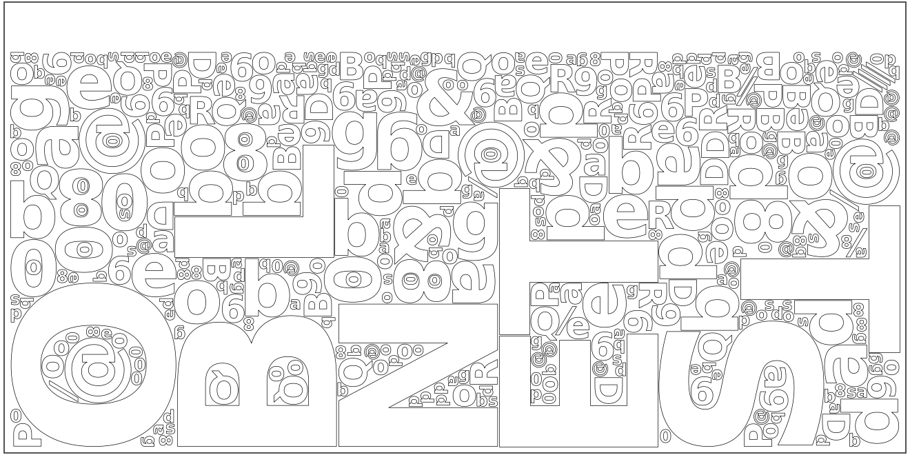
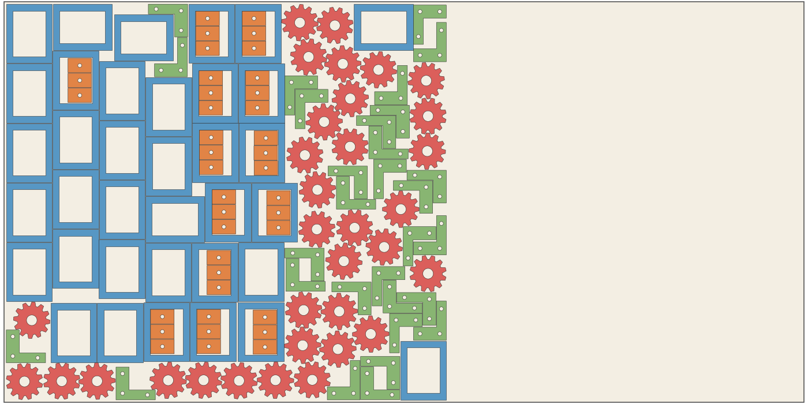
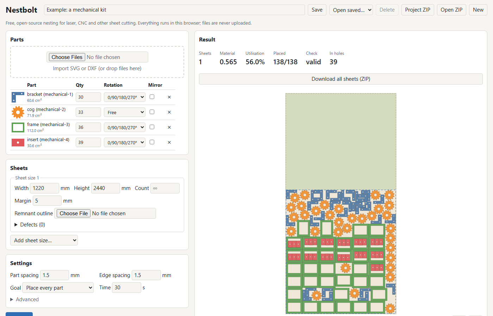

# Nestbolt

[简体中文](https://github.com/skulitom/Nestbolt/blob/main/README.zh-CN.md) · [日本語](https://github.com/skulitom/Nestbolt/blob/main/README.ja.md)

In the frozen v1 benchmark, **8.5% less material at the median than the best of Deepnest, SVGnest and Sparrow**
at equal 60-second budgets, and 9.6% at 300 seconds, in the final benchmark run
(fresh seeds, ten held-out jobs). Sparrow still wins 8 of the 56 jobs at 60 seconds
([details](#how-it-compares), [every number](https://skulitom.github.io/Nestbolt/results/)).

Free, open-source nesting for people who cut **fixed sheets**: laser cutters, CNC
routers, plasma, waterjet, fabric and leather. Nestbolt arranges parts so they use
the least material. It runs [in your browser](https://skulitom.github.io/Nestbolt/)
(nothing is uploaded), on the command line, and as an MCP server that AI agents
can call.

[Open the browser app](https://skulitom.github.io/Nestbolt/) ·
[Download a release](https://github.com/skulitom/Nestbolt/releases) ·
[Connect an AI agent](docs/AGENT_INTERFACE.md)

Compared with other ways an AI agent can nest parts (OpenNest, pyFit, Sparrow, Deepnest, SVGnest and more), by
interface, file formats and sheet model: [nesting for AI agents](https://skulitom.github.io/Nestbolt/compare/nesting-for-ai-agents/).

**[Try the v0.2.0-alpha.1 preview](https://github.com/skulitom/Nestbolt/releases/tag/v0.2.0-alpha.1)**
for editable LightBurn project nesting, lead-in allowances and improvements for
large curved drawings. Windows x64, Linux x64 and macOS Apple silicon tools are
available, plus the Windows MCP bundle. Their [published-download checks](benchmarks/results/preview-depth-published-20261016.md)
pass. Import acceptance and common-line material use remain under development;
the [v1.1 plan is 60% complete](docs/STATUS.md). Stable v0.1.0 remains available.

The hosted browser app runs a preview build from `main` (newer than v0.2.0-alpha.1).
The benchmark figures below belong to the frozen `75cbb32` build; this preview
makes no new comparison against competing tools.



451 parts on one 850 × 425 mm sheet in 120 seconds on one CPU core: DejaVu Sans
Bold glyphs in four sizes with their exact Bézier outlines, 90° rotations and
1 mm spacing. 29 letters sit inside the holes of others, and the unused material
stays as one clean offcut along the top. The layout passed the independent
validator. Rebuild it with `python scripts/make_showcase.py --nest 120`.

## How it compares

Final acceptance run (2026-10-13): 75 frozen sheet jobs (35 academic, 40 maker,
ten of them held out from all tuning), equal time budgets, one CPU core per tool,
five fresh seeds each, every layout checked by an independent validator. The
comparison is against the best of [Deepnest](https://github.com/deepnest-next/deepnest),
[SVGnest](https://github.com/Jack000/SVGnest) and [Sparrow](https://github.com/JeroenGar/sparrow)
on each job, each with the better of its two settings.

| Budget | Valid Nestbolt layouts | Less material than the best competitor (median) | Wins or ties |
| --- | ---: | ---: | ---: |
| 60 s | 375/375 | **8.5%** | 48 of 56 |
| 300 s (long subset) | 60/60 | **9.6%** | 11 of 11 |

At 60 s Nestbolt uses less material than Deepnest on all 55 jobs where Deepnest
produced a layout (median 9.9%) and than SVGnest on all 36 (14.4%). Sparrow, which
Nestbolt builds on, wins 8 jobs. Seven are one-sheet jobs that Nestbolt hands to
Sparrow itself after its own first layout, so Sparrow runs with slightly less time
there; it is 0.03-2.4% better on them. The eighth (two sheets) is 0.34% better.
That misses the project's own 60-second bar (wins or ties on 90% of jobs and never
more than 1% worse); the 300-second, strip-parity and speed bars are met
([status](docs/STATUS.md)).



One benchmark job exactly as nested in a 60-second development run (`m-mechanical-frame-inserts`,
seed 0, sheet turned to landscape): 138 parts, all 39 inserts placed inside frame
windows, everything packed into 56% of a 2440 × 1220 mm sheet so the rest stays one
offcut. The best competitor used 62% of the sheet on this job.

In 30 s Nestbolt matches the competitors' 300 s result on 10 of 11 jobs. The first
final run (build `484ce8b`) stopped with an error on one job; the fix is in `75cbb32`
and both runs are published. Every run, including failures, is in
[BENCHMARKS.md](BENCHMARKS.md); [status](docs/STATUS.md) lists the evidence per
gate. The [results page](https://skulitom.github.io/Nestbolt/results/) shows every
per-job number, tool revision, seed and the hardware; `python scripts/reproduce.py
--phase final --final-acceptance` rebuilds the datasets, reruns what is missing and regenerates it.

## What works today

- **Import** SVG and DXF: lines, arcs, ellipses, Béziers, B-splines, blocks,
  transforms and units, converted to millimetres. Each closed outline is a part;
  outlines inside it are its holes. Choose cutting layers, identify stock outlines,
  and review repairs and unsupported geometry. See [import options](docs/IMPORTING.md)
  and the [shop-file verification](docs/STATUS.md).
- **LightBurn projects** (`.lbrn2` and legacy `.lbrn`): nest groups as rigid units
  and export an editable `.lbrn2` per sheet, preserving original artwork, text,
  images and layer settings. Tool and output-disabled shapes stay fixed. Older
  text may need a separate native save to embed its outlines; mixed active/fixed
  groups need regrouping before nesting. Import messages explain cached text,
  bounding rectangles and missing curve controls. See [LightBurn preparation](docs/LBRN2.md#required-preparation-for-older-or-mixed-projects).
- **Nest** on fixed sheets: margins, part and edge spacing, several sheets, several
  stock sizes with limits, defects, remnant outlines, rotations (free, stepped or a
  list such as 0/180 for fabric grain) and mirroring. Small parts can sit inside the holes of larger parts.
  The last sheet is compressed towards one end so the offcut stays usable.
- **Export** one SVG and one DXF per sheet from the original curves, transformed
  rather than re-polygonised. LightBurn projects use preserving `.lbrn2` output.
  [Export fidelity checks](docs/STATUS.md) record the tested files and tolerances.
- **Lead-in allowances** reserve room for leads and set contour starts, with
  shortened leads and unresolved contours reported explicitly. Red LEADIN paths
  are review guides; the cutting program creates the actual leads. Imported
  LightBurn projects keep their editable contents and receive separate SVG/DXF
  cutting files. See [lead settings and CAM setup](docs/LEAD_INS.md).
- **Common-line cutting**, optional and still under development: identify shared
  straight cuts with kerf compensation. It can reduce cutting distance while
  increasing material use; two development jobs exceed the planned material
  limit. The export needs CAM preparation to avoid cutting shared sections twice.
  See [common-line setup and limitations](docs/COMMON_LINES.md).
- **Check** every result with an independent Clipper2 validator (overlap,
  spacing, containment, rotations, quantities). Invalid layouts are never returned.
- **Browser app** (`web/`): the same engine compiled to WebAssembly in Web
  Workers, automatic worker selection, a live view of the best layout, projects
  saved in the browser or as a ZIP, and five one-click examples. Files never leave
  the computer. An optional **Quick initial layout** setting helps start large
  jobs. Current browser checks and native comparisons are tracked in
  [Status](docs/STATUS.md).
- **MCP server** with `import_parts`, `nest`, `validate_layout`, `export_layout`
  and `estimate_sheets`, tested with Claude Code. Its budgets are repeatable:
  same build, inputs, work budget and seed give the same layout unless the real-time
  limit is reached, which is reported explicitly. See
  [the agent interface](docs/AGENT_INTERFACE.md).

The engine builds on [jagua-rs](https://github.com/JeroenGar/jagua-rs) and
[sparrow](https://github.com/JeroenGar/sparrow) by Jeroen Gardeyn and collaborators
(arXiv [2509.13329](https://arxiv.org/abs/2509.13329)). Fixed-sheet search lays
the last sheets end to end as one walled strip and shrinks the last sheet with a
port of Sparrow's separator; parts move between sheets and an emptied sheet
disappears. Near-rectangular parts such as box panels also get a bounding-
rectangle packing start. One sheet of hole-free parts without defects is exactly
Sparrow's own strip-packing problem, where it is the state of the art, so there
Nestbolt runs unmodified Sparrow for the rest of the budget.

## Quick start

Use the [browser app](https://skulitom.github.io/Nestbolt/) without installing
anything, or download native tools for **Windows x64, Linux x64 or macOS Apple
silicon** from the [v0.2.0-alpha.1 preview](https://github.com/skulitom/Nestbolt/releases/tag/v0.2.0-alpha.1)
or [stable v0.1.0](https://github.com/skulitom/Nestbolt/releases/tag/v0.1.0). Each
archive contains `nestbolt`, `nestbolt-mcp` and licences; download checksums are
provided alongside it. The separate Windows MCPB bundle installs the server in
Claude Desktop; see
[agent setup](docs/AGENT_INTERFACE.md).

To build the development version, install Rust through rustup (the repository
selects Rust 1.98.1):

```sh
cargo build --release -p nestbolt-cli -p nestbolt-mcp
```

Import parts, nest them for 30 seconds, and get per-sheet SVG/DXF files
(`examples/box-99x63x45.svg` is the browser app's example box):

```sh
target/release/nestbolt import examples/parts.svg --output library.json
target/release/nestbolt nest --library library.json --request examples/nest-request.json --out-dir run --seconds 30
```

For drawings with larger gaps, `import --close-gaps 0.05` explicitly repairs up
to 0.05 mm and reports every repair's position and size. It is off by default;
the silent join limit remains 0.005 mm. The UI and MCP expose the same option.
See [import options and reports](docs/IMPORTING.md).
Lead reservations and contour starts are available in the browser, request JSON
and `nest --lead-in --kerf ...`; see [settings and LightBurn setup](docs/LEAD_INS.md).

A request names library parts with quantities and the sheets in millimetres:

```json
{
  "parts": [{"id": "parts-1", "quantity": 4}, {"id": "parts-2", "quantity": 12, "rotations": {"kind": "free"}}],
  "sheets": [{"width_mm": 600, "height_mm": 400, "margins_mm": {"left": 5, "right": 5, "bottom": 5, "top": 5}}],
  "spacing_mm": 1.0,
  "edge_spacing_mm": 1.0
}
```

`run/` then holds `layout.json`, `report.json` and `sheet-0.svg`/`sheet-0.dxf` and
so on. Existing files are never overwritten. `nestbolt export` re-exports a
layout; `nestbolt validate` checks a polygon job and layout. Add `--repeatable`
to `nestbolt nest` or `nestbolt sheets` for a deterministic work budget instead of
wall-clock time: the same inputs, budget and seed then give the same layout. On a
machine much slower than the reference PC, `--time-limit <seconds>` allows more real
time for the same work (the default is `--seconds`).
The optional `--quick-start` setting tries a conservative initial arrangement
before improving it. It is off by default and may use more material. The browser
calls it **Quick initial layout** under Advanced; request JSON and MCP use
`"quick_start": true`. Original geometry, spacing, stock limits and rotation
permissions still apply. Unsupported stock or angle rules use the ordinary
constructor.
File formats are described by the [JSON Schemas](schemas/README.md).

## Browser app

[Open the hosted app](https://skulitom.github.io/Nestbolt/) and pick an example
(finger-jointed boxes, letters inside letters, a 138-part mechanical kit, a
FreeSewing T-shirt pattern on a fabric roll, interlocking gears), or drop your
own SVG/DXF files. LightBurn import, lead allowances and the newer large-drawing
features are available in the hosted preview build and in a local build.
The best layout so far is drawn while the search runs, and each sheet shows the
box around its parts and the clear offcut left above them.
Guides: [free nesting for laser cutting](https://skulitom.github.io/Nestbolt/free-nesting-software-laser-cutting/), [Nestbolt vs Deepnest and SVGnest](https://skulitom.github.io/Nestbolt/deepnest-alternative/), [nesting SVG and DXF in the browser](https://skulitom.github.io/Nestbolt/nest-svg-dxf-in-browser/) and [the five examples](https://skulitom.github.io/Nestbolt/nesting-examples/).



To build it locally you need the `wasm32-unknown-unknown` target, `wasm-bindgen-cli`
0.2.129 and Node.js 24; then open the printed address:

```sh
cd web && npm ci && cd ..
python scripts/build_web.py
npm --prefix web run preview
```

`python scripts/build_web.py --test` also runs the Playwright tests in Chromium
and Firefox.

## Use from agents

Register the MCP server with an absolute path, for example in Claude Code:

```sh
claude mcp add --transport stdio --scope local nestbolt -- /path/to/target/release/nestbolt-mcp
```

The server reads and writes only inside its working directory (or
`NESTBOLT_WORKSPACE`). [docs/AGENT_INTERFACE.md](docs/AGENT_INTERFACE.md) covers
Claude Code, Codex and Claude Desktop, the request format and the rules.

## Development

```sh
python scripts/check.py
python scripts/sheets_batch.py --cpu 0 --cpu 2 --seconds 60
```

The first runs format, lint, all Rust and Python tests, WebAssembly builds,
notice and dataset checks; add `--web` for the browser build and tests. The second runs the development benchmark (held-out
jobs excluded) and writes an audited report under `benchmarks/results/`.

| Path | Purpose |
| --- | --- |
| `crates/core` | Geometry import/export, sheet search, separator, part-in-part |
| `crates/cli` | Command-line interface |
| `crates/mcp` | Native stdio MCP server |
| `crates/validator` | Independent Clipper2 checker and material scoring |
| `crates/wasm` | WebAssembly boundary for the browser app |
| `web` | Browser app (Preact, Vite) and its Playwright tests |
| `benchmarks` | Frozen datasets, competitor runners and all results |
| `docs/PLAN.md` | Original v1 plan and acceptance gates |
| `docs/PLAN_V1_1.md` | Current shop-file and cutting-feature plan |
| `docs/STATUS.md` | Milestone evidence and next steps |

Every benchmark run, including failures, is logged in [BENCHMARKS.md](BENCHMARKS.md).

## Sibling tools

Nestbolt belongs to a family of free, MIT-licensed tools for agents by the same author. These run locally as MCP servers:

- [Anode](https://github.com/skulitom/Anode): a hidden background Windows desktop where agents automate and test GUI
  apps, take screenshots and run headed browser tests without taking over the user's screen.
- [Pixelbolt](https://github.com/skulitom/Pixelbolt): pixel art and sprite animation from editable JSON recipes,
  exported as sprite sheets, atlases, animated PNGs and GIFs.
- [Cutbolt](https://github.com/skulitom/Cutbolt): a video editing engine with exact timelines, captions and rendering.
- [Inkbolt](https://github.com/skulitom/Inkbolt): vector and raster image editing for diagrams and illustrations,
  with SVG import and SVG and PDF export.

## Progress and licence

Progress counts finished milestones only; see [docs/STATUS.md](docs/STATUS.md).
Nestbolt is [MIT](LICENSE). jagua-rs is an unmodified MPL-2.0 dependency; the
separator in `crates/core/src/separate.rs` is adapted from Sparrow (MIT).
[THIRD_PARTY_NOTICES](THIRD_PARTY_NOTICES) records every dependency and licence.
