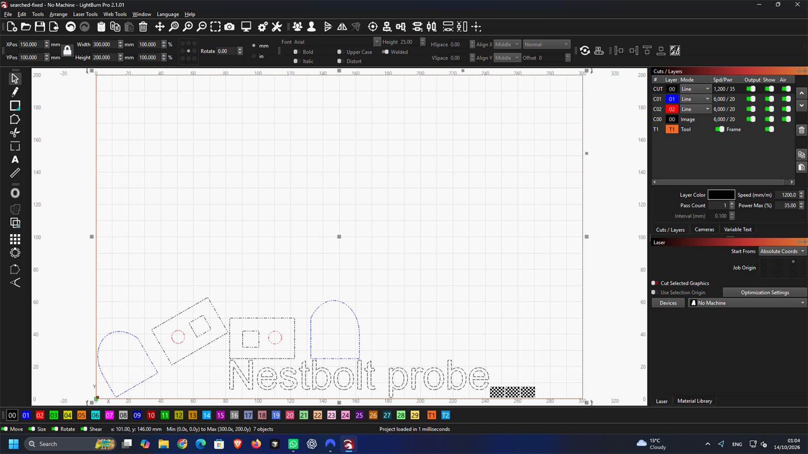

# Legacy LightBurn conversion checkpoint — 2026-10-14 UTC

**Development evidence; H3 remains incomplete and milestone completion remains
15%.** Legacy import/nesting now produces modern LBRN2 through CLI, MCP and the
browser. The original project remains unchanged in library/project storage.

## Format and preservation

The source is the original MIT Nestbolt
[features probe](../datasets/shop/probes/features-line-leads.lbrn2), saved as
`.lbrn` in LightBurn Pro 2.1.01. It contains two transformed groups, editable
cached Text, three embedded/shared Bitmaps, four operation settings, kerf and
lead settings. The legacy save contains 285 vertices and 285 primitives.
No third-party, held-out or uncached-font input was substituted for it.

The writer adds compact geometry lists and FormatVersion 1, preserving original
V/P elements, comments and unknown attributes. It handles partial control
coordinates and the native absent-handle marker, and converts Text backups and
fixed paths too. Modern no-op writes remain unchanged. The synthetic regression
fixture additionally covers missing version, StartV and opaque unknown nodes.

[Native comparison](h3-legacy-20261013T235803Z/native-check.json): native saves
of the original and converted identity project are **entirely canonically
equal**. All original elements survive the conversion when added lists and the
version change are removed. Three independent published-oracle comparisons
cover 37 leaves, 85 contours, with maximum bidirectional point difference
0.0004963 mm and maximum bounds difference 0.0004995 mm. The oracle is the
unmodified MIT `lbrn2-to-svg@0.5.3`, using the previously documented normalization
of native-saved groups, text caches, zero handles and shared data.

## Real search and retained failures

[Search request](h3-legacy-20261013T235803Z/search.request.json),
[job](h3-legacy-20261013T235803Z/searched/job.json),
[layout](h3-legacy-20261013T235803Z/searched/layout.json),
[independent validation](h3-legacy-20261013T235803Z/searched/report.json).
The one-second repeatable work budget places all six units on one 300 × 200 mm
sheet, with zero individual overlap, total overlap and outside ratios.

Two failures remain visible:

- The initial version-only conversion loses paths in native LightBurn. Its
  screenshot and XML are retained; compact lists are necessary.
- The first search export appended the new T1 setting and rectangle after
  Notes. Native LightBurn silently omitted them. The
  [initial failing report](h3-legacy-20261013T235803Z/native-check-initial.json)
  checks every leaf, so a missing outline cannot pass by comparing only the
  leaves that survived. The corrected writer puts new settings before shapes
  and the outline before trailing metadata. It re-exports the same validated
  layout, with no new search or score substitution.

The corrected native save contains all seven objects and a 300 × 200 mm T1
rectangle. All four original CutSettings remain canonically unchanged.
LightBurn names the **new** Tool setting T1 and supplies priority 4. Its strict
all-settings comparison initially failed on those two generated fields;
[that result](h3-legacy-20261013T235803Z/native-check-new-tool-defaults.json)
is retained. The final verifier requires exact equality for every original
setting, exact expected native defaults for the new T1, and every geometry leaf.
No existing setting mismatch is waived by this check.

## Surfaces, reproducibility and limits

The [workspace test log](h3-legacy-20261013T235803Z/workspace-tests.log) passes
198 tests with one existing ignored test. The final 18 core LightBurn/project
tests also pass after the empty-project ordering case was added. The MCP stdio
test and CLI feature test now import a legacy file, run real search and inspect
modern output. Four focused browser checks pass across Chromium and Firefox,
including the existing modern-file flow and two legacy copies on two sheets.
Both browsers' screenshots and downloaded ZIPs are retained. Strict Clippy,
formatting, browser/WASM builds, TypeScript tests, notices and the frozen
1,181-file integrity check pass.

`scripts/h3_legacy_probe.py` records preparation, re-export and independent
verification. Preparation takes the native-created original from the explicit
ignored probe folder; refresh reuses the retained validated layout; verification
reads the saved native evidence. These diagnostics and their subprocesses run
sequentially on CCD0 logical CPU 8. Builds/tests use CCD1. Source/binary digests
are retained in `prepared.json`, `refreshed.json` and `native-check.json` because
the outline fix followed the initial run. [Checksums](h3-legacy-20261013T235803Z/artifacts.json)
cover every retained artifact. The owned LightBurn window was closed, display
restored and Anode lease released; no device setting or installation was changed.

The two original legacy training files still contain uncached movable text;
this conversion does not invent font bounds or erase those failures. Mixed
fixed/active groups, five real searched native projects and before/after
cut-settings dialogues remain outstanding. This is not a solver quality claim,
a final acceptance run or a release.
