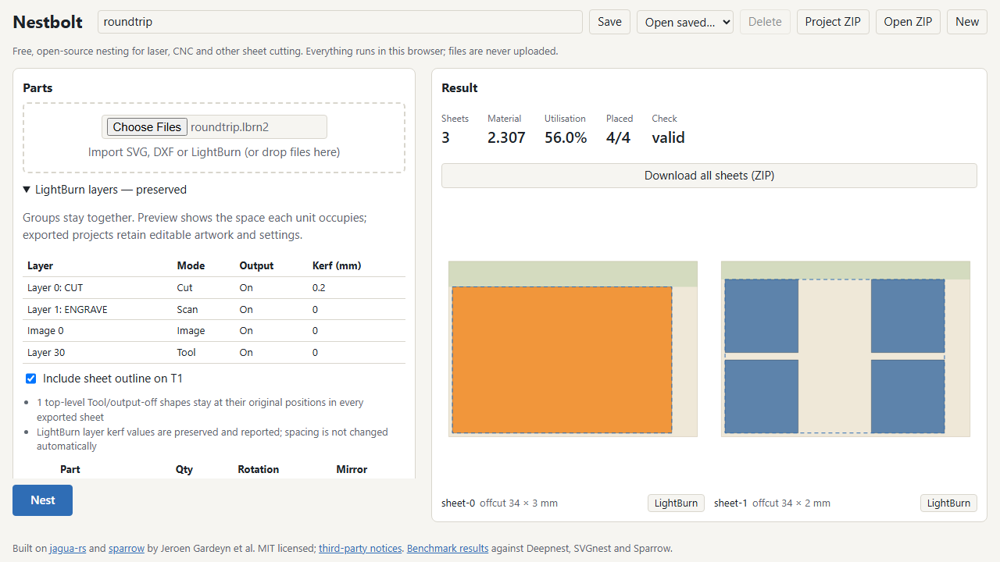

# H3 public-surface integration checkpoint — 2026-10-13 UTC

**Development evidence only; H3 remains incomplete.** CLI, MCP and the browser
now use the same preserving LightBurn Library/Request/export flow. Completed
v1.1 milestone weight remains 15%.

## Implemented and exercised

- Import one original project, derive rigid units including disconnected group
  components, select quantities/rotations/mirroring and run the existing search.
- Retain original XML in the saved library/project. Re-derive job geometry from
  that XML before validation/export; changed cached polygons cannot weaken it.
- Export `<source>-sheet-<k>.lbrn2`, with T1 outline on by default and explicit
  opt-out. CLI accepts the project directly or a library JSON. MCP defaults to
  the preserving format and accepts `format: "lbrn2"`. Browser offers per-sheet
  downloads, all-sheet ZIP and a Project ZIP containing original XML.
- Keep layer settings, unknown nodes, notes, text caches, group children and
  shared image data. Reject lossy SVG/DXF export and incomplete unit mappings.
  Report layer kerf without changing user spacing; all components contribute to
  the UI preview and area estimate.
- Refuse groups mixing fixed Tool/output-off shapes with active artwork at the
  public import boundary. The old core policy keeps the whole group fixed,
  which cannot establish that its active artwork is valid on every output sheet.
  The message asks for separating fixed and movable artwork in the source.

The [MIT authored fixture](../../crates/core/tests/fixtures/roundtrip.lbrn2)
combines two disconnected rectangular group children, a cut rectangle containing
native cached Text and a Bitmap, a shared Bitmap copy, fixed Tool rectangle,
cut/scan/image settings and a mirrored root. Text/cache/image data came from the
original authored native probes, not a held-out or third-party design.

## Retained native CLI runs

[Exact commands, exits and hashes](h3-surfaces-20261013T233512Z/native.json),
[successful job](h3-surfaces-20261013T233512Z/w34-s1/job.json),
[layout](h3-surfaces-20261013T233512Z/w34-s1/layout.json),
[independent report](h3-surfaces-20261013T233512Z/w34-s1/report.json).
The 34 × 24 mm case places all three units on two sheets; independent maximum
individual overlap, total overlap and outside ratios are all zero.
Both `.lbrn2` files remain beside that report.

The 32 × 24 mm case fails to place all units with both one- and five-second
repeatable work budgets. Both requests, stdout and stderr are retained. The
failure is not erased or credited as success; the tighter-sheet search remains
an open investigation. The reported message requests more time/sheets/fewer
parts, but the five-second rerun does not resolve it. There is no solver quality
claim in this checkpoint.

Run `python scripts/h3_surfaces_probe.py` after building the release CLI to
reproduce these three diagnostics. It starts children suspended, pins each to
logical CPU 8 (one CCD0 physical core), runs sequentially and checks source and
binary hashes before/after. Builds and tests used CCD1. No corpus geometry or
labels were opened; the frozen 1,181-file hash check passed unchanged.

## Browser and shared checks

[Browser test scope](h3-surfaces-20261013T233512Z/surface-tests.json),
[Chromium archive](h3-surfaces-20261013T233512Z/chromium/project.zip),
[Firefox archive](h3-surfaces-20261013T233512Z/firefox/project.zip).
The browser test requests two group copies (four units total), confirms both
group components render, nests all four, checks project settings and preserved
child XML with the browser XML parser, resolves every exported Bitmap's data,
and exercises the T1 opt-out. Individual downloads agree with the sheet ZIP.
The full browser suite passed 46 enabled tests; four opt-in deployed/scale tests
were skipped. The final LightBurn test passed again in both browsers after the
fixed-group guard and layer-table presentation update.

The [complete workspace test log](h3-surfaces-20261013T233512Z/workspace-tests.log)
passes 194 tests, with one existing upstream-debug test ignored. All 19 optimized
CLI feature tests pass. Strict Clippy, schema consistency, notices, browser
production build, TypeScript tests and the frozen corpus integrity check pass.
The initial CLI test incorrectly expected several 40 × 32 mm sheets despite the
fixture fitting one. The first tighter 32 mm test then found the retained search
failure above; 34 × 24 mm forces multiple sheets without that failure. The first
MCP area assertion differed by 0.00000720 mm² because imported areas use the
validator's 0.000001 mm coordinate grid while estimates use unrounded bitmap
corners. Its 0.0001 mm² comparison allowance covers that rounding and still
rejects omission of a disconnected component (100 mm² in this fixture).

All raw artifacts have [SHA-256 checksums](h3-surfaces-20261013T233512Z/artifacts.json).
The native diagnostic predates a browser-only layer-table spacing change;
`native.json` and `surface-tests.json` retain their respective source digests.

## Remaining H3 work

Legacy `.lbrn` output conversion, uncached movable Text, mixed fixed/active group
semantics, five actually searched native projects and before/after cut-settings
dialogues remain open. The earlier native bitmap priority normalization failure
also remains recorded. These surface tests do not replace independent full
corpus geometry/fidelity or native H3 acceptance. No held-out geometry/labels,
accounts, uploads, registry publication or new final quality run were used.
