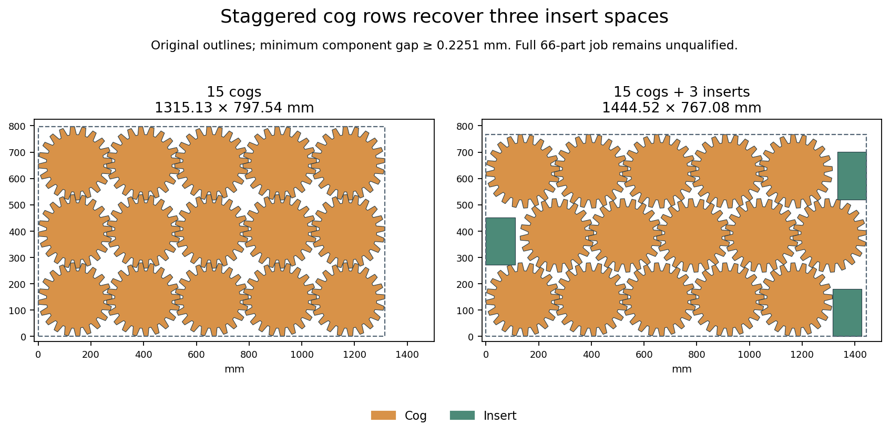

# H5: aligned pockets, independent bracket aspects and frame rows — 2026-10-18

**The component geometry improves; no full target layout is qualified.** The
strongest new retained layout has every frame, cog and bracket, but is missing
eight inserts. Its filled area, **4,323,340.784070 mm²**, remains **8,211.843186 mm²**
below the earlier 63-part partial missing three cogs. H2/H5 remain open at **60%**.

The [contact-direction study](h5-outline-contact-direction-20261018.md) supplies
the original cog angle and horizontal pitch. The original 66-copy job, stock,
reserved holes and 0.2 mm clearance stay unchanged. The last-sheet used-height
limit remains **325.92690233 mm**, corresponding to **4,988,890.353495 mm²** of
charged material. These are offline constructions, not native quality runs.

## Actual contact geometry and filled pockets

Eight declared row-offset fractions and nine patch sizes produce **72** valid
components. Their **3,080** original pair checks pass at minimum
**0.225123442 mm**. Independent rays in the unrotated exclusion polygon recover
vertical pitches within **8.6×10⁻¹⁴ mm**; all member transforms and nondominated
bounding choices are verified. The half-offset fifteen-cog group is
**1,444.523309 × 767.082326 mm**, 30.455373 mm shorter than the square group,
while remaining inside the original usable stock width.

Using those same audited pitches, a finite follow-up forms **28** patches with
9–15 cogs, four or five columns, and square or half-offset rows. All **1,904**
original pair checks pass. Two filler-family orders and four corner priorities
give **224** mixed components in **18.317621 seconds**. All cog poses and group
bounds remain exact. Independent checks cover **5,511** proposed additions and
**29,724** final component pairs; the minimum distance is about **0.2251 mm**.
There are 993 accepted additions across these alternative components, not within
one job. Every implied remainder still contains exactly the original inventory.
The fifteen-cog staggered component holds **three inserts** in its side pockets.
Component checks alone establish neither full-job savings nor native acceptance.

## Whole-inventory construction

One new exact-count model allows all eighteen frame rectangles to translate,
six bracket-pair slots to independently choose any of the three retained aspects,
fifteen remaining inserts, and one of five complete cog decompositions. Shared
position/size variables and two non-crossable stock strips avoid duplicated
coordinates per alternative. Independent protobuf review verifies all **465**
variable domains, **393** constraints and **136** choices, including all inventory,
area bounds and interchangeable-copy ordering. The first auditor has a false
empty-slot assertion; its original source and failure remain. A corrected
inventory comparison passes without changing model bytes or inputs.

The unchanged seed 0, eight offline workers and 120-second ceiling return
**UNKNOWN after 120.160022 seconds**, with no full selection. This is not an
infeasibility result. Its 20 source components also pass 766 original pair checks.
The older bracket patterns have only about **0.2011 mm** spacing: they satisfy
the original physical condition but are **not native-margin qualified**.

Separate deterministic rectangle sweeps use the audited components, all three
bracket aspects and original quantities. A complete 364-recipe sweep tries the
new unfilled cog shapes. The filled-pocket sweep retains 93 distinct rectangle/
inventory combinations from 224 components, records 131 rectangle-equivalent
omissions, and expands all 5,246 remaining-inventory recipes. It includes actual
aligned cog prefixes whose additional 66 pair checks pass. These equivalences
apply only to rectangle packing, not to arbitrary outline placement.

| Construction | Attempted arrangements | Seconds | Outcome | Greatest-filled-area partial | Filled area, mm² |
| --- | ---: | ---: | --- | ---: | ---: |
| Aligned components, fixed columns | 109,200 | 6.391310 | finished | 56/66 | 4283740.784 |
| Filled pockets, fixed columns | 1,573,800 | 87.998685 | finished | 57/66 | 4303540.784 |
| Same filled recipes, five frame rows | 1,028,981 | 120.018964 | expired | 57/66 | 4303540.784 |

The row study enumerates all 32 five-row orientation sequences and retains
**24** distinct valid count allocations. Five is the minimum possible shelf-row
count for eighteen frames at this width; higher row counts and unrestricted frame
positions remain outside this sweep. Its original patterns and 5,246 recipes
are byte-identical to the filled-pocket column study. **35,107** recipe/frame
prefixes are skipped because their mandatory component rectangle fits none of
the saved free rectangles. Every filter is independently checked, as are **3,672**
fixed-frame pairs and the exact free-space union (maximum area discrepancy
**6.8×10⁻¹⁰ mm²**). The 120-second cap leaves **60,583** arrangements unattempted;
the measured 120.018964-second soft overrun is retained. No suffix retry occurs.

All **2,711,981** attempted inventory records, missing counts and filled areas
recompute. Geometry of every rejected arrangement is not claimed to be audited.
Eight retained partials from each sweep receive one original-outline gap-fill
continuation. All 24 finish without expiry, adding 18 parts across their separate
layouts. Independent audits verify **54** proposed additions and **27,954**
retained-layout pairs, preserve every initial placement, and check original stock,
rotations, quantities and material target. The frozen CLI rejects all 24 for
missing quantities. No partial is relabelled as valid, and no full witness emerges.

## Next evidence to use

A geometry-signature census against the earlier 8,798-entry contact pool finds
**261** additional signatures: 97 frame, 63 bracket, 66 insert and 35 cog. Of
these, 55 come from the verified frame-only row allocations. The row run's
retained layouts add no signatures beyond the column results. Rounding to
0.0001 mm is used only for this diagnostic census; original coordinates are
unchanged and no candidate graph or new selection run is claimed.

The coordinated original geometry now supplies materially different positions for a finite placement-selection model. The new best partial has all frames, brackets and cogs but lacks eight inserts; its filled area is 4,323,340.784069745 mm2, still 8,211.84318605 mm2 below the earlier 63-part partial missing three cogs. Do not rerun the UNKNOWN shared-coordinate model, completed column sweeps or timed-out row suffix, and do not extend their limits. Next prepare a fresh extension of the previously audited 8,798-pose contact-selection pool from the 24 retained layouts in h5-aligned-aspect-backfill-20261018, h5-pocket-aspect-backfill-20261018 and h5-five-row-backfill-20261018, plus the 24 verified frame-only row allocations in h5-five-row-shelves-20261018. A diagnostic 0.0001 mm vertex-signature census identifies 261 additional signatures: 97 frame, 63 bracket, 66 insert and 35 cog; the row-run retained layouts add no signatures beyond the column layouts, while its frame-only allocations add 55. This census is not a pool mutation and its rounding must not change original stored coordinates or establish tolerance-based acceptance. Declare exact deduplication, source lists and one finite full-inventory selection limit before running. Preserve every old candidate, graph, failure and model; verify new candidates against original geometry/rotations/target bounds and audit all added old-new/new-new conflicts, reusing old graph evidence only under exact hashes. Keep a reproducible feasible partial hint without treating it as a complete solution. This combines different arrangements rather than committing an entire layout greedily. Any full 66-copy result must pass frozen original CLI and independent filled-outer checks; native margin qualification, original repair budgets/four-step cap and full H5 comparison remain required before integration. Older bracket patterns still have only about 0.2011 mm physical separation and are not native-margin qualified. No restricted failure proves the unrestricted original job impossible.

[Checks](h5-aligned-pockets-and-rows-20261018/checks.json), [all raw inputs, models, failures, searches and
audits](h5-aligned-pockets-and-rows-20261018/raw.zip), [verified manifest](h5-aligned-pockets-and-rows-20261018/raw-manifest.json),
[source review](h5-aligned-pockets-and-rows-20261018/source-review.json). All **1336** archive members,
CRCs and byte hashes verify; the component figure has been visually reviewed.

All six hosted checks on [main f825cab](h5-aligned-pockets-and-rows-20261018/main-ci-f825cab.json) pass.
The preceding contact-direction checkpoint is pushed to main as **c9b0176**;
its ongoing check snapshot is recorded accurately in source review. Production,
gate limits, preview assets and all three accurate READMEs remain unchanged.
No runtime integration, new release qualification or gate credit is claimed.
