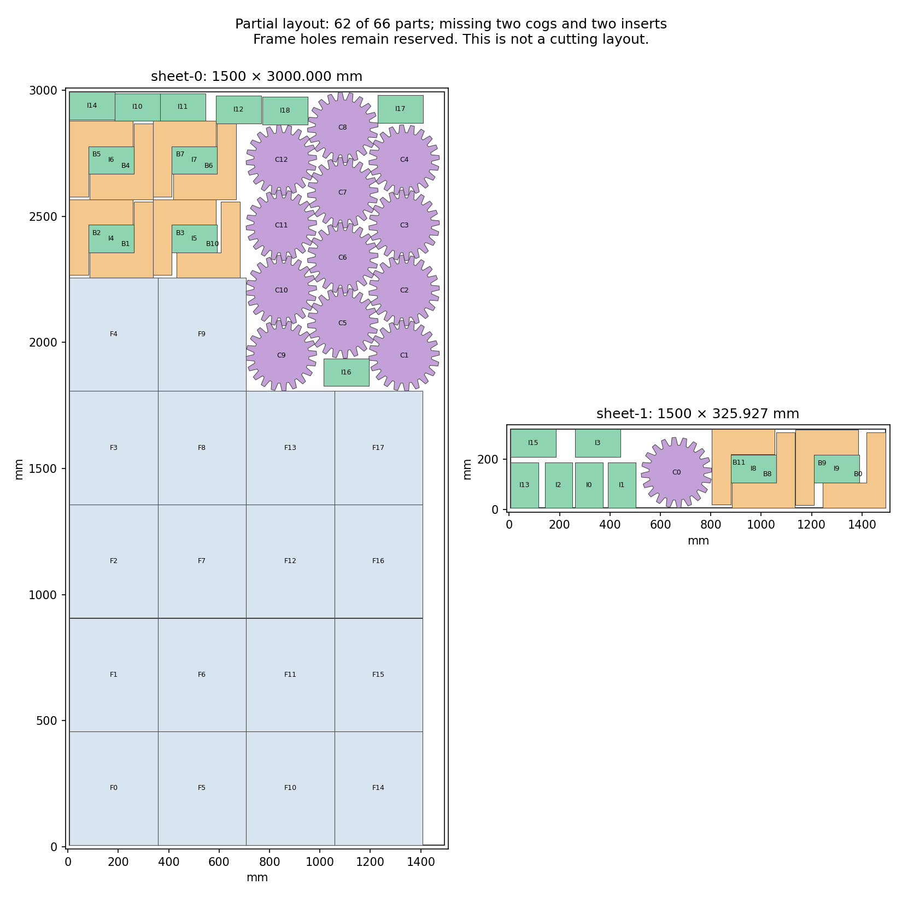

# H5: continuous capacity and cog/insert contacts — 2026-10-23

**The changed contact model still places 62 of the original 66 copies.** Its finite
candidate-set optimum retains 13 cogs and 19 inserts with all 18 frames and 12 brackets.
No full witness or filled-area improvement is found. A distinct wider-frame group
is now geometry-checked for the next construction. H2/H5 remain open at 60%.

## Continuous-space diagnosis

The [previous 62-part partial](h5-group-choice-20261023.md) has narrow gaps between
the large frame block, brackets and cogs. The side strip beside its frame block
is too narrow for the rectangular inserts. Frame holes remain reserved.

Three necessary all-angle cog-capacity relaxations complete within the declared
90-second allowance. Exact rational interior rectangles, outward stock domains,
inscribed/circumscribed cog disks, reachable area and diameter covers give:

| Held fixed | First-sheet bound | Last-sheet bound | Total upper bound |
| --- | ---: | ---: | ---: |
| 18 frames, 12 brackets, 19 inserts | 17 | 1 | 18 |
| 18 frames and 12 brackets | 19 | 3 | 22 |
| 18 frames | 28 | 7 | 35 |

All three bounds are **inconclusive** for the required 15 cogs; they do not prove
that those counts are attainable or that omitted families can also fit. The
independent audit checks 73 strictly interior rectangles, six center components,
twelve diameter covers and every exact complement/reachable-area computation.
All 13 original cog placements remain in each relaxation. No solver is used here.

## New joint contacts and complete graph

The new model fixes the saved 30 frame/bracket poses while allowing every cog and
insert to move. All compatible old poses remain: 1,470 choices. Twelve free-region
queries cover four cog phases and two insert orientations on both sheets. Their
representative points, vertices and edge midpoints add 196 cog and 72 insert poses.
All 268 proposals complete in 5.358254800 seconds, with no cap, rejection or pending
query. New proposals include 0.0126 mm positive construction padding; old poses
retain their original coordinates, and original acceptance tolerances stay unchanged.

All cog/cog, insert/insert and cog/insert conflicts are recomputed. The 1,738-pose
graph has 259,549 conflicts represented by 1,999 verified cliques, with no residual
edges or compression limit. Independent checking covers 140,728 old/fixed pairs,
5,780 proposal/fixed pairs and 948,773 small-pair possibilities. Every actual
proposal and original transform/stock bound is checked; the complete 13-cog,
19-insert seed remains feasible. Every protobuf model field is independently
reconstructed before solving.

One 30-second maximum, eight-worker, seed-zero call finishes in 4.219901600 seconds
and reports `OPTIMAL` for this finite pose set. Its filled-area objective equals
the starting seed; it does not prove continuous or unrestricted impossibility.
One callback and a different final layout both pass original geometry. Their two
fresh frozen-CLI checks fail only for two missing cogs and two missing inserts.
The callback uses four new poses and the final uses seven; neither increases
the 4,342,015.346194 mm² filled area. Final charged material is 4,988,890.203495 mm²,
within the unchanged allowance. Minimum clearance remains 0.201 mm, so native
construction margins are not qualified. No native packing or quality run occurs.

## Distinct frame construction prepared

Inspection of all 26 reviewed frame groups confirms that none has all 18 frames in
the 450-by-350 orientation. A new three-column/six-row arrangement uses exactly
those original frames, 0.225 mm pair gaps and 0.025 mm extra stock margin. It leaves
a 136.525 mm side strip and 885.85 mm above the frames. Eleven optional inserts,
rotated to 110-by-180, fit in the side strip. All 406 pairs in this 29-part construction
pass independent original-vertex geometry, rotation and stock checks; minimum
distance is 0.225 mm. The eleven insert poses are optional future candidates.

This is a checked subassembly, not an improvement over the 62-part partial. Its
small-family completion and native qualification have not been run. The capacity
bounds and conditional graph above apply to the earlier frame group and must
not be reused as certificates for this different arrangement.

## Repository and next investigation

Five checks on main 44ff9cc4 pass; the Windows native-check job remains live in the saved snapshot. No complete CI pass is inferred. Core source and all three README hashes remain unchanged. The published
v0.2.0-alpha.1 preview is still accurately described; no additional release or
registry publication is made. H2 keeps Artem’s unchanged-denominator decision,
and no reserved input is opened. The existing release authorization remains.

Do not repeat the contact model with 30 fixed frames/brackets. Next complete the distinct all-wide frame construction: retain all original quantities and stock/material limits; treat the 11 side-strip inserts as optional candidate positions. Generate and independently audit bracket, cog and insert candidates against the new 18-frame group, including translated previously audited cog groups to populate open interior regions as well as boundary contacts. Check conditional capacity first, declare finite generation and solver limits, and preserve every failure. Do not reuse the old conditional conflict graph. Any full 66-copy witness still needs native margins and unchanged full H5 gates.

Evidence: [capacity audit](h5-cog-insert-regions-20261023/capacity-audit.json), [contact audit](h5-cog-insert-regions-20261023/contacts-audit.json),
[model audit](h5-cog-insert-regions-20261023/model-audit.json), [solver result](h5-cog-insert-regions-20261023/solver-result.json),
[layout audit](h5-cog-insert-regions-20261023/layout-audit.json), [wide-frame audit](h5-cog-insert-regions-20261023/wide-frame-audit.json),
[source review](h5-cog-insert-regions-20261023/source-review.json), [raw inputs and all outcomes](h5-cog-insert-regions-20261023/raw.zip),
and [verified manifest](h5-cog-insert-regions-20261023/raw-manifest.json). All 106 archive members,
CRCs and byte hashes verify.
