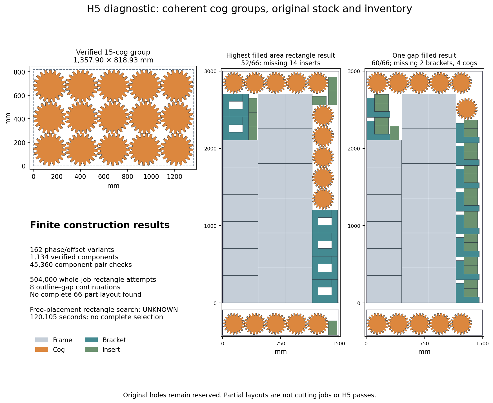

# H5: coordinated cog groups and free frame placement — 2026-10-18

**No complete target layout is found.** All newly constructed cog components
validate, but neither fixed-column rectangle packing, outline-gap continuation,
nor a bounded free-placement rectangle model returns all 66 original parts.
The earlier 63-part partial, missing three cogs, remains better than these new
partials. H5 stays open and total completion remains **60%**.

The [previous contact-pool study](h5-contact-selection-20261018.md) left exact
inventory selection unresolved. This investigation constructs coordinated cog
positions directly instead of asking a selector to discover an arrangement from
unrelated poses. It uses the same saved large-plates development job at 0.2 mm
kerf, original 1,500 × 3,000 mm stock, margins, rotations and full inventory.
The original conditional material target remains **4,988,890.353495 mm²**, with
last-sheet used height no more than **325.92690233 mm**. All holes remain reserved.

## Geometry construction

The recorded finite catalogue has base angles 0°, 4.5° and 9°; relative phases
0°, 3°, 6°, 9°, 12° and 15°; and alternating x/y offsets −6, 0 and 6 mm.
For each of the **162 variants**, pitches come from horizontal and vertical
intersections of the actual filled-outer Minkowski obstacle. Rotations use the
original cog's centroid, approximately (139.723742, 139.723742) mm. No rotational
symmetry or circular surrogate is assumed. Conservative 0.22 mm construction
clearance and a positive pitch increment leave the 0.2 mm acceptance rule intact.

Seven components per variant contain 15, 12, 10, 9, 6, 5 or 3 cogs. All **1,134
components** pass **45,360** independent pair checks, with minimum distance
**0.22012005 mm**. The independent audit reconstructs every unrounded transform
from original vertices and checks all bounds and component pairs. Catalogue
generation takes **9.296775 seconds**, below its 120-second ceiling.
The smallest full 15-cog rectangle is **1,357.901348 × 818.933402 mm**.

## Whole-job construction and gap continuation

The twelve best full-group variants supply five complete cog decompositions:
15; 10+5; 9+6; 12+3; and 5+5+5. Each is combined with all 25 retained frame-column
configurations, 28 original bracket/insert pattern inventories, four sort orders
and three rectangle-fit rules. All **504,000 attempts** finish in
**107.285217 seconds**, without the 120-second limit firing.
Every attempted placed-plus-unplaced inventory independently totals the original
66 parts. Pair validation of every rejected attempt is not claimed.

The greatest filled-area rectangle result has **52/66 parts**, including all cogs,
frames and brackets, but lacks fourteen inserts. It uses three separate five-cog
rows, not the full 15-cog rectangle shown on the left of the figure. Its original
CLI check rejects only quantity; all 1,050 filled-outer pairs and target bounds pass.

A separately recorded continuation chooses eight partials by frame configuration
and per-sheet cog count, ranking each group's best filled-area result. Actual
outline gaps allow **15 additions total** across those eight layouts in
**8.620295 seconds**. None becomes complete. The largest count is
60/66, missing two brackets and four cogs. All **144** proposed additions are
independently checked against their accepted prefixes. All **10,915** final
same-sheet pairs pass, every initial placement is byte-for-byte preserved, and
the original CLI rejects each result only for missing quantities. Conservative
empty-region observations do not prove arbitrary placement impossible.

The new cog components have extra construction space; reused mixed bracket
patterns retain minimum distance about **0.2011 mm**. This is valid original
geometry but is **not native-margin qualification**. No native packing call is
made or implied by these checks.

## Freely placed rectangle groups

A distinct CP-SAT model removes the fixed frame-column restriction. All eighteen
frames, six verified two-bracket/one-insert groups, fifteen remaining inserts and
one of the five complete cog decompositions may translate on a 0.001 mm grid,
choose sheets and rotate by a quarter-turn when they fit. Padded sizes round
outward and target capacities round inward. Each alternative requires exactly
the original inventory, with no partial objective. Only interchangeable identical
copies are ordered to remove symmetry.

The exported model has **471 variables, 517 constraints and 139 optional
rectangles**. A separate protobuf parser verifies every variable domain, every
interval, all per-sheet overlap constraints, all five exact inventories, rounding,
and absence of hidden constraints or objectives. OR-Tools 9.15.6755 uses the
already verified isolated standard CPython runtime, seed 0, eight offline CCD1
workers and a 120-second allowance. It returns **UNKNOWN** after
**120.104933 seconds**, with 1,532,756 branches and 17,023 conflicts,
and no complete selection. This is not an infeasibility proof or a runtime
comparison. The unchanged model is not rerun.

[Checks](h5-cog-lattices-20261018/checks.json),
[all inputs, scripts, components, attempts, models, logs and audits](h5-cog-lattices-20261018/raw.zip),
[byte manifest](h5-cog-lattices-20261018/raw-manifest.json),
[next investigation](h5-cog-lattices-20261018/source-review.json).
All 139 archived members, CRCs and hashes verify; the figure has been
visually inspected. Existing failed attempts and all original inputs remain.

Coherent rectangular checkerboards are valid but have not produced a full target witness. Do not rerun these unchanged searches or raise their time limits. The best previous partial still has 63/66 parts, missing three cogs; these new partials do not improve it. Next test ragged staggered cog rows with alternating row lengths, especially 5/4/5 (14 cogs) plus one on the other sheet, and 5/4/4 (13) plus two. This differs from the earlier uniform staggered grid whose five-cog shifted middle row overhangs the usable width. Predeclare the finite phases, row offsets, decomposition and time limits. Derive horizontal same-row pitch and vertical cross-row pitch from actual Minkowski contacts, check every original pair, then fit all frames, brackets and inserts without fixing frame columns. Only an original 66-copy layout passing frozen CLI and filled-outer target checks is a witness. If new geometry supplies no useful whole-job arrangement, inspect nonrectangular contact structure rather than repeating identical CP-SAT seeds. Native-margin compatibility, production-budget qualification, four-step repair cap and full H5 matrix remain separate requirements before integration.

The [main 67e77b1 check snapshot](h5-cog-lattices-20261018/main-ci-67e77b1.json)
records its actual status at sealing; unfinished jobs are not counted as passes.
Production source, original gate limits, preview assets and the three accurate
READMEs are unchanged. No native quality run, production integration, new release
qualification or gate credit is claimed. H2 and H5 remain open.
