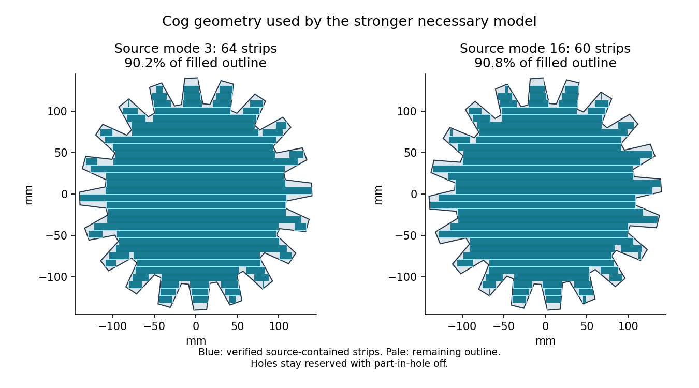

# H5: source-contained cog strips and a timing failure — 2026-10-26

**The new cog representation covers over 90% of each filled source outline, but
its one search returns UNKNOWN and misses the requested 60-second solver limit.**
There is no layout, unrestricted exclusion, native validation or timed quality
result. H2/H5 remain open at 60% by completed gate weights.

## More occupied source area

Each actual cog mode is split into 32 horizontal bands. Intersections of source
sections at band edges and every source-vertex height identify common horizontal
intervals; inward integer-micrometre rounding makes their rectangles conservative.
Direct source-polygon containment is required for every entire rectangle.

Mode 3 yields 64 disjoint strips, occupying 45,131.711335 mm², or **90.150340%**
of its filled outer outline. Mode 16 yields 60 strips, 45,440.856082 mm², or
**90.767855%**. These replace no source geometry and ignore no original: the holes
remain reserved with part-in-hole off. For the 12 first-sheet cogs, the new
representation contains 728 strips. Adding the unchanged 53 non-cog rectangles
gives 781 rectangles occupying 4,075,822.063704 mm², compared with
3,812,050.736262 mm² in the older 65-rectangle representation.

An independent reader reconstructs each shape from the original ring and checks
all 781 whole rectangles, all 57 owners and 21,740 within-original disjoint pairs.
It checks 282,850 cross-original rectangle pairs in the known constructed witness,
finding 1,193 overlaps involving 36 original pairs. The witness that satisfied
the old necessary model is correctly rejected by the richer geometry.

A separate exact-integer slab audit also rejects that witness through both
cumulative constraints alone. Across 1,038 X slabs, 674 exceed the 2,987 mm height
capacity, with peak demand 3,352.183 mm. Across 216 Y slabs, 102 exceed the 1,487 mm
width capacity, with peak demand 2,679.758 mm. These are sums of disjoint occupied
source strips, not the full-source layout acceptance test.

## Added source constraints

The complete prior seeded model is retained byte-for-byte as a prefix: every
whole-stock coordinate domain, all 38 source-pair disjunctions, the old
65-rectangle non-overlap/strip constraints, 47 equivalent-copy orders and 90
non-cog coordinate hints. No first-sheet original is fixed; all 57 remain
mandatory alongside the verified short nine.

The new model adds 1,562 intervals, a second NoOverlap2D and two cumulative
constraints for the 781 rectangles. It has **3,880 variables and 14,811
constraints**. An independent protobuf reader verifies the exact old model and
all 1,565 added constraints. The model hash is
`b045ec52775277c18bf7dfee6a8bf82eef99d2ff5a36053e43be73fd126c3103`.

## Closed UNKNOWN with an unqualified overrun

The single call requested 60 solver seconds within 90 shared process seconds.
Search starts after approximately 2.93 seconds. The response returns **UNKNOWN**,
20,248 branches and 5,401 conflicts, without an assignment. Solver time is
**87.617085 seconds**, returned solve time **87.625742**, shared process time
**88.877085**. The requested solver limit is exceeded by **27.617085 seconds**;
the returned solve overrun is 27.625742 seconds. The 90-second process boundary
is met, but the 60-second benchmark condition is **not**.

The log records the `fj` worker at 1.41 minutes while the three main workers each
end near 57 seconds. This observation does not identify the exact internal
propagator responsible. The raw response, log and explicit failed timing flags
are preserved. The call is CLOSED without extension, reseeding or retry.

Four independent audits pass on geometry, capacity, serialized constraints and
response integrity. Those passes do not turn the timing failure or UNKNOWN into
H5 acceptance. A different staged model could use aggregated per-original strip
capacities first, reserving detailed source cuts for actual returned violations,
without the extra global 781-rectangle non-overlap system. Profile aggregation
and deadline handling must be checked before opening such a run.

## Checkpoint and evidence

At 2026-10-26T20:13:27.420878+00:00, [all six main checks pass](https://github.com/skulitom/Nestbolt/actions/runs/40386947038).
The prior two local checkpoints and this evidence checkpoint may now be pushed
normally after commit. Production, READMEs and upstream heads/releases are
unchanged; all 22 reserved H2 vectors remain unopened. No release is qualified.

[Checks](h5-cog-source-strips-and-timing-20261026/checks.json), [source](h5-cog-source-strips-and-timing-20261026/source-checks.json),
[capacity](h5-cog-source-strips-and-timing-20261026/capacity-checks.json), [model](h5-cog-source-strips-and-timing-20261026/model-checks.json),
[response and timing](h5-cog-source-strips-and-timing-20261026/response-checks.json), [scope](h5-cog-source-strips-and-timing-20261026/scope.json),
[next step](h5-cog-source-strips-and-timing-20261026/next-step.json) and [raw manifest](h5-cog-source-strips-and-timing-20261026/raw-manifest.json).
The archive verifies 58 canonical files and
21 identical-content aliases by bytes, SHA-256 and CRC.
