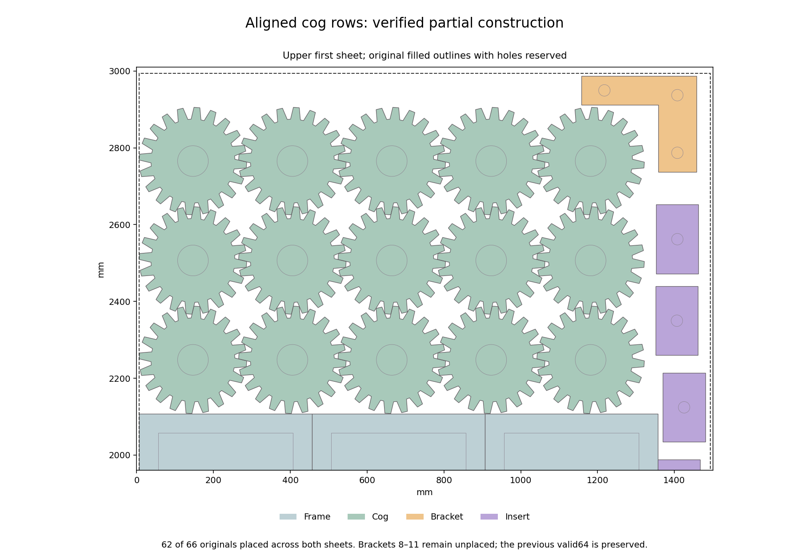

# Cog topology source checks — 2026-10-28

Two new cog arrangements were checked against the original source geometry.
Neither completes the mechanical layout: the mixed-phase triangular packet is
**47.819 mm too wide**, and the aligned-row construction places **62 of 66
originals**. The previous valid64 remains the best partial layout. H2/H5 remain
open at **60% completed milestone weight**.

## Finite triangular phase model

A new contact scan covers 2,592 ordered phase pairs along 60° and 120° rays,
with 62,208 distance evaluations. It reuses the 1,296 audited horizontal contacts
unchanged. The independent reader verifies all contact endpoints directly
against the original 80-vertex cog and checks the exact source-kernel argument.
Only the finite legal phases 0°–17.5° in 0.5° steps are considered; no unsampled
angle is excluded and no tooth symmetry is assumed.

All 15 cogs independently choose a phase on a fixed five-column, three-row
equilateral lattice. Thirty directed neighbour tables determine a common pitch.
The independent model reader verifies all 46 variables, 31 constraints and
38,880 allowed-table rows. A uniform-phase source control passes all 105 pairs.

The sole predeclared 60-second, four-worker solver call returns **OPTIMAL** in
10.309316 solver seconds and 11.141385 shared seconds. The saved protobuf and
all **31 incumbents** pass independent domain, table, maximum and objective
checks. The best pitch is **278.84 mm**, optimal only for this finite model.

Reconstructing the actual originals verifies all 105 cog pairs, all 15 holes
and 3,000 hole vertices. Minimum separation is **0.214489154 mm**, above the
unchanged guarded requirement. The packet is **1,534.768912 × 762.958224 mm**;
available guarded stock width is 1,486.95 mm. It cannot be used as the proposed
stock placement. No broader rotation, lattice or full-layout exclusion follows.

## Aligned rows and bounded insertion

A separate deterministic construction aligns three rows of five cogs, at 7°
and 258.86 mm spacing in both axes, leaving a strip on the right. It retains
the 29-original first-sheet frame/side-insert core and the source-valid short14.
The resulting source58 passes **1,037 pairs, 232 stock edges and all 72 holes**.
This checks the vertical contacts directly without relying on tooth symmetry.

One predeclared insertion sequence considers all eight bracket modes, then the
two insert outer-shape classes. It retains every conservative region, selects
the representative point of the largest component and stops a family when all
its regions are empty. The call closes after **22 region calculations in
9.370884 shared seconds**, inserting one bracket and three inserts.

Independent readback verifies all ten modes, 22 region records, nine candidate
points and four deterministic choices. Final source62 passes **1,219 pairs,
248 stock edges and 78 holes / 8,562 hole vertices**, with minimum gap
0.214826984 mm and minimum extra stock clearance 0.025 mm. Brackets8–11 remain
unplaced. Empty conservative regions do not prove actual or global infeasibility.

The original-ring figure was visually inspected. Both calls are closed; there
were no retries or native calls. The next construction must allow independent
part positions or change the retained frame arrangement, with a declared budget
and independent original-source checks before any complete-layout claim.
The unchanged necessary count frontier still contains 444 candidates.

## Publication checks

All six jobs passed in main
[CI 40711177461](https://github.com/skulitom/Nestbolt/actions/runs/40711177461).
The queued seven-bracket checkpoint and this evidence can be pushed together
after fresh remote, ancestry and live-run checks. Production and all READMEs
remain byte-identical. All 22 reserved H2 vectors remain unopened.

Sparrow advanced one commit to
[`6f7b9d35`](https://github.com/JeroenGar/sparrow/commit/6f7b9d353c2b2a4fc68454590a2e8e83475c12ef).
The complete comparison changes only README and wordmark assets; it introduces
no fixed-sheet, part-in-part, solver or licensing change. Studio and both
projects' releases are unchanged, so the upstream stop rule does not fire.
The new release remains unqualified while H2/H5 are open.

[Contact audit](h5-cog-topology-source-checks-20261028/contacts-audit.json),
[response audit](h5-cog-topology-source-checks-20261028/response-audit.json),
[triangular stock check](h5-cog-topology-source-checks-20261028/triangular-source-audit.json),
[aligned insertion audit](h5-cog-topology-source-checks-20261028/insertion-audit.json),
[next work](h5-cog-topology-source-checks-20261028/next-step.json),
[raw manifest](h5-cog-topology-source-checks-20261028/raw-manifest.json).
The byte-verified archive preserves 143 canonical files
and 98 identical-byte aliases in 1,060,647
compressed bytes, including every incumbent, contact input, source placement,
region, original-ring readback, helper and upstream comparison.
