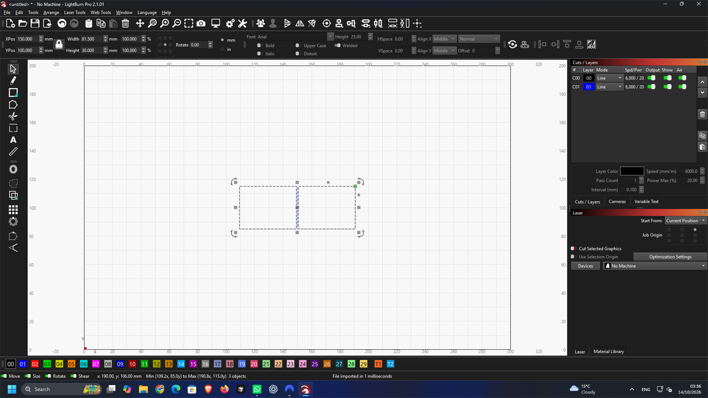

# H5 compensated common-line checkpoint — 2026-10-14 UTC

**Development checkpoint; H5 remains incomplete. Completed milestone weight: 15%.**

The new common-line mode detects shared straight outer edges at least 10 mm
long, using analytic half-kerf offsets within the specified 0.01 mm tolerance.
It keeps closed CUT outlines, exports each COMMON span once, and decomposes
connected line graphs into the minimum number of trails without adding bridges.
Reports include original/replacement cut lengths, saved fraction and path counts.
No holes or sheet edges are shared. Kerf must be finite and at least 0.05 mm;
the existing independent layout validator remains authoritative.

The UI toggle/kerf field, CLI `--common-line --kerf`, JSON request and MCP
parameters use the same core. Common mode disables the part-in-hole pre-pass.
The effective CLI request is retained with the layout for subsequent exports.
Normal mode and its published results are unchanged. Editable LightBurn imports
must first export their cut outlines as SVG/DXF for this workflow. Curved inputs
retain the existing collision tolerance allowance, which can prevent otherwise
straight edges from satisfying the common-line tolerance. This limitation and
the CAM setup are documented in [COMMON_LINES.md](../../docs/COMMON_LINES.md).

## Independent geometry checks

Six integration tests include 64 randomized rectangle/rotation/mirror/kerf
cases. Their independent integer Clipper2 miter offsets are compared with 33
samples per COMMON segment, within 0.000003 mm. Fixed tests cover laser/plasma
kerfs, partial overlaps, subdivided edges crossing the arbitrary contour start,
10 mm minimum length, holes/sheet exclusions, invalid parameters, curved
segments, CUT dimensions and distinct export colours. Three unit tests check
minimum trail count/deduplication and analytic/adaptive contour lengths.

## Native LightBurn evidence

[Preparation](h5-lightburn-20261014T023327Z/preparation.json) uses the authored MIT
40 × 30 mm panel fixture, quantity two, 86 × 36 mm stock, seed 0 and one second
of repeatable work on physical CPU 0. Each native file is an actual CLI search
export, independently valid and repeatable. Original request spacing was 5 mm;
the effective job uses the chosen kerf. Builders/tests use CCD1; the native
geometry audit uses CPU 8. Source, runner, binary and manifest guards pass.

| File | Kerf | LightBurn displayed width × height | Saved size error | Maximum half-kerf offset error |
| --- | ---: | ---: | ---: | ---: |
| [Laser SVG](h5-lightburn-20261014T023327Z/laser.svg) | 0.2 mm | 80.200 × 30.000 mm | 0.0000024 mm | 0.000006 mm |
| [Plasma DXF](h5-lightburn-20261014T023327Z/plasma.dxf) | 1.5 mm | 81.500 × 30.000 mm | 0.0000026 mm | 0.000007 mm |

Both native saves contain two closed C00 parts and one open C01 COMMON path.
Individual panels remain 40 × 30 mm within 0.000004 mm; the shared line is 30 mm
within 0.000001 mm. The reported replacement cut length is 280 → 250 mm and
path count 2 → 3. The 10.714% saving is specific to these two authored coupons;
it is not the 13-job savings gate. Both DXFs pass ezdxf audit with no repair.

The [native audit](h5-lightburn-20261014T023327Z/native-audit.json) records hashes,
UI observations, native saves and screenshots. The independent unmodified MIT
`lbrn2-to-svg@0.5.3` reader runs after the existing H3 normalization that composes
group transforms and resolves shared references. Its different colour table is
not used as palette evidence: native CutIndex values and screenshots show C01
blue. LightBurn Pro 2.1.01 ran in hidden Anode 0.11.2, No Machine, without an
import warning. The owned app was closed, display restored and lease released.

## Failed probes retained

- [Initial preparation](h5-lightburn-20261014T023247Z/failure.json) incorrectly
  demanded ideal width within 0.000001 mm. The search adds a 0.0000086 mm contact
  guard. Native comparisons use actual exact placed bounds; no geometry changed.
- [Raw oracle output](h5-lightburn-20261014T023327Z/probes/direct-oracle-failure.json)
  exposes its known nested-group double-flip. The established H3 normalization
  resolves that test-oracle limitation. Raw SVGs remain alongside the failure.
- The first audit counted DXF contours as entities. CUT is eight LINE entities
  forming two closed contours, verified in the native saves; the audit now checks
  those eight lines and the single COMMON line.
- Browser test setup initially used the wrong accessible label, retained 5 mm
  margins around a 36 mm sheet, assumed wall-time nesting guaranteed sharing
  with no bonus, and omitted the `sheets/` ZIP prefix. The corrected test uses
  the same repeatable setup as CLI/MCP and passes in both browsers. Failed logs
  are retained in the [check records](h5-commonline-checks-20261014/checks.json).

## Verification and remaining work

216 workspace tests pass (one existing ignored), including 21 CLI feature tests
and the MCP common-line parameter/export test. All 50 enabled browser tests pass
(four opt-in tests skipped). Strict Clippy, formatting, optimized CLI/WASM/browser
builds, TypeScript and schema agreement pass. All 1,181 frozen corpus hashes match
manifest `02e1f40fe7ad6459cce801620d7de4a14c10d9a1fad435e6d1b45a68ac34c3b7`.
No held-out geometry or labels were opened.

The optional search bonus, the 13-job two-kerf savings/material comparison and
Deepnest SVG-only comparison remain pending. H5 is not complete. Lead-in
allowances/start points, curve-performance work and the outstanding H2/H3
decisions also remain required by the active goal.
