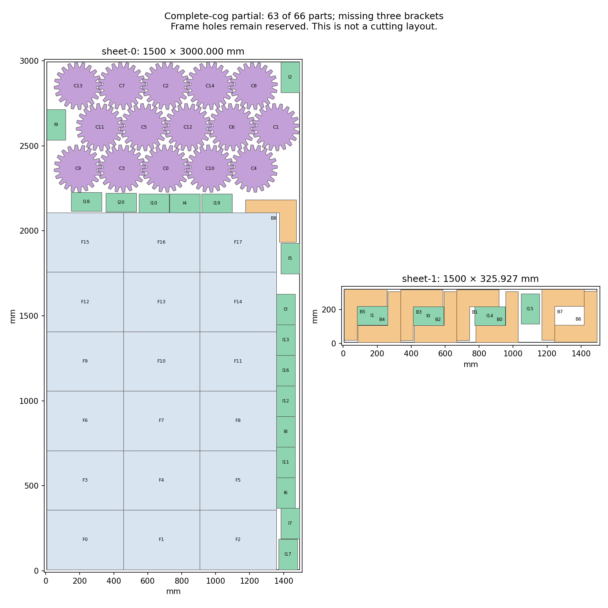

# H5: complete-cog group choice and sheet coverage — 2026-10-23

**The best retained partial remains 64/66 parts.** A new choice among 165 complete
cog groups improves this branch to 63/66: all 18 frames, all 15 cogs, all 21
inserts, and nine of 12 brackets. Its filled area is still below the saved
64-part result. A separate audit identifies 200 additional complete-cog groups,
including distributions with three or five cogs on the last sheet. H2/H5 remain
open at **60%**.

## Construction and independent graph audit

The [previous experiment](h5-complete-cog-small-relocation-20261023.md) fixed one
complete-cog arrangement. This construction instead chooses one of all 165 saved
cases, each with the same 18 frames, while every bracket and insert may move.
Every original source candidate keeps its exact index. Old small parts excluded
by a former fixed cog arrangement are reconsidered against all cases.

Exact neighborhood deduplication gives 1,670 new translation-region queries.
All finish in 6.992402800 seconds. Thirty zero-origin Minkowski cache entries
are checked against absolute-position calculations; maximum coordinate error
is 4.619×10⁻¹³ mm. Every query region is reconstructed with zero area difference.
The new caps add 1,600 bracket and 1,200 insert poses. Generation takes
9.488442600 seconds. All 13,226 events are retained: 10,426 duplicates and no
geometry rejections. The family caps leave 980 recorded lists pending; none is
resumed. No query is unbuilt.

Independent checks reconstruct all 165 groups and cover 82,160 within-group
original geometry pairs, 169,794 old/frame pairs and 418,731 proposal/neighbor
pairs. Every allowed transform, stock bound and complete seed is checked.
Among 2,007,005 cog/small-part possibilities, 333,130 exact distances establish
277,611 conflicts. Every complete-group compatibility list is reconstructed.

The resulting 9,089 small-part choices have 28,654,006 same-sheet pair
possibilities. The independent audit checks 3,495,106 exact distances, finding
3,051,661 conflicts. All are covered by 13,632 verified cliques; there are no
residual edges or compression expiry. Old source coordinates and the original
61-part seed remain unchanged.

## Starting layouts and one bounded solve

A separately declared 30-second construction census checks 20 deterministic
small-part orderings for every group. All 3,300 cases finish in 15.958726700
seconds. Every result is checked against full compatibility, conflicts, quantity
caps and filled-area score. The best starting layout uses case 97 and contains
62 parts: nine brackets and 20 inserts alongside all frames and cogs.

All fields of the 9,254-variable, 22,725-constraint protobuf model are independently
reconstructed before one eight-worker, seed-zero solve. Its 60-second allowance
finishes in 60.296662800 seconds; the soft overrun is preserved. Two callbacks
and a different final result are retained. Status is `FEASIBLE`, with score
775,800,000 and upper bound 895,800,000, the full-inventory score. The bound
therefore remains unresolved; neither optimality nor finite infeasibility is
claimed. No extra call or limit extension occurs.

The best returned counts use case 144 and total 63 parts, missing three brackets.
Filled area is 4,361,740.784070 mm², below the saved 64-part result's
4,381,615.346194 mm². The second callback uses 4,985,157.064866 mm² of charged
material; the different final layout reaches the original target of
4,988,890.353495 mm². All four layouts, including the starting hint, receive
fresh frozen-CLI checks. Their only failures are the recorded missing quantities.
Original filled-outer geometry passes throughout. Minimum clearance is about
0.2001 mm, so native construction margins remain unqualified.

The image shows the final diagnostic layout. Frame holes remain reserved; this
is not a complete cutting layout or an H5 pass.

## Additional distributions across sheets

The 165 cases put zero or one cog on the last sheet. A fresh finite coverage audit
combines every saved first-sheet catalogue group with every saved last-sheet
group (or no last group) whose counts total exactly 15. It preserves exact source
poses and checks all original stock, transform and pair constraints. This is
coverage of the present group-selection model, not a claim that earlier unrelated
algorithms never tried other sheet distributions.

All 210 declared combinations finish in 0.256266400 seconds, with none pending.
There are 6,930 stock/transform checks and 92,030 original same-sheet pair checks,
including exact reuse of 7,649 distinct pairs. Minimum distance is 0.2126 mm.
All component poses already exist in the full source pool.

Ten combinations match existing complete groups. The other 200 are new to this
165-case model: 75 split cogs 10+5 across sheets, 75 split them 12+3, and 50 split
them 14+1 using different last-sheet catalogue poses. These are valid frame/cog
subassemblies; no small-part completion or full original CLI pass is claimed.

Do not repeat the expired 165-group solve or resume its 980 capped proposal lists. The saved 64-part layout remains the best retained partial by both part count and filled area. Use output/h5-cog-sheet-group-coverage-20261023/new-cases.json for 200 independently checked additional complete-cog arrangements: 75 with five cogs on the last sheet, 75 with three, and 50 with one at catalogue poses different from the exact old last-sheet seed. Combine these with the existing 165 cases in a fresh declared 365-group construction, preserving every source/global candidate index and the new checked 63-part case-144 seed. Begin from the complete current source pool before group-compatibility filtering. Generate new small-part contacts only for the additional case neighborhoods under freshly declared time/family caps; reconstruct all compatibility, actual geometry and the complete changed graph before at most one newly declared selection call. Preserve all failures, caps and pending work. Merely combining the already checked components is not a full-job witness, a new production repair, or proof that two-sheet cog distributions have never been tried elsewhere. Original native margins, production repair limits and budget, 66-part validity and all H5 jobs/kerfs still apply. H2 retains Artem's unchanged gate.

## Repository and release status

All six checks on main `2333dd2c` passed. The two preceding checkpoints were
pushed normally together as `37b671d3`, with local and remote ancestry equal
after the push. Its new run `39955078136` is saved as `in_progress` with
conclusion `pending`; no unobserved pass is inferred.
Production source and all three README hashes remain unchanged. The existing
preview is accurate, and no new application build qualifies for release. No
production packing, quality matrix or reserved-input evaluation occurs.

Evidence: [plan](h5-complete-cog-group-choice-20261023/plan.json), [generation](h5-complete-cog-group-choice-20261023/generation.json),
[graph audit](h5-complete-cog-group-choice-20261023/graph-audit.json), [starting layouts](h5-complete-cog-group-choice-20261023/hint-audit.json),
[model audit](h5-complete-cog-group-choice-20261023/model-audit.json), [solver result](h5-complete-cog-group-choice-20261023/solver-result.json),
[original layouts](h5-complete-cog-group-choice-20261023/layout-audit.json), [coverage plan](h5-complete-cog-group-choice-20261023/coverage-plan.json),
[coverage audit](h5-complete-cog-group-choice-20261023/coverage-audit.json), [new cases](h5-complete-cog-group-choice-20261023/new-cases.json),
[source review](h5-complete-cog-group-choice-20261023/source-review.json), [raw evidence](h5-complete-cog-group-choice-20261023/raw.zip), and
[manifest](h5-complete-cog-group-choice-20261023/raw-manifest.json). All 1803 archive members, CRCs and
byte hashes verify.
