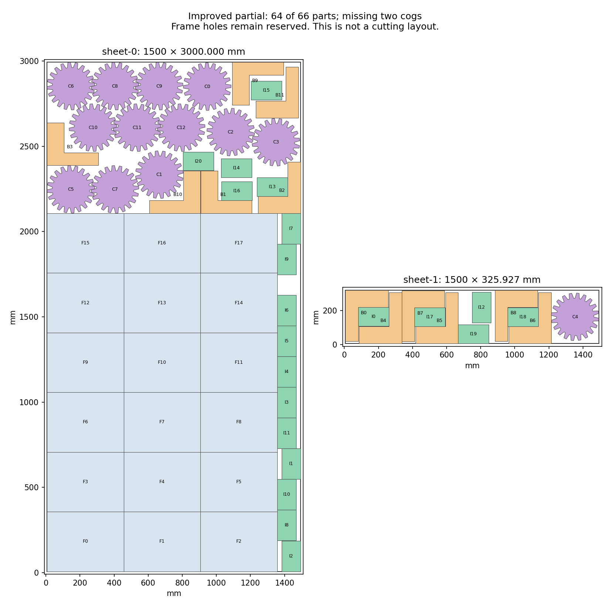

# H5: denser cog groups improve the partial to 64 parts — 2026-10-23

**The retained partial now places 64 of the original 66 parts.** All frames,
brackets and inserts fit; two cogs are still missing. Filled area rises to
**4,381,615.346194 mm²**, a **39,600 mm²** gain over the previous best, within
the same material allowance. This is still an incomplete job. H2/H5 remain
open at **60%**, and no native quality or release claim follows.

## Changed contacts and complete collision checks

The [previous coverage audit](h5-wide-small-selection-20261023.md) supplied 488
absent cog poses from denser, already checked groups. The changed pool retains
all 10,066 old choices before any old reduction; a previous substitution could
cease to be valid against a newly added position. All 488 cog poses are added.

Seventy-five placed groups with at least nine cogs produce 750 bracket/insert
queries. Groups propose positions only; all small families remain free in the
final selection. Cached zero-translation original-outline Minkowski obstacles
are translated for each neighbor. All queries finish. The fresh caps add 1,200
bracket and 800 insert poses, leaving 626 recorded proposal lists pending.
Generation takes 6.811821100 seconds; no old capped list is resumed.

Independent checks reconstruct all 750 free regions and compare all 40 cache
entries with direct absolute-position calculations; maximum translation error
is 4.69×10⁻¹³ mm. All 303,804 frame pairs and 69,123 proposal/group pairs pass,
with no geometric rejection. Exact transform deduplication records 4,248 duplicates.
Among 54,495,448 same-sheet possibilities, 9,460,375 exact distances establish
7,910,375 conflicts. Bounded compression retains 2,022 cliques and 1,477,496
explicit residual edges. The independent audit proves complete coverage.

Fresh same-family substitution certificates remove 3,371 poses, checking
2,985,531 replacement-neighbor relations. The ten-million-comparison cap stops
further reductions after 4.452257200 seconds; remaining choices stay present.
All 9,183 retained variables and 927,875 projected conflict constraints are checked.

## Better starts and one bounded solve

The original wider-frame 62-part result survives the changed graph and fresh
substitutions. Forty greedy scans do not improve it. A separately declared
finite enumeration then starts from each of the 75 denser cog groups, with or
without the optional insert strip, using 20 ordering rules. All 3,000 cases
complete in 20.267838900 seconds, below 30 seconds; every final mask is checked.
The best starting layout contains 63 parts, missing three cogs.

Every protobuf model field is independently reconstructed before solving.
Binary model export uses the installed exporter's documented format and avoids
parsing a large text model; it changes no constraint or solver parameter.
One eight-worker, seed-zero call uses the declared 60-second limit and returns
`FEASIBLE` after 61.654028900 seconds. The measured soft overrun is preserved.
Four callbacks and a distinct final selection are saved. The bound still permits
full inventory; neither optimality nor unrestricted impossibility is established.

The best selection has 18 frames, 12 brackets, 13 cogs and 20 inserts. Its filled
area is 4,361,815.346194 mm², 19,800 mm² above the previous best. The starting
hint and all five returned layouts pass independent original stock, rotation,
mirror, pair-distance and material checks. Five fresh frozen-CLI calls fail only
for their recorded missing quantities. The first callback exactly matches the
checked hint, so its result is reused with source-byte verification.

## One more insert fits without moving the other parts

Four new conservative free-region queries test the two rectangular orientations
on both sheets while preserving every one of the final 63 placements. Three
regions are empty. The fourth supplies 23 valid positions, all checked against
the original neighbors (1,173 pairs). One insert is appended deterministically.
The original 63 placements remain byte-for-byte equal.

All 1,392 pairs in the resulting 64-part layout pass. A fresh frozen-CLI check
reports exactly two missing cogs and no other violation. Charged material remains
4,988,890.203495 mm² against the unchanged 4,988,890.353495 mm² target. Minimum
clearance remains about 0.2011 mm; native construction margins are unqualified.
The conservative insertion queries are not a general impossibility test.

## Continuous capacity and next investigation

With the new 51 non-cog placements fixed, a necessary all-angle cog relaxation
allows at most 18 cogs on the first sheet and one on the second, total 19.
The independent exact-rational audit checks 75 strictly interior rectangles,
two components, four diameter covers, every complement and reachable-area
calculation, and retention of all 13 current cogs. This bound is inconclusive
for the required 15; it does not assert that they can be packed.

Use the exact 64-part layout in output/h5-dense-insert-gap-20261023/layout.json as the retained seed. Its 51 fixed non-cogs allow at most 19 cogs under the checked continuous relaxation: 18 on the first sheet and 1 on the last. This is inconclusive for 15, not evidence of attainability. Next construct a changed cog-only pool against those exact 51 poses, retaining every compatible old cog and all 13 seed cogs. Include current actual cog angles and the declared sampled phases on both sheets, with original-outline free-region contacts and the applicable audited denser groups. Declare finite generation and solver bounds, check every new transform/conflict, and solve only after independent model review. Do not retry the expired all-small model or resume capped lists. If the finite cog pool cannot complete 15, keep the failure and investigate coordinated non-cog moves instead of claiming continuous impossibility. A full 66-copy original witness, native margins, production-budget qualification and all unchanged H5 gates are required before integration. H2 stays open under Artem’s retained-denominator decision.

## Repository and release

All six checks on main `37edb1d2` pass. Core source and all three README hashes remain unchanged. The existing
v0.2.0-alpha.1 preview and hosted browser preview are still accurately described;
no new application build is qualified. Stable v0.1.0 and registry versions remain
unchanged. No reserved inputs, native packing runs or quality matrices are used.
Artem’s H2 denominator decision and release authorization remain in force.

Evidence: [generation](h5-dense-wide-progress-20261023/generation.json), [geometry/graph audit](h5-dense-wide-progress-20261023/graph-audit.json),
[substitution audit](h5-dense-wide-progress-20261023/reduction-audit.json), [starting layouts](h5-dense-wide-progress-20261023/group-hints-audit.json),
[model audit](h5-dense-wide-progress-20261023/model-audit.json), [solver result](h5-dense-wide-progress-20261023/solver-result.json),
[returned-layout audit](h5-dense-wide-progress-20261023/layout-audit.json), [insert addition](h5-dense-wide-progress-20261023/insert-gap-audit.json),
[retained 64-part layout](h5-dense-wide-progress-20261023/layout-64.json), [original CLI failure](h5-dense-wide-progress-20261023/public-64.json),
[capacity audit](h5-dense-wide-progress-20261023/capacity-audit.json), [source review](h5-dense-wide-progress-20261023/source-review.json),
[raw evidence](h5-dense-wide-progress-20261023/raw.zip), and [manifest](h5-dense-wide-progress-20261023/raw-manifest.json).
All 947 archive members, CRCs and byte hashes verify.
