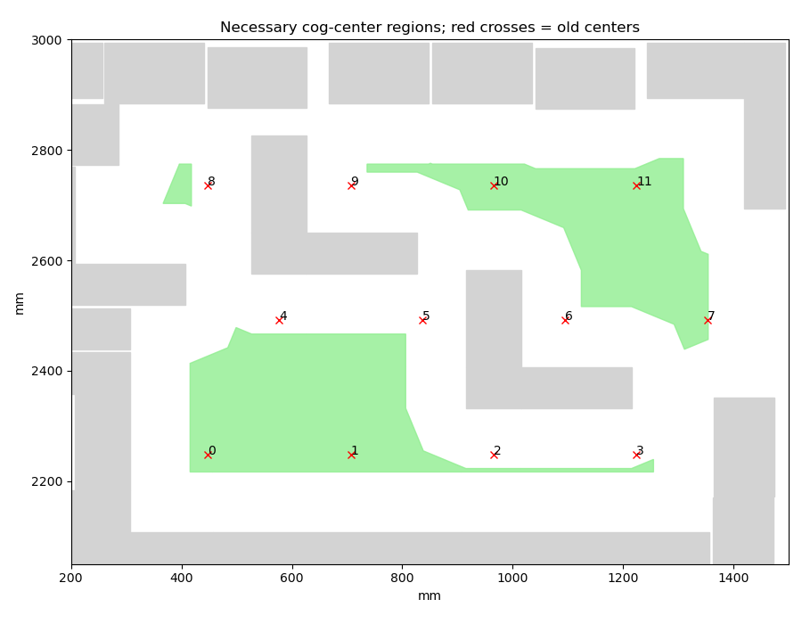

# H5: the saved non-cog arrangement cannot hold all 15 cogs — 2026-10-26

**At least one of the 51 non-cog poses or orientations must change.** With those
poses fixed, audited necessary geometry permits at most **14 of the 15 required
cogs**, even if every cog moves, rotates freely and changes sheet. This excludes
the saved arrangement only; it does not exclude a different complete layout.
H2/H5 remain open at **60%**.

## Whole-domain center cover

The complete proxy construction contains all 51 non-cog originals. Their 75
source-contained component rectangles are expanded by the independently proved
all-angle cog octagon, producing 75 convex integer forbidden polygons and 900
facets. An independent support reader verifies all source identities and
28,800 point-sum support checks. Cog center stock domains retain the original
audited all-angle support and its outward necessary relaxation.

Each closed stock domain is tiled by 10 mm cells. A cell is discarded only if
every corner is strictly inside one forbidden convex polygon. Convexity then
excludes every point in that cell. Remaining closed cells retain all possible
centers, including isolated legal boundary points and segments that a floating
polygon difference might omit. The audit checks **33,275 cells**, including
**30,979 strict exclusions**, **2,296 remaining cells** and **1,486,992 exact
corner/facet tests**. The first sheet has three remaining components of
1,115, 914 and 43 cells; the short sheet has one of 224 cells.

## Exact cell capacity certificates

The earlier full-circle source certificate requires rounded cog centers to be
at least **254,297 µm** apart. Each cell is smaller than that diameter. Two
cells are compatible only if their maximum possible point distance reaches the
required separation. Any placement of k cog centers therefore implies a
k-clique in this conservative graph.

The independent reader checks **1,064,175 graph vertex pairs** and **748 exact
color/branch certificate nodes**. Exhaustion proves that the lower first-sheet
component holds at most **six** cogs, the small component at most **one**, and
the short sheet at most **three**. No heuristic graph coloring is treated as
an exact answer: every excluded target has a complete branch certificate.

The upper component initially admits a five-cell clique. Its pairwise rectangle
distances can use different corners for different neighbors, so that is not a
point placement. An auxiliary rational clipping/refined graph still finds a
five-cell clique; its unverified coverage is not used in the exclusion below.
The floating plot, hex-grid scan and refined geometry are retained as
diagnostics only. The audited original closed-cell cover remains authoritative.

## Five upper centers are necessary, then excluded

Since the other regions hold at most 6 + 1 + 3 = 10 cogs, fitting all 15 requires
at least five centers in the upper component. This implication allows any cog
sheet allocation. It does not freeze the previous 12/3 allocation.

A new necessary model gives those five centers free integer coordinates in the
upper component's conservative bounding box and minimum x+y support. Each
center must remain outside the relevant source-contained forbidden polygons.
Exact domain separation makes 49 of the 61 first-sheet polygons irrelevant;
the other 12 produce 60 source clauses. Each of the ten center pairs must lie
outside a 64-vertex integer polygon strictly inside the disk of radius
254,297 µm. Every valid source center pair satisfies this necessary condition.
Only equivalent-copy X ordering is imposed; there are no hints or objective.

The independent reader verifies all **1,370 variables and 1,439 constraints**,
all source clauses, all ten pair clauses and the 64 exact radius/convexity
certificates. The single call returns **INFEASIBLE** after **12,464 branches and
2,439 conflicts**, in **0.408622 solver / 0.413757 returned / 1.759713 shared
seconds**, within the declared 60/90-second limits. Its model hash is
`039583787909a1379d1e12a8dd52402bf50bc650b642bd818116e076f3766508`. The response audit binds the model, parameters,
raw response, log and process boundary. This uses the solver's infeasibility
result; it is not an external formal UNSAT certificate.

Thus the first-sheet component bounds are **6 + 4 + 1 = 11**, and the short
sheet holds at most **3**. Total capacity is **14**, below the mandatory **15**.
Moving or rotating cogs alone cannot repair these fixed non-cog poses. The next
distinct construction can free both newly added brackets together with all cogs,
retaining the other 49 non-cog poses and keeping every original mandatory.
No complete source layout, native call or H5 material pass is claimed.

## Main CI and preservation

At 2026-10-26T21:32:53.163284+00:00, [main 36f162d0](https://github.com/skulitom/Nestbolt/actions/runs/40400314122)
has 4 successful jobs. The browser job reached its configured 30-minute
limit after dependency setup consumed over 24 minutes. Raw logs identify long
downloads from the Ubuntu package mirror, including a 278.903-second gap while
fetching libcodec2. The browser tests started, but no full-suite pass is claimed.
The timeout was not caused by an agent cancellation or a new push. Its raw job,
annotations, logs and checksums are preserved; a Windows check was still live
when the timeout was diagnosed. Wait for that check before retrying only the
browser job, and require six successful jobs before the next normal push.
A post-capture console encoding error is also retained; all four network
captures had succeeded and no capture was repeated.

Production, READMEs and upstream heads/releases are unchanged. The 22 reserved
H2 vectors remain unopened. No new release qualifies.

[Checks](h5-fixed-noncog-cog-capacity-20261026/checks.json), [whole-domain/graph audit](h5-fixed-noncog-cog-capacity-20261026/geometry-cover-graph-checks.json),
[model audit](h5-fixed-noncog-cog-capacity-20261026/model-checks.json), [response audit](h5-fixed-noncog-cog-capacity-20261026/response-checks.json),
[scope](h5-fixed-noncog-cog-capacity-20261026/scope.json), [next step](h5-fixed-noncog-cog-capacity-20261026/next-step.json),
[timeout annotations](h5-fixed-noncog-cog-capacity-20261026/main-web-timeout-annotations.json) and
[raw manifest](h5-fixed-noncog-cog-capacity-20261026/raw-manifest.json). The archive verifies
89 canonical files and 23
identical-content aliases by bytes, SHA-256 and CRC.

The [retained-guard addendum](h5-fixed-noncog-cog-capacity-20261026/retained-guard-addendum.json) preserves six legacy pair-clearance and three stock-guard failures. The retained non-cogs are not already a current-guard source-valid scaffold. Repair and independently recheck those failures, or free the affected poses as well, before claiming a source candidate. Changed poses require fresh forbidden geometry; the fixed-position exclusion above must not be silently transferred to them.
