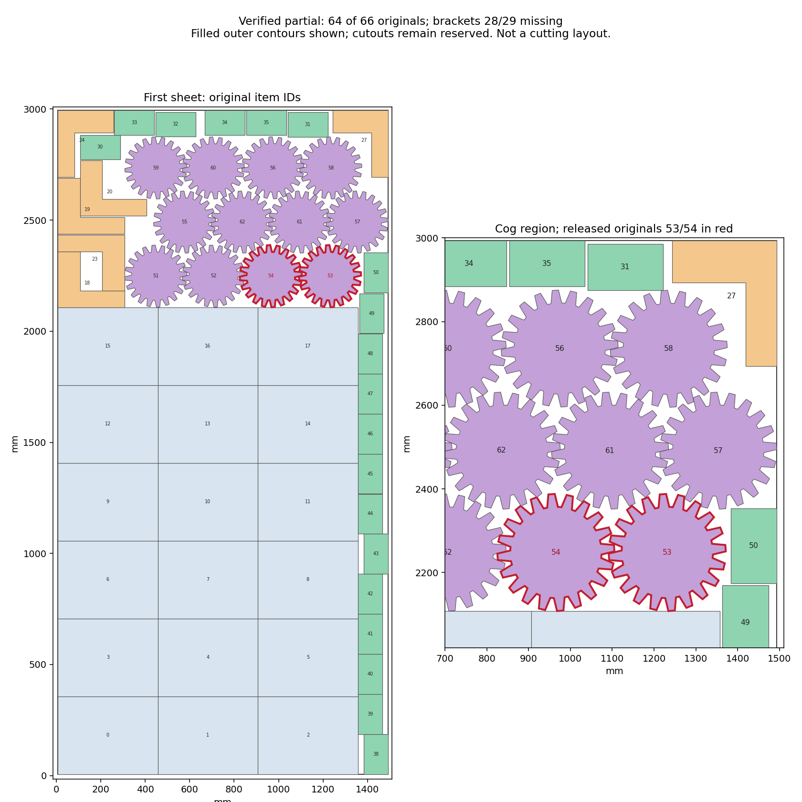

# H5: focused original-geometry obstruction and broader search — 2026-10-26

**Two narrower arrangements are now ruled out within their stated scope; the
broader search remains unresolved. No complete 66-part target layout has been
found. H2/H5 remain open at 60%.** All original parts and gate limits are retained.

## Broader bottom-cog search

Starting from the full 54-fixed source model, free both brackets and both
bottom-strip cogs across all their source choices. Keep eight other non-bracket
domain restrictions and all 60 nonbinding partial hints. One additional clause
excludes both released cogs returning simultaneously to their previous domains.
An independent implication audit restores the exact previously INFEASIBLE
ten-domain model when those two flags are true. This is scoped solver-model
evidence, not a raw-geometry or formal UNSAT certificate.

The complete audit passes: **223,086 variables, 289,925 constraints, 60 hints**,
all 66 originals mandatory. The one call returns **UNKNOWN in 45.423204 solver /
47.721778 shared seconds**. Its 0.423204-second soft overrun is recorded; the
60-second outer budget passes. Actual model, parameters, response and timing
readback pass. This call is closed and supplies no infeasibility claim.

## Exact obstruction with 62 fixed originals

Freeze the independently verified 64-part partial except cogs 53/54, leaving
both missing brackets 28/29 mandatory. Rebuild all 20 free-region queries from
62 original outlines. An independent reconstruction checks **1,414 fixed pairs,
248 stock edges, 82 cutouts and 8,894 cutout vertices**; all 100 cached guarded
profile obstacles are reverified. No old conditional cuts are transferred.

Only bracket queries 0/8 remain nonempty. The two cogs have five small free-space
components in two separate zones. Exact rational checks of all **228 raw cog
collision-boundary segments** establish a strict collision disk and capacity
one in each zone. Both zones must therefore be occupied. For either bracket
orientation, its entire possible position relative to the compulsory left cog
lies strictly inside the raw original collision region. Independent exact
segment clipping and parity check **162 boundary/box cases**. This excludes
completion within this particular 62-fixed, original-angle construction,
without a solver call. The broader 54-fixed construction is not excluded.

An initial helper had an incorrect empty-region assertion and produced no
certificate. Its failure is preserved; a separate corrected construction and
independent audit pass. The original plot with unclipped labels is also retained;
the repaired rendering below was visually inspected. It remains a partial,
not a cutting layout.

## Fresh five-mover construction

Free the adjacent middle cog 61 as well: **61 fixed originals and five mandatory
movers**, original items 28/29/53/54/61. The independent rebuild checks **1,362
fixed pairs, 244 stock edges, 81 cutouts and 8,694 cutout vertices**. All three
prior cog anchors remain represented. The 62-fixed obstruction is not reused.

All 20 queries finish without a construction cap or uncovered raw area.
There are **2,120 raw convex faces, 2,118 inward domains and two recorded
discards**, with 6,954 independently verified inside inequalities. All 82
historical mutual cases retain their original IDs and byte-verified geometry;
73 are used, nine explicitly unused. The unchanged insert queries 16/17 are
computed but unused by the five movers. The full physical inventory has ten
pairs and 230 same-sheet query combinations. Half are impossible because their
empty-query selectors are forced false, leaving **115 active-capable modes**.

Independent whole-model reconstruction and actual solver import pass:
**22,545 variables / 39,619 constraints / 18 advisory hints**. All ten anchor
coordinates remain free; two original-area inequalities are freshly derived.
No prior capacity, domain conflict or conditional exclusion is copied.
The single bounded call returns **INFEASIBLE in 17.065219 solver / 18.006190
shared seconds**, with no overrun. The exact response and model readback pass.
This excludes only this finite 61-fixed source construction, not arbitrary
orientations or unrestricted packing. Both calls in this checkpoint are closed.

The next distinct construction will also release upper-right bracket27 and
cog58, giving 59 fixed originals and seven movers. Every free region, domain,
area charge and applicable pair must be rebuilt and independently checked.
No exclusion from the older fixed arrangements can be transferred silently.
Any positive still requires all **66 originals, 90 cutouts and 10,026 hole
vertices**, native validation and material checks, followed by production
integration and the full 13-job/two-kerf H5 matrix.

## Repository and release state

Previous main b8535505 passes all six jobs in CI40264589776. The verified
conditional-selection checkpoint **679e97e0 is pushed normally to main**.
At 2026-10-26T04:10:35.849330+00:00, [its checks](https://github.com/skulitom/Nestbolt/actions/runs/40267513191)
are in_progress with 0 jobs passed;
preserve the live run before the next normal push. An initial review selected
an incorrect workflow name; raw results and failure are preserved, and the
separate repaired review uses the observed name, Checks.

Upstream heads and releases are unchanged; no stop rule has triggered. Product
source, READMEs and releases are unchanged. No new release is qualified. H2
retains the original gate and all 22 reserved vectors remain unevaluated.

Evidence: [raw geometric certificate](h5-focused-partial-obstruction-20261026/focused62-raw-certificate.json),
[five-mover readback](h5-focused-partial-obstruction-20261026/search61-search-audit-checks.json),
[checks](h5-focused-partial-obstruction-20261026/checks.json), [next step](h5-focused-partial-obstruction-20261026/next-step.json), and
[raw manifest](h5-focused-partial-obstruction-20261026/raw-manifest.json). **431** canonical
files and **388** aliases are independently checked by
size, SHA-256 and ZIP CRC across **1** archive parts.
