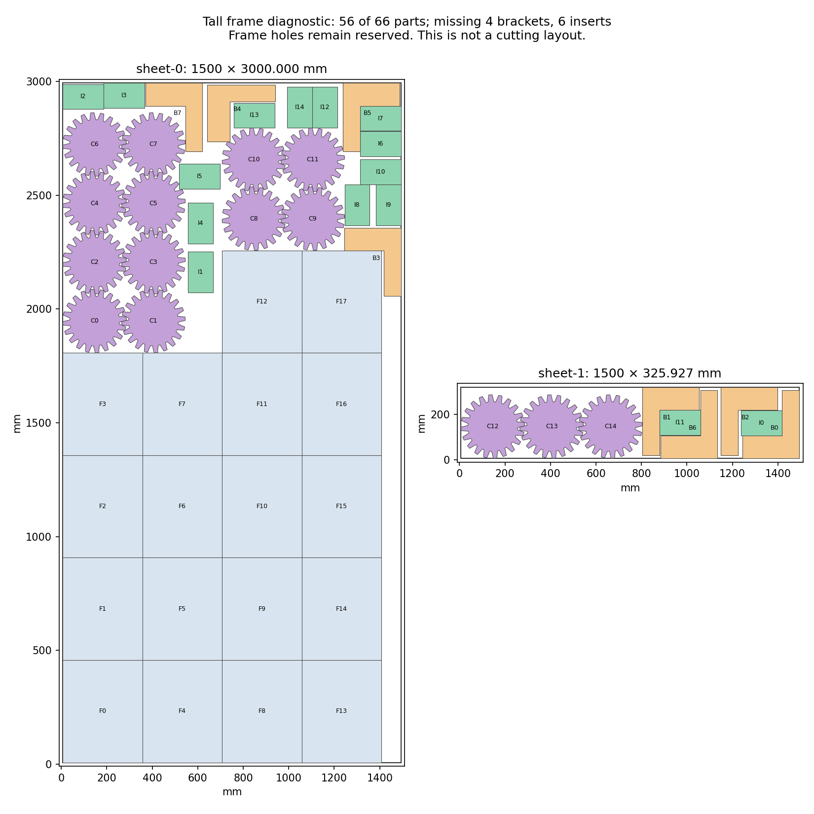
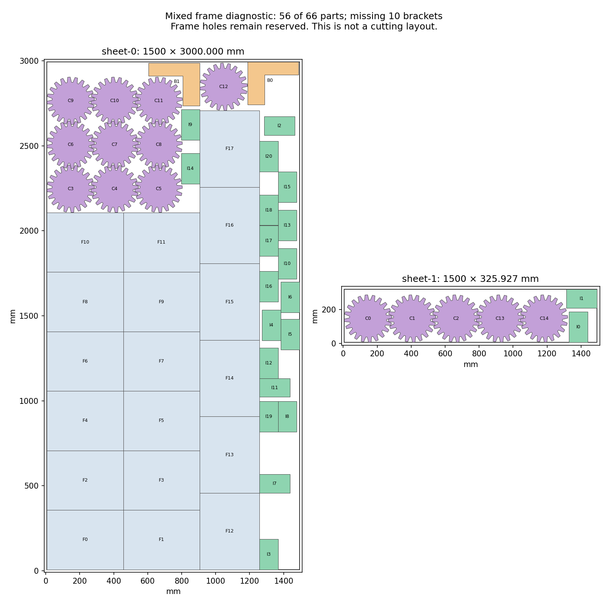

# H5: alternate frame arrangements and actual compound contacts — 2026-10-23

**Neither changed frame arrangement improves the saved partial layouts.** Both
finite candidate models reach a proven optimum below the original 66-part job.
The 63-part layout still has the highest retained filled area; the separate
64-part layout still has the highest part count. H2/H5 remain open at **60%**.

## Construction and limits

The tall construction fixes the checked four frame columns (4/4/5/5) with cogs
split 8+4+3. A separate mixed construction fixes three columns of six frames,
two unturned and one quarter-turned, with cogs split 9+1+5. The mixed core passes
388 original same-sheet pairs, all stock and transform checks, and a frozen CLI
check whose only failures are the absent brackets/inserts. Historical mixed
frame patterns already exist; no first-ever orientation claim is made.

Each completion preserves the preceding complete source pool before fresh
filtering. It queries every bracket orientation/reflection and both insert
classes, plus 36 saved two-to-four-member bracket/insert compounds under four
whole-group rotations, on both sheets. Each of the 308 regions uses the union
of actual member exclusions; compound bounding rectangles only limit stock
translations. Internal compound gaps remain their saved values. Construction
padding applies to the fixed neighbors and stock, and is not native qualification.

The initial tall preparation failed on an absent `passed` field in an older
audit. The corrected reader checks its actual source-hash, transform and pair
fields. The original script and failure are retained separately; no search or
plan had started in that failed folder.

| Checked result | Tall frame core | Mixed frame core |
| --- | ---: | ---: |
| Queries finished | 308/308 | 308/308 |
| Added brackets / inserts | 642 / 1,600 | 103 / 1,600 |
| Retained choices | 4,960 | 3,592 |
| Complete conflicts | 2,454,670 | 883,219 |
| Pending capped member lists | 81 | 16 |
| Choices after certified substitution | 1,347 | 798 |
| Starting layouts checked | 20/20 | 20/20 |
| Solve wall seconds | 9.474773800 | 0.448532400 |
| Finite optimum, original area × 1,000 | 617,000,000 | 495,800,000 |
| Full inventory would require | 895,800,000 | 895,800,000 |
| Best area counts: frames / cogs / brackets / inserts | 18 / 15 / 8 / 15 | 18 / 15 / 2 / 21 |
| Original layouts checked | 11 | 3 |

All regions, events, duplicate records, pending positions, original stock bounds,
allowed transformations and full conflict graphs reconstruct independently.
Tall/mixed audits check 6,173,201 / 6,049,581 same-sheet possibilities and
2,671,478 / 905,511 exact distances. The 36 / 54 cache translations agree within
6.636×10⁻¹³ / 9.113×10⁻¹³ mm; every reconstructed region has zero area difference.
All original cliques cover the complete graph, with no residual edge dropped.

Fresh same-family substitution requires adjacency and a subset of all other
original neighbors. Independent enumeration verifies 3,148,318 / 1,191,757
certificate neighbors and both projected graphs. Each model's every protobuf
field is independently reconstructed. Each makes exactly one call, with a
declared 60-second allowance, eight workers and seed zero. Both finish early
with `OPTIMAL`; neither call is extended or repeated. This proves a limit of
these finite pools with their fixed cores, not unrestricted packing impossibility.

All 14 original layout checks pass geometry and retain only expected quantity
failures from the frozen CLI. The highest-area results in these experiments each
contain 56 pieces: tall fills 4,202,940.784070 mm² and lacks four brackets/six
inserts; mixed fills 4,081,740.784070 mm² and lacks ten brackets. Some lower-area
tall intermediate results contain more pieces; count is not the area objective.
Their minimum gaps are about 0.2002 and 0.2011 mm. Neither is native-qualified.

## Fresh coverage for the next comparison

A read-only coverage audit fixes the 18 wide frames from the better 63-part
layout, then considers every cog/bracket/insert pose in the full 29,838-entry
accumulated pool. All 404,658 fixed-frame comparisons are checked. The earlier
19,834-entry source prefix is unchanged, and all 12,554 earlier all-family
choices remain eligible. The 21,468 eligible choices include **8,914 additions**:
4,125 bracket, 4,766 insert and 23 cog poses. Both best partials map by exact
identity and pass their full original geometries. This is useful coverage;
the new complete mutual conflict graph and selection remain pending.

Do not rerun either fixed-core solver, extend their limits, or resume the 81 tall-core or 16 mixed-core pending member lists. Both finite models have a proven optimum below full inventory; no continuous/global impossibility is claimed. Preserve the highest-filled-area 63-part partial and the separate highest-count 64-part partial. The next concrete changed model is output/h5-latest-wide-pool-coverage-20261023/mapping.json: fix only its exact 18 wide frames, and let all cogs, brackets and inserts select together from the 21,468 freshly checked original poses. The source preserves the entire preceding 29,838-pose pool and all 12,554 choices from the earlier dense-wide all-family model. Its 8,914 additional compatible choices include 4,125 brackets, 4,766 inserts and 23 cogs. Both prior partials are mapped by exact identity and their full geometries checked. This is coverage only: declare fresh bounded graph compression, safe same-family substitutions, hint construction and at most one bounded solve before proceeding; audit every original conflict, all residual edges, the projected graph and every model field. Use the higher-area 63-part seed while preserving the 64-part alternative. Do not reuse prior reduced subsets or assume unchanged graph adjacency. Only an original complete 66-part target witness can advance to native margins and a production repair within the original budget; all H5 jobs and both kerfs remain required. H2 retains Artem's unchanged gate decision; the 22 reserved vectors stay unopened.

## Repository, release and evidence

All six checks on main `37b671d3` passed. The queued `356c8523` and `4592d97c`
checkpoints were pushed normally to main, without force. Run `39960579594` for
`4592d97c` is saved as `in_progress` / `pending`;
no unobserved completion is inferred. This report's commit will follow the
same policy of allowing the current checks to finish before another push.

Original job, library, request and target hashes match the preceding archive.
Core source and all three READMEs are unchanged. Their current preview wording
remains accurate. These diagnostics do not qualify a new application release;
v0.2.0-alpha.1 and stable v0.1.0 remain as published. No production packing,
full quality run, registry publication or reserved-input evaluation occurs.

Evidence: [tall plan](h5-frame-compound-limits-20261023/tall-plan.json), [tall graph](h5-frame-compound-limits-20261023/tall-graph-audit.json),
[tall model](h5-frame-compound-limits-20261023/tall-model-audit.json), [tall layouts](h5-frame-compound-limits-20261023/tall-layout-audit.json),
[mixed plan](h5-frame-compound-limits-20261023/mixed-plan.json), [mixed graph](h5-frame-compound-limits-20261023/mixed-graph-audit.json),
[mixed model](h5-frame-compound-limits-20261023/mixed-model-audit.json), [mixed layouts](h5-frame-compound-limits-20261023/mixed-layout-audit.json),
[mixed core](h5-frame-compound-limits-20261023/mixed-core-audit.json), [coverage](h5-frame-compound-limits-20261023/wide-coverage-audit.json),
[preflight failure](h5-frame-compound-limits-20261023/preflight-failure.txt), [source review](h5-frame-compound-limits-20261023/source-review.json),
[raw evidence](h5-frame-compound-limits-20261023/raw.zip) and [manifest](h5-frame-compound-limits-20261023/raw-manifest.json).
All 946 archive members, CRCs and byte hashes verify.
