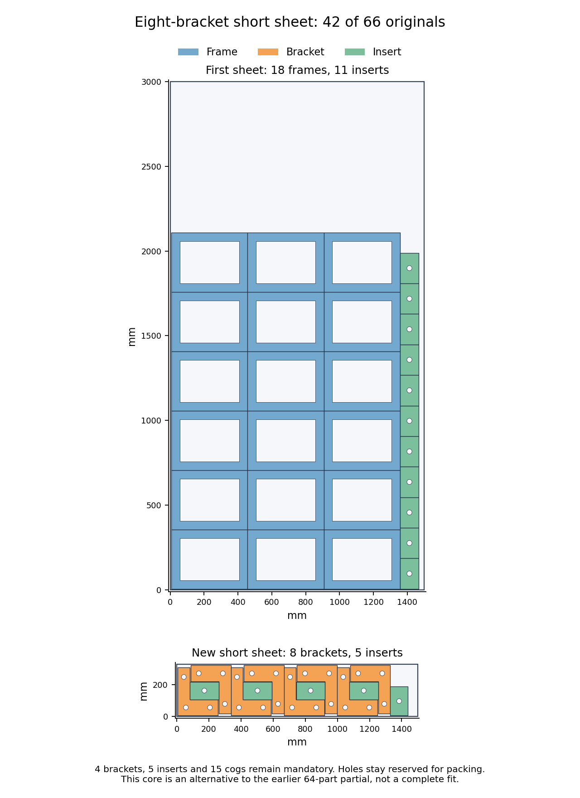

# H5: global short-sheet count frontier and eight-bracket construction — 2026-10-26

**Exact necessary bounds exclude 4,122 of 4,576 short-sheet allocations without
fixing the first-sheet layout.** A separate original-geometry construction fits
eight brackets and five inserts on that short sheet. Its new 42-original core
still needs 24 first-sheet placements. There is no complete target witness;
H2/H5 remain open at 60% by completed gate weights.

## All available counts, without a fixed first layout

The declared usable short stock is [6.5, 6.5, 1493.5, 319.42699] mm. The upper
edge is slightly outward of the retained target; another 0.020 mm outward
relaxation covers quantization. Recomputed floor-anchor bounds exactly match
the previously proved source domains. Fresh transverse support checks retain
positive margins for every bracket stem. Frames have at least 350 mm height
in every allowed orientation, so all eighteen remain on the first sheet for
this two-sheet target.

Reuse intrinsic, source-contained stem/rectangle and mixed-pair necessities,
without importing any fixed first-sheet positions. The full-circle cog proof
gives at least 254.297 mm between rounded centers. Their entire vertical range
is 34.426 mm, so exact integer square-root arithmetic strengthens the necessary
horizontal gap from **245.034 mm to 251.956 mm**.

The complete ordered projection considers all eight bracket modes, arbitrary
real cog angles and all available counts: 0–12 brackets and 0–15 cogs. The
forward earliest-position recurrence has **222 states and 1,998 transitions**.
An independently implemented backward latest-position recurrence has 222
states and exactly the same surviving count pairs. The auditor independently
reconstructs all **81 pair bounds**, including **768 guaranteed-Y rectangle
overlap relations**, and checks every saved forward witness and transition.

| Brackets on short sheet | Maximum cogs allowed by this necessary bound |
| --- | ---: |
| 0 or 1 | 5 |
| 2 | 4 |
| 3 or 4 | 3 |
| 5 | 2 |
| 6 or 7 | 1 |
| 8 | 0 |
| 9–12 | No placement survives, even with zero cogs |

Exact rational triangulation of the original filled outlines supplies a
separate area bound for every 0–21 insert count. Holes remain reserved; omitting
clearance only weakens this necessary bound. All **4,576 allocations** and their
first-sheet complementary counts are checked: **3,850** fail the ordered
projection, another **272** fail filled-outer area, and **454** remain unresolved.
Their 32 componentwise maximal count vectors are archived. None of these
positive necessary results is presented as a source fit. This is not a proof
that the full job is impossible.

## A concrete alternative short allocation

Four source bracket-pair patterns, each with an insert between separate filled
outers, plus one vertical insert on the right fit **eight brackets and five
inserts**. Originals18–25 and30–34 are on the short sheet. Their filled area is
**419,000 mm²**, which is 800 mm² more than the earlier verified six-bracket/
nine-insert arrangement. Its outer top is 319.0 mm and right edge 1,439.225 mm.
This is an allocation tradeoff, not a complete-layout improvement.

The first-sheet core uses eighteen unturned frames in three columns by six rows,
with eleven vertical inserts35–45 beside them. All **four brackets26–29, five
inserts46–50 and fifteen cogs51–65** remain mandatory. Every one of the 66 source
identities is accounted for exactly once. No search is opened for this new core.

Independent source readback checks **42 originals, 484 same-sheet pairs, 168
stock edges and 58 cutouts with 4,952 vertices**. All 42 anchors are reconstructed
from rational formulas. Minimum pair gap is 0.225 mm; minimum extra stock margin
is 0.025 mm, above the native guards. The first fixed top is 2,107.65 mm. No
part-in-hole packing is used. Earlier 64-part partials and other cores remain
preserved, and old neighborhood exclusions do not transfer.

## Repository and evidence

Both independent audits pass. One initial checker failure remains preserved:
it incorrectly expected a 180° horizontal insert where the saved original
profile uses 0°. The repaired expectation validates the unchanged geometry.
There are **no solver calls, native calls or full quality runs** in this work.

At 2026-10-26T17:51:58.045100+00:00, [all six checks on main e158daa2](https://github.com/skulitom/Nestbolt/actions/runs/40365489221)
pass, allowing a normal two-commit push with the queued d09d5011 checkpoint.
Production, READMEs, upstream heads/releases and all 22 reserved H2 vectors
are unchanged. No new release qualifies. The next source construction must
retain all 24 movers and pass full66 source/native/material checks before
production integration within 60 seconds and the complete H5 matrix.

[Checks](h5-global-short-frontier-and-eight-brackets-20261026/checks.json), [frontier audit](h5-global-short-frontier-and-eight-brackets-20261026/frontier-checks.json),
[necessity proof](h5-global-short-frontier-and-eight-brackets-20261026/necessity-proof.json), [source audit](h5-global-short-frontier-and-eight-brackets-20261026/source-core-checks.json),
[inventory](h5-global-short-frontier-and-eight-brackets-20261026/all66-inventory.json), [scope](h5-global-short-frontier-and-eight-brackets-20261026/scope.json),
[next step](h5-global-short-frontier-and-eight-brackets-20261026/next-step.json), and [raw manifest](h5-global-short-frontier-and-eight-brackets-20261026/raw-manifest.json).
The archive verifies 65 canonical files and
21 aliases by bytes, SHA-256 and CRC.
