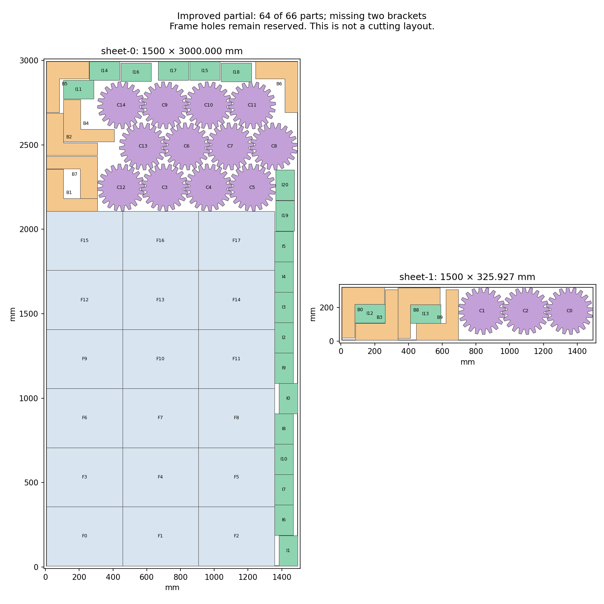

# H5: improved joint wide-frame partial — 2026-10-23

**The new best partial fits 64 of 66 original parts and lacks only two brackets.**
All 18 frames, 15 cogs and 21 inserts are present. Filled area improves by
**19,800 mm²** over the previous best 63-part layout and by **20,125.437876 mm²**
over the older 64-part layout that lacked two cogs. Both older layouts and every
intermediate result remain preserved. This is not a complete job; H2/H5 remain
open at **60%**.

## Complete changed graph and safe reduction

The full 29,838-entry source pool is preserved before fresh filtering against
only the 18 exact wide frames. All 21,468 eligible cog/bracket/insert choices
are reconsidered together: 8,359 brackets, 8,588 inserts and 4,521 cogs.
This includes every previous all-family choice plus 8,914 compatible additions.
No new pose or old pending-list continuation is introduced here.

Graph construction takes 66.542927800 seconds. A separate bounds
scan checks 149,735,398 same-sheet possibilities and 23,855,322 exact distances,
reconstructing **20,223,984 conflicts** and every saved adjacency row. The
original filter receives 404,658 pair checks; all stock bounds and transforms,
153 frame/frame pairs and both previous partial geometries pass. The graph is
stored as documented fixed-width binary rows with a verified byte hash.

Fresh substitutions consider the entire audited graph and require same family,
adjacency and a subset of all other neighbors. They finish all 43,417,456
comparisons in 25.478793900 seconds, below the declared 30-second /
50-million-comparison limits. Independent enumeration checks 12,928,359
certificate neighbors. Removing 8,153 choices leaves 13,315, preserves both
seed counts and geometry feasibility, and retains an exact induced graph of
9,231,632 edges.

Constraint compression happens after reduction. Its 20-second allowance ends
at 20.002337600 seconds; 1,770 cliques and **all 1,877,444
residual edges** are saved. Independent reconstruction confirms complete
coverage by the 1,879,214 constraints. No edge is dropped to simplify the model.

## Bounded selection and original acceptance checks

All 416 fresh starting-layout cases finish in 4.689276200 seconds.
They cover both mapped original partials, each intact or with one small-part
family released, under 52 deterministic orders. Every result's graph, original
caps and score passes; none improves the saved 63-part seed.

Every field of the 13,315-variable, 1,879,218-constraint model is independently
reconstructed. Original integer area weights preserve all 4,576 original
quantity-combination orderings. One eight-worker, seed-zero call with a
60-second allowance takes **62.403213800 seconds**; the soft overrun
is retained. It returns `FEASIBLE` with score 1,566,740,785 and full-inventory
upper bound 1,646,740,785. The gap is unresolved; no optimum or impossibility
is claimed. No call is repeated or extended.

The hint, three callbacks and different final selection receive five original
layout audits: four fresh frozen-CLI calls and one exact-layout reuse with
source hashes. All original geometry passes. Only expected missing quantities
fail. The intermediate 64-part layout lacking one bracket and one cog is also
preserved, before the better 64-part result lacking two brackets.

The final result fills **4,401,740.784070 mm²** and charges 4,988,890.203495 mm²,
within the unchanged material target. All 1,521 same-sheet original pairs pass.
Minimum clearance is about 0.2001 mm; native margins remain unqualified.

## Fixed-layout gaps and the next construction

Sixteen fresh bracket orientation/reflection queries against the exact fixed
64-part layout finish in 7.806513200 seconds. Every padded
region is empty; no proposals or pending queries remain. The unchanged layout
and its 1,521 pairs pass. Its frozen CLI result is reused only by exact equality
and source hashes, with no repeated call. Conservative empty regions do not
prove unrestricted packing impossibility.

The next checked core extracts exactly the new 18 frames and 15 cogs while
retaining the original 64-part layout as its completion seed. It passes all
stock/transform checks and 438 original same-sheet pairs, with minimum gap
0.2126 mm. Cogs split 12+3 across sheets; four cog poses differ from the previous
63-part core. Every core and seed pose maps exactly to the full source pool.
This is a subset geometry check, not an additional full-job CLI acceptance.

Do not repeat or extend the 60-second all-family solve, resume the bounded compression, or repeat the 16 unchanged fixed-64 bracket gap queries. Preserve the improved final layout at output/h5-latest-wide-joint-20261023/layout-audit/layout-final.json, its intermediate 64-part layout with one bracket and one cog missing, and both earlier best partials. The concrete next construction is output/h5-latest-wide-compound-core-20261023/layout.json: exactly the new 18 wide frames and 15 cogs, with all 31 small parts from source-seed.json retained as the baseline. Four cog poses differ from the previous 63-part core; its 12+3 sheet split passes 438 original pairs. Declare a fresh bounded actual-outline compound contact experiment against these 33 fixed poses, using all 36 saved two-to-four-member bracket/insert patterns under four whole-group quarter turns plus all allowed single-part classes on both sheets. These actual-compound contacts were checked on the inferior tall and mixed cores, not this new wide core; prior wide whole-bounding-rectangle probes and single-part complete-group queries are not resumed. Preserve the entire 29,838-pose source pool before fresh filtering, map the 64-part seed exactly, retain every pending event under fresh caps, and independently audit every original member, cache, region, mutual conflict and model field. Fresh substitutions must preserve the seed and original counts; use its 10 brackets and 21 inserts as a score floor. At most one newly declared solve may seek 12 brackets and 21 inserts. Native margins, unchanged production repair limits and the full original H5 jobs/kerfs remain required after a complete 66-part witness. H2 retains Artem's unchanged gate and the 22 reserved vectors remain unopened.

## Repository and evidence

All six jobs in main run 39960579594 for 4592d97c have passed. There are no
incoming changes after fetch. The previous abc464a2 audit and this report are
ready for a normal push after the staged evidence check and commit.

Original job, library, request and target hashes match the preceding archive.
Production source and all three README hashes remain unchanged. The README's
published-preview wording remains accurate; this diagnostic work does not
qualify a new application release. No native packing, full quality matrix,
registry publication or reserved-input evaluation occurs.

Evidence: [plan](h5-latest-wide-joint-progress-20261023/plan.json), [graph](h5-latest-wide-joint-progress-20261023/graph-audit.json),
[reduction](h5-latest-wide-joint-progress-20261023/reduction-audit.json), [hints](h5-latest-wide-joint-progress-20261023/hint-audit.json),
[model](h5-latest-wide-joint-progress-20261023/model-audit.json), [solve](h5-latest-wide-joint-progress-20261023/solver-result.json),
[original layouts](h5-latest-wide-joint-progress-20261023/layout-audit.json), [gap checks](h5-latest-wide-joint-progress-20261023/gap-audit.json),
[next core](h5-latest-wide-joint-progress-20261023/next-core-audit.json), [source review](h5-latest-wide-joint-progress-20261023/source-review.json),
[raw evidence](h5-latest-wide-joint-progress-20261023/raw.zip) and [manifest](h5-latest-wide-joint-progress-20261023/raw-manifest.json).
All 142 archive members, CRCs and byte hashes verify.
