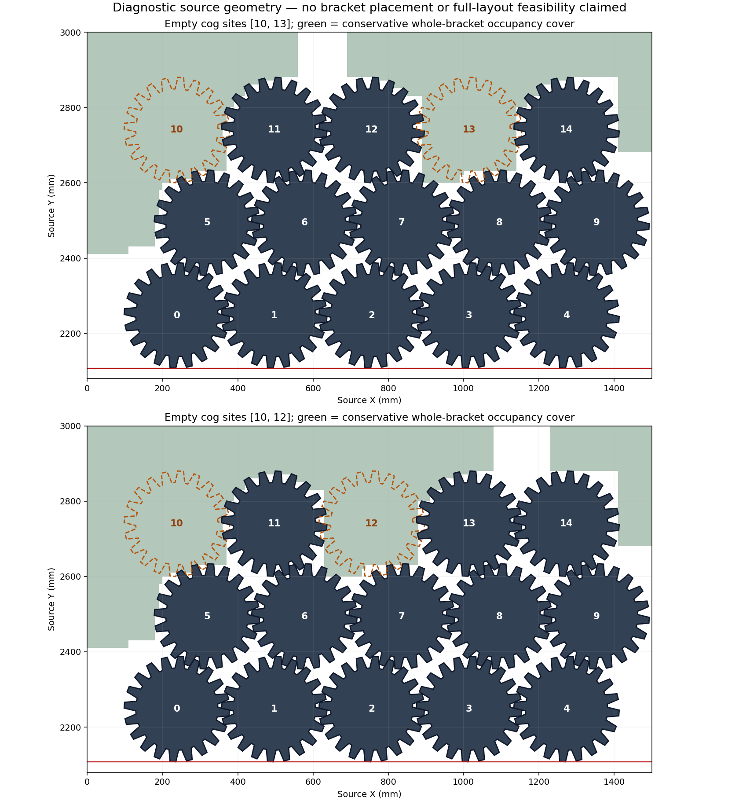

# Local-coordinate source construction and component halfspace bounds

2026-10-29. H5 development evidence for `m-mechanical-large-plates`.

A smaller-coefficient construction passed exact geometry and complete model
audits, then finished its single bounded call without an assignment. Its raw LP
overflow counters are zero; other LP diagnostic counters remain. Separately,
independent component halfspace proofs exclude six more fixed cog-site choices,
leaving **29 of the original 105**. These restricted bounds exclude no overall
allocation. The matching first55 and full66 source/native/material validation
remain open, alongside integration and the H5 matrix. H2/H5 remain open at **60%**.

## Conservative local-grid geometry

The construction retains all 13 original movers, all 80 source-mode options,
and the 35 choices left by the preceding audited bounds. It uses a world origin
of (0,2100) mm and a 0.1 mm position grid. For each unchanged convex source-region
hull, its outward edge normal is normalized by its largest absolute component
using exact rational arithmetic, then quantized at scale 10000. Each inequality
is tightened by the exact worst-case quantization error over the local
1500×900 mm envelope, plus 1e-7 mm, before inward integer rounding.

The [geometry audit](h5-local-grid-construction-and-component-halfspaces-20261029/geometry-audit.json) verifies **1116 retained hulls
and 4559 integer plane implications**. It checks that all 527 removed hulls
require an empty-site set incompatible with every remaining choice. The maximum
integer plane activity is **239205000**, compared with 3354101557500000 in the
earlier absolute-coordinate encoding. The largest normal-error allowance is
0.074751924 mm; minimum certified inset after rounding is 1.060968905e-7 mm.
This encoding is a conservative positive construction, not a globally equivalent
replacement for continuous source geometry.

All 12 family modes retain their original affine transforms. Their stock domains
round inward on the new grid. The 20 mode-component rectangles round outward,
with padding below 0.1 mm; different-owner rectangles require 0.3 mm axis clearance.
The earlier exact source partitions and source-support proofs remain bound inputs.

## Complete model and closed call

The [model audit](h5-local-grid-construction-and-component-halfspaces-20261029/model-audit.json) checks every field of **8336 variables /
43571 constraints**, including 80 source-mode selectors, 15 site flags, 7403 unary
selectors, 30208 guarded unary planes, 11568 site-mask implications, 70 forbidden
site-pair rows, 544 rigid coordinate equalities and 183 rectangle separation
pairs. All 35 remaining site choices and all original identities remain present.
Binary and text models agree. No objective or hint is supplied.

The initial builder-generator failure and the subsequent missing-file invocation
opened no model or solver. The distinct corrected generator and the failed
original are retained in the [correction record](h5-local-grid-construction-and-component-halfspaces-20261029/preparation-corrections.json)
and raw archive. Geometry and complete model audits passed before the only call.

The [response audit](h5-local-grid-construction-and-component-halfspaces-20261029/response-audit.json) verifies 5507 recursive input
bindings, the raw response, parameters, absence of an assignment and all timings.
The call returns **UNKNOWN**, with **33140 branches / 770 conflicts**, no incumbent
and no source checker or native validator call. It uses four workers, seed zero,
default presolve/LP, and disables the `fj` subsolver. It is closed and is not
restarted, extended or reseeded. UNKNOWN does not establish infeasibility.

| Timing | Seconds |
|---|---:|
| Charged preparation |32.862712|
| Allocated solve slice |22.401802|
| Returned solve time |22.702092|
| Preserved solve-slice overrun |0.300290|
| Preparation-inclusive algorithm time |56.313912|
| Preparation-inclusive shared time |56.388191|

Preparation includes the validshort11's 22.247810-second shared construction,
source masks, original integer preparation needed by the area bound, rigid source
components, area and connectivity bounds, local-grid conversion and model build.
The overall 60/90-second budgets pass; the slice overrun remains explicit.

The returned worker reports 24373 LP iterations. Raw diagnostics show zero
Overflow for both default_lp and max_lp, but retain default_lp Bad19 and max_lp
Bad12829, with nine max_lp cut-equality propagations. Zero overflow is not a
placement or feasibility result and does not establish why the search failed.

## Whole-bracket capacity within separate pockets

The existing exact grid covers bound every point a source bracket can occupy for
each fixed cog-site choice. Each connected bracket must lie in one connected
component of that cover. The new preparation assigns every applicable swept
region to its unique component and derives each mode's conservative position
extrema over all those original convex hulls.

For a halfspace above a horizontal or vertical cut, occupied area is monotone in
the corresponding translation coordinate; below a cut it is antitone. Taking
the appropriate extreme for each source mode therefore bounds the material every
bracket must put in that halfspace. Axis-aligned rectangles inset by 1e-6 mm are
proved contained within each original affine component, providing conservative
source-area lower bounds. Dividing the cover's area in the same halfspace by the
minimum required area over all modes bounds the number of whole brackets there.

The [independent halfspace audit](h5-local-grid-construction-and-component-halfspaces-20261029/component-halfspace-audit.json) verifies
all **64 inner-rectangle corners**, **2358 source-region/component assignments**
and **eight strengthened component certificates**. Its separate polygon-clipping
reader recomputes the per-mode material lower bounds, while direct cell counting
recomputes the component-area upper bounds. The summed capacities exclude
**six additional site pairs**, bringing restricted exclusions to 76 and leaving
29. All 35 evaluated choices, including unexcluded outcomes, remain in the
[complete table](h5-local-grid-construction-and-component-halfspaces-20261029/all35-halfspace-bounds.json); the
[29 remaining pairs](h5-local-grid-construction-and-component-halfspaces-20261029/allowed-empty-site-pairs.json) are listed separately.
The proof preparation took 1.185738 seconds, with no cap overrun or solver call.

The following diagnostic plot shows two source cog configurations and their
conservative bracket occupancy covers. It is an illustration, not evidence of
a bracket placement or a complete layout.

The [next preparation](h5-local-grid-construction-and-component-halfspaces-20261029/next-step.json) investigates diagonal halfspace
capacity certificates before another placement model. It retains every choice
without a verified contradiction. Fixed sites, conservative masks and grid
covers restrict these claims; the overall allocation frontier remains 440.

## Preservation and publication

Validshort11 and valid64 retain their original hashes. Production, READMEs,
upstream heads and releases remain unchanged in the
[publication review](h5-local-grid-construction-and-component-halfspaces-20261029/publication-review.json). Stable remains v0.1.0 and
preview remains v0.2.0-alpha.1. H2's original gate and 22 unopened reserved vectors
remain unchanged. No new release qualifies.

The previous checkpoint **8ba6a6db** was normally pushed to main and the working
branch after all six checks on 6a0c7b56 passed; its
[push receipt](h5-local-grid-construction-and-component-halfspaces-20261029/prior-main-push-receipt.json) is retained. At the saved
snapshot, four jobs on [main run 40827161407](https://github.com/skulitom/Nestbolt/actions/runs/40827161407)
pass and both platform checks are running. Another push requires fresh all-six-pass
evidence, unchanged remote heads and no live main run; no check is cancelled.

The archive preserves **4784 canonical members**, **882 byte-identical
aliases** and **57986634 ZIP bytes**. Its verifier checks archive integrity, member
and alias hashes, recursive bound inputs, JSON data and every local report link.
