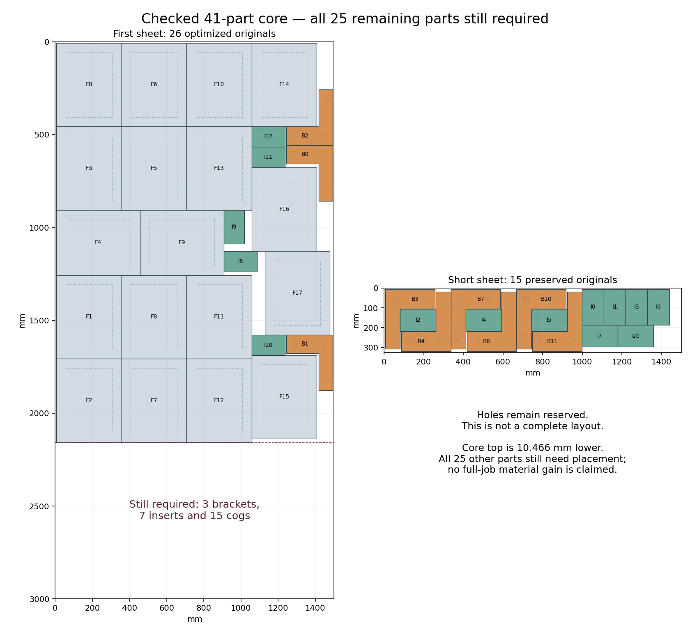

# Mixed-core compaction and exact height bounds — 2026-10-28

A new source-valid mixed core is **10.466 mm shorter**. Exact section-weight
certificates also rule out simply adding the two missing brackets to the old
source64 lower core without raising its top. These are partial constructions
and scoped core-height bounds. H2/H5 remain open at **60% completed milestone
weight**; no full 66-part placement or H5 material result follows.

## Core optimization and source readback

The new model moves all 18 frames, three L brackets and five inserts independently.
It retains all four frame/insert quarter turns and all eight bracket quarter /
mirror modes. The actual short15 layout remains exact. All 25 remaining originals
are explicitly listed. The unchanged stock, source gap, margin and material target
apply; part-in-hole remains off as required by the plan.

Each full source outer is expanded by 112 µm, then its union is partitioned into
rectangles with disjoint interiors. This preserves the complete L shape without
creating collisions between overlapping padded pieces of the same bracket.
Independent readback verifies all 16 source/expanded mode unions and the complete
valid initial core, including 325 expanded original-pair checks. The complete
model audit covers **169 variables, 564 constraints, 52 independent coordinates,
116 legal mode options, 140 expanded component options and every hint value**.

The sole 60-second, four-worker optimization returns **FEASIBLE**, with seven
incumbents. The final top is **2,157.409 mm**, down from 2,167.875 mm. Solver time
is 60.046240 s, returned time 60.047559 s and shared time 60.831537 s. The returned
soft overrun of **0.047559 s** is retained. Its solver bound is 2,062.452 mm;
the result is not a proven optimum. Returned protobuf branch/conflict counters
are zero, which does not mean the worker portfolio performed no search.

All seven incumbents and the final assignment pass the independent model reader,
including 406 expanded component pairs per assignment. Every incumbent and the
final layout also pass original-source readback. Each includes 41 originals,
**430 same-sheet pairs, 164 stock edges and all 59 holes / 5,074 hole vertices**.
Final minimum source gap is 0.224 mm and extra stock clearance is 0.013 mm.
The earlier valid64 is preserved; this smaller core is not a better full partial
count. No native call is made.

## Changed placement regions

All eleven source-mode free regions are rebuilt against the new 26 first-sheet
poses. Independent source geometry checks cover 286 neighbour relations and
3,920 Minkowski hulls. The cog-anchor region grows by **1,354.085730 mm²**, about
**0.20%**. It gains 1,744.991891 mm² but loses 390.906160 mm²; lower maximum height
does not preserve every old position. Bracket/insert regions likewise have both
additions and removals. These modest changes do not justify blindly repeating
the closed 25-mover search.

## Exact section-weight bounds

Three bounded linear programs propose weights for source-contained rectangular
sections. Their floating results are not used as proof. Each proposal is converted
to exact rational weights and normalized by the exact maximum feasible section
weight. A separate reader reconstructs every legal source quarter/mirror mode,
checks 24 contained rectangles against 128 exact source edges, independently
enumerates all **11,741 section-count patterns**, and verifies every rational sum.
Each bracket's two rectangles have disjoint Y spans, so at most one component
from that original appears at a horizontal section. Integrating these section
weights gives necessary bounds for arbitrary independent core positions.

| Core composition | Patterns | Necessary minimum top |
| --- | ---: | ---: |
| 18 frames, 3 brackets, 5 inserts | 2,369 | 2,113.619939 mm |
| 18 frames, 2 brackets, 11 inserts | 1,827 | 2,144.593263 mm |
| 18 frames, 6 brackets, 12 inserts | 7,545 | 2,249.796028 mm |

The second composition is the source64 frame/insert core with its two missing
brackets added. It **cannot fit within the old 2,107.65 mm core height**, even
with arbitrary repositioning and every legal turn/mirror: the minimum exceeds
that height by **36.943263 mm**. This excludes that particular lower-core repair,
not the full job. Cogs and upper inserts would also need a changed arrangement.

The first certificate leaves at most 43.789061 mm of further height reduction
for the new mixed26 core. The third covers every first-sheet non-cog under the
actual short6/9 allocation. If all cogs were placed in a wholly separate band
above those non-cogs, only about **743.481 mm** could remain after the original
stock guard and source gap. The existing 772.329 mm cog packet cannot simply be
stacked above that core. Interleaved full layouts remain possible; no full66,
free-angle cog or count-frontier exclusion is claimed.

The next investigation therefore targets cog-packet height with independently
movable source coordinates and a height objective, beginning with the audited
phase7 constructive subset. Review the earlier fixed triangular/oblique attempts,
build and audit a fully valid positive control, and declare a new bounded call
only after checking the entire model. Existing closed calls remain closed. A
useful packet still requires all complementary originals, full66 source/native
validation and material evidence before integration or a new H5 matrix.

## Publication state

The previous two checkpoints were normally pushed to main and the working branch
as **2adfa569**, after all six jobs on d71c9c85 passed. The receipt is archived.
At this review CI 40735870933 has four passing jobs; Ubuntu and Windows checks
remain live. Wait for all six plus fresh remote guards before the next push.
Production and all READMEs remain unchanged. Sparrow stays 6f7b9d35 / v0.3.0;
Studio stays c0bb9e86 with no release. No stop rule fires. The 444-count frontier,
H2 gate and all 22 unopened reserved vectors are unchanged. No release qualifies.

Evidence: [complete model](h5-mixed-core-height-and-section-bounds-20261028/model-audit.json),
[response](h5-mixed-core-height-and-section-bounds-20261028/response-audit.json),
[source readback](h5-mixed-core-height-and-section-bounds-20261028/source-audit.json),
[region comparison](h5-mixed-core-height-and-section-bounds-20261028/free-region-comparisons.json),
[exact height certificates](h5-mixed-core-height-and-section-bounds-20261028/section-bound-audit.json),
[proof](h5-mixed-core-height-and-section-bounds-20261028/height-bound-proof.json),
[next step](h5-mixed-core-height-and-section-bounds-20261028/next-step.json),
[raw manifest](h5-mixed-core-height-and-section-bounds-20261028/raw-manifest.json).
The archive retains 131 canonical files and
71 identical-byte aliases in 536,773
compressed bytes, including every incumbent, both plot versions, all original
inputs, closed call records and exact pattern/weight certificates.
