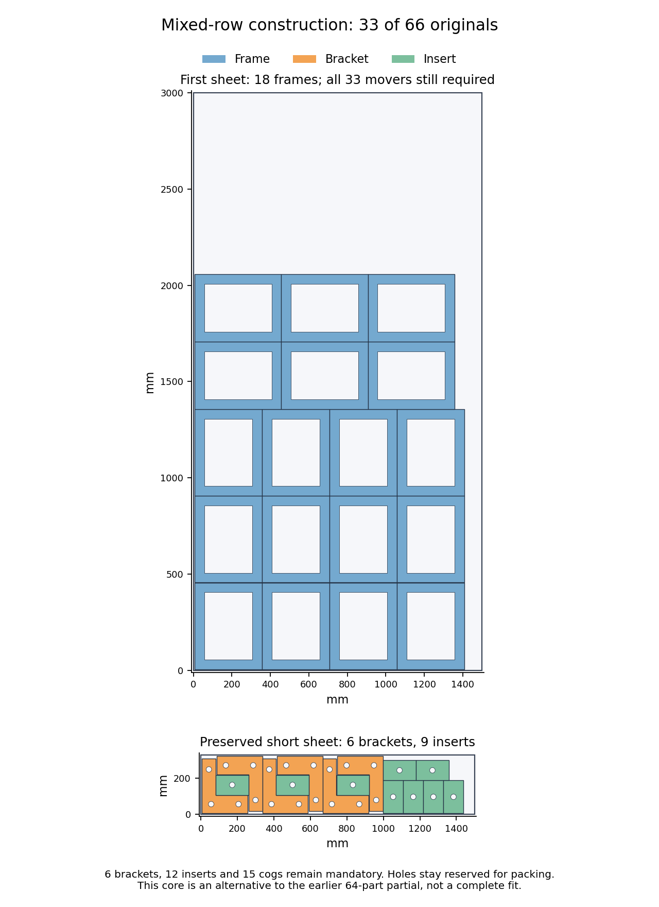

# H5: mixed frame rows and complete source contacts — 2026-10-26

**A changed frame arrangement and a fresh joint search remain unresolved.**
The original geometry, complete conflict graph and exact required quantities
pass independent audits. The one bounded call returns UNKNOWN; there is no
complete layout, exclusion or new release qualification. H2/H5 remain open
at 60% by completed gate weights.

## Changed core

Twelve quarter-turned frames occupy four columns by three rows, followed by
six unturned frames in three columns by two rows. Their top is 2,057.425 mm.
Keep the checked short sheet's six brackets and nine inserts exactly. The
remaining **six brackets, twelve inserts and fifteen cogs** are all mandatory
on the first sheet. No quantity is dropped and no old fixed-owner exclusion
is transferred.

The independent readback verifies all 33 fixed originals, **258 same-sheet
pairs, 132 stock edges and 45 cutouts with 3,366 vertices**. Minimum pair gap is
0.225 mm; minimum extra stock margin is 0.025 mm. All eighteen first-sheet
anchors are checked against rational construction formulas. A comparison with
29 historical frame groups finds no identical sorted sheet/bounds arrangement
at 0.000001 mm precision. This does not establish a globally new topology or
an improved partial score. The lower side strip is narrower than the wide-row
alternative. Both older 64-original partials remain preserved.

## Actual-source contact pool

The new pool has **2,200 cog, 1,000 bracket and 1,000 insert poses**. Its declared
finite orientations are four cog phases (0°, 4.5°, 9°, 13.5°), all eight allowed
bracket rotation/mirror modes, and two insert outer-orientation classes.

Fourteen fixed-obstacle queries seed placements. A table of 384 checked
source-cog contacts extends independent centers to depth three. Forty contact
queries around 64 spatially spread cog parents provide noncog poses; a separate
100-query stage around 64 stratified bracket/insert parents adds mutual contacts.
This permits bracket pairs and inserts to touch without requiring common cog
rows, pitch or phase. Generation takes **5.437320 seconds**.

Before counting a contact toward any quota, the generator rejects obstacle
interior representatives and checks actual distance from the generating parent.
It rejects **1,280 interior proposals**. All accepted contact-parent links pass
the independent source check. The resulting provenance counts are 247 fixed
seeds, 2,139 cog contacts, 714 contacts around cogs and 1,100 mutual contacts.
Finite caps, 25 mm spatial bins, omitted proposals and unfinished queues remain
recorded; no continuous or arbitrary-angle coverage is asserted.

## Complete graph and exact model

Independent reconstruction checks **75,600 fixed-original pairs, 16,800 stock
edges and all 8,817,900 candidate pairs**, reproducing **1,998,405 conflicts**.
The minimum candidate/fixed gap is 0.221851 mm and extra stock margin 0.012600 mm,
both above their native guards.

The initial graph builder takes 64.856107 seconds. Its reported cover stage,
including saved residual bookkeeping, takes 22.961423 seconds against a
20-second loop allowance; this overrun is retained. It leaves 794,682 explicit
edges after 112 cliques. A separate first-bit bitset extension compresses the
same graph into **25,736 verified cliques**, with zero residual edges, in
0.862628 seconds of cover work and 1.371304 seconds including output. No candidate
or conflict is removed. The original cover and graph bytes remain archived.

The model contains **4,200 Boolean variables and 25,739 constraints**: exact
family counts 6/12/15 plus the complete conflict cover, with no objective or
hints. Independent protocol reconstruction and solver import/export pass.

## Closed result and evidence

The sole 60-second call, inside 90 shared seconds, returns **UNKNOWN** after
search. Internal time is **60.066062 seconds**, returned-call time **60.071975
seconds**, and shared time **61.044539 seconds**. The 0.071975-second returned
soft overrun is preserved. The returned worker reports 175,799 branches and
1,184 conflicts; separate worker statistics are archived. No assignment is
returned. The call is closed, without retry, reseeding or extension.

All four independent audits pass. One initial response-checker failure is kept:
it assumed finer precision than the solver's printed walltime. The repaired
reader uses the printed decimal precision and verifies the unchanged response;
the search is not rerun. No native call or full quality run is justified by
this unresolved result.

At 2026-10-26T17:33:38.007783+00:00, **5 of six** checks on
[main e158daa2](https://github.com/skulitom/Nestbolt/actions/runs/40365489221)
have succeeded. The next push must wait for all six. Production, READMEs,
upstream heads/releases and all 22 reserved H2 vectors remain unchanged.
H2 retains its original gate. A complete 66-original source/native/material
witness is still required before integration and the complete H5 matrix.

[Checks](h5-mixed-rows-source-contacts-20261026/checks.json), [core](h5-mixed-rows-source-contacts-20261026/core-checks.json),
[source graph](h5-mixed-rows-source-contacts-20261026/source-graph-checks.json), [model](h5-mixed-rows-source-contacts-20261026/model-checks.json),
[response](h5-mixed-rows-source-contacts-20261026/response-checks.json), [inventory](h5-mixed-rows-source-contacts-20261026/all66-inventory.json),
[scope](h5-mixed-rows-source-contacts-20261026/scope.json), [next step](h5-mixed-rows-source-contacts-20261026/next-step.json),
and [raw manifest](h5-mixed-rows-source-contacts-20261026/raw-manifest.json).
The archive verifies 235 canonical files and
26 aliases by bytes, SHA-256 and CRC.
