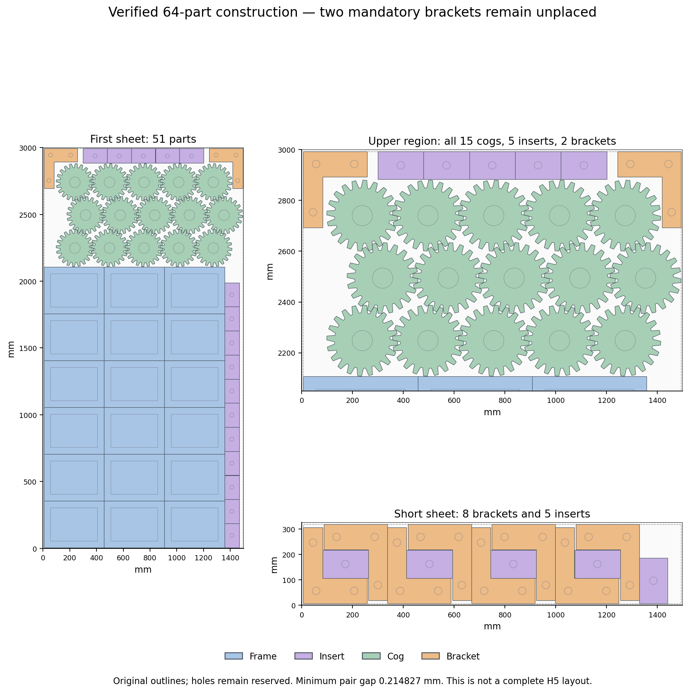

# Original-source oblique cog construction — 2026-10-28

The new construction independently validates **64 of 66 original parts**, including
all15 cogs and all21 inserts. Bracket copies10/11 remain mandatory and unplaced.
It does not satisfy H5. A subsequent joint66 construction stops at a local minimum
and fails independent source readback; that failure is preserved in full.

## Finite source-contact scan

The declared36 phases (0° through17.5° by0.5°), all1,296 ordered pairs, and
directions0°/72°/108° yield3,888 contact cases and93,312 distance evaluations.
The original80-vertex outline has the origin in its star kernel. Every ray's
outward contact is bracketed on240–281mm with20 bisections; no tooth symmetry is
assumed to skip cases. The independent reader checks all80 exact kernel edges,
all7,776 bracket-end distances and all666 complete ranked phase pairs.
The best complete pair is7°/7°, with258.86mm conservative neighbor pitch.
The scan completes in2.786448 seconds,3.730314 shared seconds, within60/90 limits.
This finite construction does not exclude any unsampled phase or prove optimality.

## Valid source64

The15 original cogs form five columns and three alternating-offset rows:
79.992139mm row offset and246.190490mm row height. Their actual packet is
1,395.380539×772.329379mm. All42 prior core originals are unchanged. Five remaining
horizontal inserts and two top-corner brackets complete the64-part construction.
First-sheet counts are18 frames,16 inserts,15 cogs and2 brackets; the short sheet
retains8 brackets and5 inserts. The target stock bounds and PIH-off reservation
of filled outer outlines are unchanged.

Independent readback checks1,353 same-sheet source pairs,256 stock edges,
84 cutouts and9,294 hole vertices. There are **zero pair or stock failures**:
minimum pair gap0.2148269833mm exceeds the required0.2117086725mm, and the
minimum extra stock0.025mm exceeds the0.0114440918mm native guard. This check
uses original rings directly, independently of the contact scan and optimizer.

## Anchor pockets and the unsuccessful joint66

Source configuration obstacles give no positive-area bracket construction pocket
with the64 poses fixed. Removing the two top brackets and five top inserts yields
two bracket modes with pockets and two insert modes. All18 cached region results
are rebuilt from world-space original polygons; maximum difference area is
2.65e-11mm². All five positive representative poses pass direct source checks.
The clearance buffer and positive construction margin are conservative, so empty
regions are **not** an original-source impossibility proof.

One materially new neighborhood retains the49 valid noncog poses, frees all15
phase7 cog centers and both missing brackets, and permits all eight bracket modes.
The initial cogs are exactly the verified64 poses. Preflight checks all9 source
modes,729 source-obstacle samples,9 free-region representatives and34 objective
gradient components (maximum error4.57e-6). All66 source identities are accounted
for; the initial complete candidate has3 source-pair failures and no stock failure.

The single call returns `LOCAL_STATIONARY` after128 objective evaluations,
two positional stages and one mode change:0.046184 search/2.960379 shared seconds,
within the60/90 ceilings. It is closed without retry or restart. Independent
readback of its best penalty result checks all66 originals,1,456 source pairs,
264 stock edges,90 holes and10,026 hole vertices. It finds **33 pair failures and
2 stock failures**. Lower penalty is not source validity. This result proves
neither unrestricted infeasibility nor a fixed-arrangement exclusion. No native
validator, production change or full-quality rerun follows it.

## Publication and remaining work

The reconciled previous checkpoint is on main at `f4f6f1fe`; its14 upstream
layered-kit example files are preserved. At this checkpoint,
[its own CI](https://github.com/skulitom/Nestbolt/actions/runs/40668367016)
has five successful jobs and the Windows checks still running. Preserve that run
and wait for all six successes before the next normal main push. Production,
README files, Sparrow/Studio heads and releases are unchanged.

H2/H5 remain open at **60% completed milestone weight**. The22 reserved H2 vectors
remain unopened. This work provides a valid partial construction and a rejected
complete candidate, with no H5 credit or new release. Next seek a different cog
row structure or a change to the surrounding noncog arrangement; preserve all66
quantities, clearances and the original material target.

[Source64 checks](h5-oblique-source-construction-20261028/source64-checks.json),
[pocket checks](h5-oblique-source-construction-20261028/pocket-checks.json),
[joint preflight](h5-oblique-source-construction-20261028/joint-preflight-checks.json),
[joint source failure](h5-oblique-source-construction-20261028/joint-source-checks.json),
[publication review](h5-oblique-source-construction-20261028/publication-review.json),
[next step](h5-oblique-source-construction-20261028/next-step.json),
[byte-verified complete archive](h5-oblique-source-construction-20261028/raw-manifest.json).
The archive holds148 canonical files plus100
exact-byte aliases (763,122 compressed bytes), including plans,
source inputs, scripts, all contacts, successful/failed readbacks and the prior
main-push receipt.
