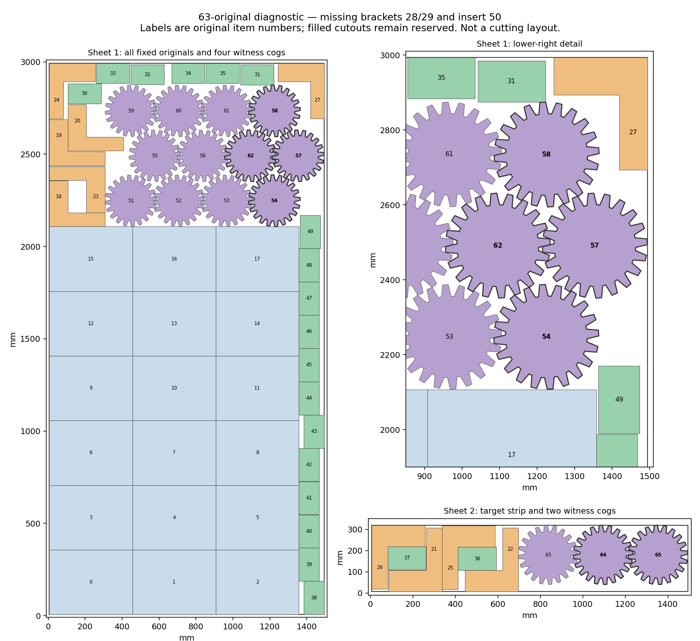

# H5: one-sided directions and restored conflicts — 2026-10-26

**Both distinct searches return UNKNOWN.** No full layout or impossibility
proof is obtained. H2/H5 remain open at **60%** completed milestone weight.
All 66 originals remain mandatory, with nine movable and 57 fixed in the
recorded source construction. Geometry, native guards and target are unchanged.

| Representation | Variables | Constraints | Solver / total seconds | Soft-limit overrun |
|---|---:|---:|---:|---:|
| one-sided | 111,710 | 164,254 | 45.486188 / 47.741708 | 0.486188 |
| conflict-propagated | 115,105 | 172,140 | 45.358075 / 48.140666 | 0.358075 |

## Exact one-sided representation

Remove the 101,455 false-flag complement definitions from the previously
verified shared-direction model. Keep every positive flag-implies-plane
definition, face OR, original base, 14 area constraints and 72 hints.
The independent occurrence audit checks all 101,455 definitions and 158,717
positive OR occurrences; no negative or arithmetic use of a shared flag remains.

Every parent solution satisfies the child. Conversely, complete any child
solution by setting each shared flag to its exact plane truth. Already true
flags remain true; only false-to-true changes occur. Positive ORs remain satisfied,
and each newly enabled plane is true. The removed complements then hold too.
This proves the same feasible projection within the source construction.
The complete parent is restored exactly and actual solver import/export matches.

## Restored whole-domain conflicts

The earlier table-free projection removed a necessary domain-conflict table
to reduce overhead. Restore that independently proved table beside the compact
one-sided source model: **5,561,575 unique conflicts**, representing **24,091,856**
physical uses, with only **3,395** additional Booleans and **7,886** constraints.
These cover all families and all 164 query cases, not only cog/cog pairs.

The independent reader checks all **8,449,813** matrix bits and every row
partition, reconstructs the 394 physical mode uses from the original inventory,
verifies domain-variable ordering, and rebuilds all 4,491 nonzero groups.
A group flag equals the sum of mutually exclusive A-domain flags. Its exclusion
against the listed B-domain flags implements exactly the saved pair conflicts.
The entire compact parent is retained and actual solver import/export matches.
No fresh geometric exclusion is inferred.

Both calls use eight workers, seed zero, a 45-second soft solver limit and
60 shared seconds with a ten-second shutdown reserve. Their **0.486188s** and
**0.358075s** soft-limit overruns are retained; both total budgets pass.
They are closed: no restart, extension or reseed. Neither produces a candidate
for original-geometry or native validation. Preparation and audits remain offline
diagnostics, not production-budget qualification.

## Broader geometric neighborhood

The visual inspection reconstructs the already audited **63-original partial**,
missing brackets 28/29 and insert 50. Filled cutouts stay reserved. It is not
a cutting layout. Among 200 first-sheet witness/fixed pairs, fixed cogs
**53, 56 and 61** border the movable cog cluster at approximately **0.213–0.238 mm**.
Frame 17 and insert 31 also border it. Distances identify neighbors; they do not
prove that moving any neighbor will supply a complete layout.

Next prepare fresh geometry with cogs 53/56/61 additionally movable: **12
mandatory movers and 54 fixed originals**. Preserve their original source angles
initially, all counts, original outlines/cutouts, guards and the target.
The fixed57 domain tables, area bounds and conditional capacities cannot be
transferred unchanged. Recompute and independently audit the expanded regions,
and verify that the prior partial remains representable before deciding a new
bounded construction. All completed calls remain closed.

A complete native-valid target, production integration and the full
13-job/two-kerf H5 matrix remain required. H2 keeps its original gate and all
22 reserved vectors untouched. Production and READMEs are unchanged; no new
release is qualified. Preview v0.2.0-alpha.1 and stable v0.1.0 remain appropriate.

All **six** jobs on [main CI 40252355666](https://github.com/skulitom/Nestbolt/actions/runs/40252355666)
now pass for **68c82ae1**. Upstream Sparrow/Studio state is unchanged. This
checkpoint and queued **7c5b8b28** are ready for a normal main push after fresh
ancestry and remote-ref verification.

Evidence: [comparison](h5-one-sided-conflict-propagation-20261026/comparison.json),
[one-sided proof](h5-one-sided-conflict-propagation-20261026/one-sided-equivalence-proof.json),
[conflict proof](h5-one-sided-conflict-propagation-20261026/restored-conflict-proof.json),
[neighborhood inspection](h5-one-sided-conflict-propagation-20261026/neighborhood-inspection.json),
[checks](h5-one-sided-conflict-propagation-20261026/checks.json), and [raw manifest](h5-one-sided-conflict-propagation-20261026/raw-manifest.json).
**805** canonical files and **138**
exact-content aliases are size/SHA-256/CRC verified in **1**
independently readable archive part(s).
