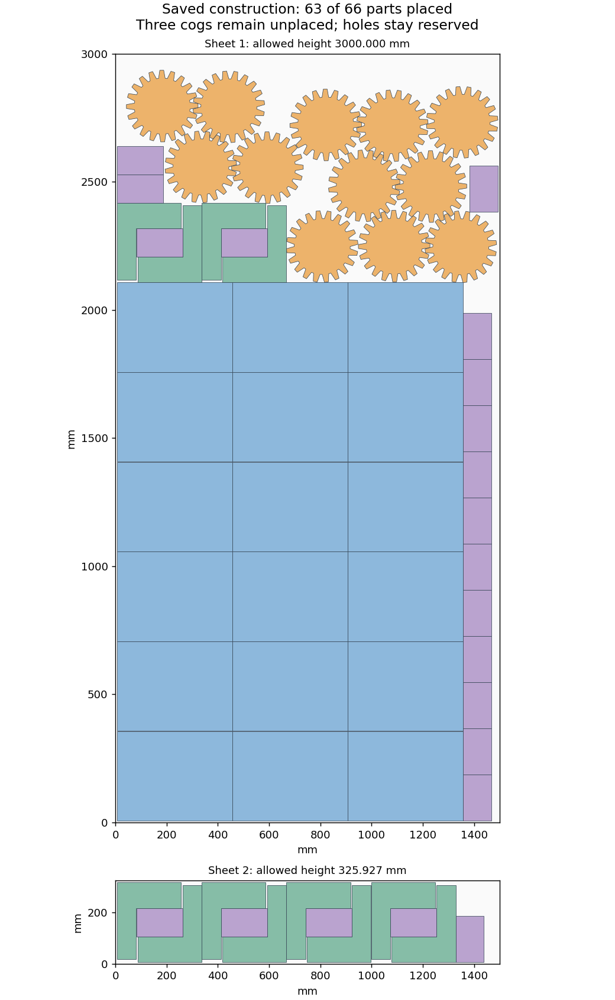

# Actual-outline construction and backfill — 2026-10-18

The [mixed-pattern diagnosis](h5-pattern-construction-20261018.md) tested enclosing
rectangles. This follow-up places the actual filled outer contours, using the same
four saved development jobs and unchanged stock/material targets. A six-state
constructive beam tests mixed and single-part inventories, four ordering heuristics,
three distinct contact points per orientation/sheet, quarter-turn compound rotation
and 15-degree free single-part angles. Every candidate addition keeps original
geometry and checks actual clearance. This is offline geometry work on CCD1;
no Nestbolt search or quality/timing comparison is rerun.

The two large-plate cases finish all eight ordering attempts without a full layout.
Both panel cases reach the explicit 120-second diagnostic ceiling during their
seventh attempt; those interruptions and skipped final orders are retained. The
ceiling does not change any runtime or H5 budget. All **159,819 candidate additions**
and **4,656,855** cross-part pairs replay from original-source vertices.

The fixed ordering stops at its first unplaceable part. A separate continuation
keeps every placed pose exact, ungroups missing compound copies, includes permitted
mirrors, and tries smaller remaining families when a larger family has no location.
It adds **74 parts** across 573 considered additions and 30,777
cross-part checks. Final partial outcomes are:

| Saved case | Parts placed | Still missing | Missing filled area (mm²) |
| --- | ---: | --- | ---: |
| large-plates-k0.2 | 63/66 | 3 cog | 150,188.157 |
| large-plates-k1.5 | 58/66 | 1 bracket, 7 insert | 178,600.000 |
| panel-hardware-k0.2 | 147/178 | 5 cog, 26 insert | 275,374.459 |
| panel-hardware-k1.5 | 146/178 | 2 bracket, 30 insert | 242,640.000 |

**No complete target layout is found.** All eight saved beam/backfill outputs are
submitted to the original public library/request validator. It rejects each with
exactly the expected quantity violations and no geometry violations. Independent
all-pair checks of the saved outputs cover 22,764 additional
pairs; every hole stays reserved at the unchanged 1e-7 mm clearance tolerance.
Geometrically legal partial layouts do not satisfy the original quantity gate.

The first audit incorrectly expected metrics on a rejected incomplete layout and
stopped on `metrics: null`. Its failure, source and rejection are preserved. The
corrected audit checks the exact quantity rejections, reuses that first validator
output byte-for-byte and verifies all candidates independently. No packing search
is repeated. All 147 raw archive members, CRCs and byte hashes verify.

[Checks](h5-outline-construction-20261018/checks.json),
[raw attempts, partial layouts and validator output](h5-outline-construction-20261018/raw.zip),
[manifest](h5-outline-construction-20261018/raw-manifest.json),
[audit recovery](h5-outline-construction-20261018/audit-recovery.json),
[source review and next investigation](h5-outline-construction-20261018/source-review.json).

The closest saved construction places 63/66 large-plate parts and is missing three cogs; all four still fail the original quantity requirement. Do not integrate the constructor or run another quality pilot. The current diagnosis keeps every placed neighbour fixed during backfill, so it cannot resolve the remaining obstructions through collective movement. Next prepare an isolated real-job witness using the existing joint_repair_pair helper on these saved layouts, with all original quantities restored in explicitly overlapping provisional poses and both original target containers enforced. First measure model conversion/collision loss separately: these physical-geometry placements have only 0.0011 mm extra separation, while native conversion_guard is 0.011444091796875 mm / 0.0095367431640625 mm for these stocks. Do not assume that independently legal partial geometry starts with zero native proxy loss or shrink that guard. Preserve provisional overlaps and every failed/expired repair. Use the existing authored witness allowance and seed as a mechanism test, not a changed H5 budget or quality comparison. Only a fully populated result that passes original library/request, filled-outer and exact target-material checks can establish feasibility. Production budgets, four-step repair cap, hole reservation, material limits and held-out isolation remain unchanged.

H2/H5 remain open at **60%**. Production, release assets and all three READMEs
remain unchanged; this creates no new release candidate.
