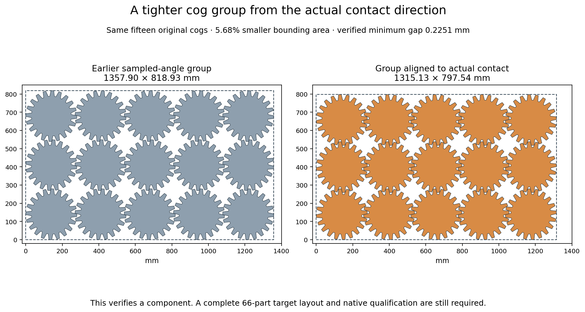

# H5: actual-outline search, reusable exclusions and contact direction — 2026-10-18

**A better cog component is verified; no complete target layout is established.**
Choosing the global rotation from an actual contact boundary yields a 15-cog
rectangle **5.6804% smaller** than the earlier sampled-angle component, with
all original gaps above 0.225 mm. This is a component bounding-area result,
not whole-job material savings. The earlier 63/66 partial remains the best
retained whole-job partial. H2/H5 remain open at **60%**.

## Controlled propagation check

Following the [ragged-pocket study](h5-ragged-pockets-20261018.md), one controlled
run enables the installed cumulative, energetic and area-energetic NoOverlap2D
flags. Independent parsing confirms that **only those three flags** change.
The saved normal-coordinate model is byte-identical, as are the original
inputs, integer domains, inventory and material target. Seed 0, eight offline
CCD1 workers and the 120-second limit remain fixed. The result is **UNKNOWN**
after **120.322155 seconds**, returning no complete selection.
The unsuccessful result is retained; no parameter sweep follows.

## Actual outlines and repeated geometry work

The next construction uses actual unions of filled-outer exclusions for rigid
groups and remaining parts. All **six** original-inventory recipes are included,
including the two previously excluded by their enclosing rectangles' area.
Each has a separately declared twenty-second search ceiling. The original
construction tries frame-first, mixed-first and cog-first family orders, with
eight retained states, three contacts per orientation and diversity in leading
group orientation and second-sheet allocation. Source cog rotations are sampled
only for this finite diagnostic; original free-rotation permission is unchanged.

The first recipe consumes its allowance after only two component placements.
Inspection finds that translated repetitions of the same cog recompute primitive
geometry. A fresh implementation caches each exact unrounded rotation/reflection
pair at zero translation, translates its obstacle by the difference of member
translations, then unions the compound terms. Every accepted candidate still
passes direct original-outline distance and stock checks. No shape, tolerance,
recipe, fixed order, contact count or per-recipe ceiling changes.

The geometric identity is `(A+a)−(B+b)=(A−B)+(a−b)`. All **336** cached primitive
obstacles recompute identically, with zero Hausdorff and symmetric-difference
area error; **7,369** compound translation terms are checked against their
original members. The union outputs are not separately serialized; their exact
term provenance and every retained layout are preserved. All eighteen fixed-order
searches now finish within their individual allowances. This is a local diagnostic
observation, not a native-speed or quality claim.

A separately recorded adaptive construction preloads the audited primitives,
branches over every remaining component kind, and retains sixteen states with
orientation and last-kind diversity. The same twenty-second ceiling applies to
each recipe. Its broad enumeration expires at depths **19–22 of 33–44**, returning
less filled area. Its **391** final primitive obstacles and **8,341** translated
terms also audit exactly. This failed direction is retained, not presented as
an improvement or repeated with a longer allowance.

| Construction | Orders/inventory roots attempted | Candidate events | Recipes expired | Greatest filled-area partial | Filled area, mm² |
| --- | ---: | ---: | ---: | ---: | ---: |
| Original compound exclusions | 14 | 14,649 | 4/6 | 57/66 | 4014527.189 |
| Cached primitive exclusions | 18 | 23,952 | 0/6 | 50/66 | 4074152.627 |
| Adaptive remaining-inventory ordering | 6 | 104,520 | 6/6 | 41/66 | 2944927.189 |

The original construction records soft-cap overruns explicitly, including
**21.193015 seconds** for its first recipe; it is not rounded down to twenty.
Across the three constructions, independent audits reconstruct all retained
states from their candidate parents, original component transforms and actual
inventory consumption. Retained-layout pair checks total **30,621**; all original
orientations, stock bounds and the unchanged material target pass. The frozen
public CLI rejects every best partial for missing quantities, with an additional
empty-second-sheet failure in the short original first recipe. Rejected candidate
geometry is not claimed to have been exhaustively independently audited.

The first audit incorrectly expected quantity-only errors and stopped at that
legitimate empty-sheet error. Its source, failure and original CLI output remain.
A fresh audit reuses that output under exact hashes and validates the remaining
partials once. An assumed return-code field in the first recovery record is
preserved and superseded by **null/unknown**: the original failed auditor did not
save the CLI return code. No layout or validator result is altered or accepted.

## Contact direction explains a tighter component

The earlier checkerboard varied offsets between alternating parity classes and
sampled global angles. A saved tight two-cog contact has a small nonzero vertical
centre offset. Aligning that **directed** contact to the grid axis rotates both
cogs together and avoids imposing the worse opposite-slope contact.

A predeclared probe checks exactly three saved pairs, with a fixed positive
centre-distance increment. All three 15-cog patches pass their **315** original
pair checks. Their minimum gap is only about **0.20893 mm**, so this initial
probe is not native-margin qualification.

A second, separately declared construction uses conservative **0.225 mm** spacing
and scans **36 relative phases**, in half-degree steps. It projects the origin
onto every exterior segment of each actual filled-outer Minkowski obstacle,
chooses the closest contact direction, rotates both orientations together, and
derives the pitch from all four axis intersections. No rotational symmetry is
assumed. Nine patch sizes/aspects per phase produce **324 valid components** in
**25.397765 seconds**, below its 120-second generation cap.

Independent nearest-boundary queries agree within **5.7×10⁻¹⁴ mm**. Independent
ray intersections in the unrotated obstacles verify the chosen pitches, and
every unrounded member transform is reconstructed. All **13,860** original
component pairs pass, with minimum distance
**0.225123442 mm**.

The best finite 15-cog, five-column group uses identical cog orientations at
**−2.242899602448 radians**, with pitch **258.794244095467 mm**. Its rectangle is
**1,315.126187 × 797.537699 mm**, area **1,048,862.712806 mm²**, versus
**1,112,030.771073 mm²** for the earlier sampled-angle group. The original cogs,
quantities and acceptance rules are unchanged. The 5.6804% rectangle-area saving
does not prove that the full job fits, that common-line quality improved, or that
native geometry qualification passes.

[Checks](h5-outline-contact-direction-20261018/checks.json),
[raw searches, geometry, failures, models, scripts and audits](h5-outline-contact-direction-20261018/raw.zip),
[manifest](h5-outline-contact-direction-20261018/raw-manifest.json),
[next investigation](h5-outline-contact-direction-20261018/source-review.json).
All **365** archive members, CRCs and byte hashes verify. The comparison
figure has been visually inspected.

The tighter original-cog geometry changes the next investigation. Use the verified phase-0 contact-aligned grid from output/h5-minimum-contact-grids-20261018: pitch 258.79424409546664 mm, common angle -2.2428996024478143 radians and actual minimum distance 0.2251234420919754 mm. Its 15-cog rectangle is 1315.1261869914774 by 797.5376988005441 mm, 5.680423591715256% smaller than the earlier sampled-angle group. First construct finite uniform staggered rows from this contact-aligned orientation, including five cogs in every row: the earlier unaligned stagger overhung stock width, but the new smaller horizontal pitch may change that. Predeclare row-offset fractions and derive vertical pitches from actual same-orientation Minkowski intersections; verify every original pair and original stock width. Then attempt the complete original 66-part job with the new square/staggered components and all three retained aspect variants of the two-bracket/one-insert pattern, allowing different variants among the six bracket groups rather than forcing the smallest-area one everywhere. Preserve stock, margins, quantity, allowed rotations and the original material target. Do not repeat unchanged propagation flags or fixed/adaptive beams: the broad adaptive enumeration timed out at only 19-22 of 33-44 component depths and was not an improvement. The primitive-translation cache is available and audited for future actual-outline construction. Component area savings are not a whole-job quality claim. Only all 66 copies passing frozen original CLI and independent filled-outer target checks form a witness. Native-margin validation, production budgets, the four-step repair cap and full H5 matrix remain required before integration.

The [main f825cab check snapshot](h5-outline-contact-direction-20261018/main-ci-f825cab.json)
records its actual status at sealing; pending jobs are not counted as successes.
Production source, original gate limits, preview release assets and all three
accurate READMEs remain unchanged. No native packing, quality run, production
integration or gate credit is claimed. H2/H5 remain open at **60%**.
