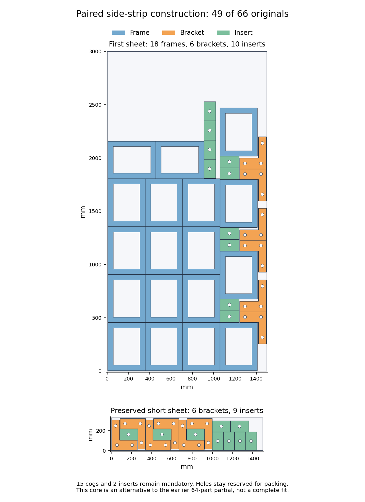

# H5: paired bracket strip and required-clearance capacity — 2026-10-26

**A different checked core places all twelve brackets and nineteen of twenty-one
inserts alongside the eighteen frames.** It accounts for 49 originals across
the two sheets, leaving both inserts and all fifteen cogs mandatory. The strongest
necessary capacity test closes UNKNOWN; there is no complete layout or H5 pass.
H2/H5 remain open at 60% by completed milestone weights.

## Source construction

Preserve the fifteen short-sheet originals. Keep twelve turned frames in the
first three columns and the two adjacent upper unturned frames. Space the fourth
column at 670.675 mm, opening three gaps that each contain two bracket feet and
two inserts. Opposite bracket stems occupy the narrow side strip. Four vertical
inserts fill the opening beside the upper frames. The first sheet now fixes
eighteen frames, six brackets and ten inserts; its highest insert reaches
2,528.325 mm. This taller shape changes the remaining space.

Independent direct-vertex readback verifies **666 filled-outer pairs, 196 stock
edges, 73 cutouts and 6,782 cutout vertices**. Minimum pair clearance is 0.225 mm
against 0.211708673 mm required for native tolerance, with 0.025 mm extra stock
margin. The short sheet is unchanged. All 66 quantities are accounted once and
holes remain reserved. Remaining first-sheet filled demand decreases by
219,000 mm² relative to the preceding staggered core. This is a different starting
arrangement, not an improvement over the preserved 64-original partial count.

## Complete necessary domains

Fresh exact bounds cover every continuous cog center and every original rotation
against the 34 current fixed owners. Forty-six source-contained rectangles pass
184 exact corner checks and 736 interval edge checks. All-angle support exclusions
leave 188 closed grid cells. Refinement against 1,874 fresh fixed source points
retains 325 atoms, merged without gaps into **54 domains** covering
489,155.167020 mm². Unresolved regions remain included.

Split these domains on a 25 mm grid into **1,111 occupancy cells**. The previously
verified all-angle cog separation gives a conservative floor-rounded separation
of 254.297 mm, greater than every cell diameter. Each cell can therefore hold at
most one center. Two cells conflict only if even their farthest corners cannot
meet that separation. Independent enumeration verifies all 616,605 pairs,
**127,947 conflicts** and their complete coverage by **1,815 cliques**. The model
requires fifteen occupied cells. Both inserts are relaxed for this necessary
test only; they remain required for a full layout.

## Three distinct models, each called once

| Necessary model | Added exclusions | Constraints | Status | Returned / shared seconds |
| --- | ---: | ---: | --- | ---: |
| Complete occupancy graph | 0 | 1,816 | OPTIMAL, necessary positive only | 1.220399 / 1.995181 |
| Exact oblique support cuts | 61 | 1,817 | OPTIMAL, necessary positive only | 0.982586 / 1.754775 |
| Required-clearance union cuts | 5 more | 1,818 | UNKNOWN | 20.026862 / 20.772295 |

Every model retains the same 1,111 variables and all fifteen required cogs.
The added models are exactly the independently checked parent plus one zero-sum
exclusion row each, without objectives or hints. All three calls are closed;
there was no retry, reseed or extension. Each had a 20-second solver allowance
inside a 30-second shared-process allowance. The final solver's internal time
was 20.022295 seconds; its internal and returned soft overruns of 0.022295 and
0.026862 seconds are recorded. The shared limit was honored.

The final call advances beyond presolve. Worker branch counts are 17,072 for
`default_lp`, 41,452 for `max_lp` and 279,521 for `no_lp`; the returned response
contains the first worker's 855 conflicts. UNKNOWN proves neither a feasible
selection nor impossibility. No formal unsat certificate is claimed.

## Source samples and exact clearance proof

The first two necessary selections each receive a finite source preflight:
a 3 × 3 grid per cell and 36 actual angles from 0 to 17.5 degrees, plus 54 insert
proposals. No exact rotational symmetry is assumed. Independent readback checks
all **9,828 events**. Two mandatory cog groups are empty in the first preflight,
and one is empty in the second. Consequently no joint source solver is opened.
These sample failures are not continuous-position or all-angle exclusions.

The subsequent cuts instead use separate exact geometric proofs. Twenty-eight
rational unit normals bound an original support vertex for every rotation;
1,288 floor-safe boxes and the original inscribed disk exclude 61 whole cells.
This includes both troublesome cells from the first preflight, independently
of the sampled angles.

The final strengthening uses the original **0.2 mm required clearance**. Expand
each source-contained rectangle by 140 micrometres per axis. Every added point
is within sqrt(2) × 140 < 200 micrometres of a fixed filled outer, so a moving
part cannot enter it under the holes-reserved rule. Exact partitioning gives **833 closed union atoms**, merged
into **24 rectangles** with complete equal-area, disjoint-interior coverage.
The overlaps bridge some 0.225 mm gaps between adjacent parts. These rectangles
describe forbidden clearance regions; the physical artwork is unchanged.

Another 506 support boxes and 1,914 clearance points prove **five additional
whole-cell exclusions**, with exact rounding margins. One is the remaining
empty preflight cell. All **1,045 retained cells** still cover every valid rounded
center for arbitrary original rotations and continuous positions. The independent
audit checks 28,163 atom pairs and 2,024 rounding margins. Sampling failures play
no role in this proof.

## Checkpoint and next work

All **15 audits pass**, with both negative source preflights preserved and no
failed checker attempts. Continue only with a materially changed joint geometry
model, a stronger independent necessary proof, or a different core. Both inserts
and all fifteen cogs remain required. A complete 66-part source/native/material
witness, production integration within 60 seconds, and the full H5 matrix are
still needed.

At 2026-10-26T16:26:21.604121+00:00, [all six main checks](https://github.com/skulitom/Nestbolt/actions/runs/40350260165)
pass on 4e3b316c, permitting a normal checkpoint push. Upstream Sparrow/Studio
heads and releases are unchanged. Production and READMEs are unchanged; no new
release is qualified. H2 retains its original gate and all 22 reserved vectors
remain untouched.

[Checks](h5-paired-strip-clearance-capacity-20261026/checks.json), [source core](h5-paired-strip-clearance-capacity-20261026/core-independent-checks.json),
[clearance proof](h5-paired-strip-clearance-capacity-20261026/clearance-necessity-proof.json),
[clearance audit](h5-paired-strip-clearance-capacity-20261026/clearance-cuts-checks.json),
[model](h5-paired-strip-clearance-capacity-20261026/clearance-model-checks.json),
[response](h5-paired-strip-clearance-capacity-20261026/clearance-response-checks.json), [scope](h5-paired-strip-clearance-capacity-20261026/scope.json),
[next inventory](h5-paired-strip-clearance-capacity-20261026/next-fixed34-neighborhood.json),
[next step](h5-paired-strip-clearance-capacity-20261026/next-step.json), and [raw manifest](h5-paired-strip-clearance-capacity-20261026/raw-manifest.json).
The archive verifies 166 canonical files and
91 aliases by bytes, SHA-256 and CRC.
