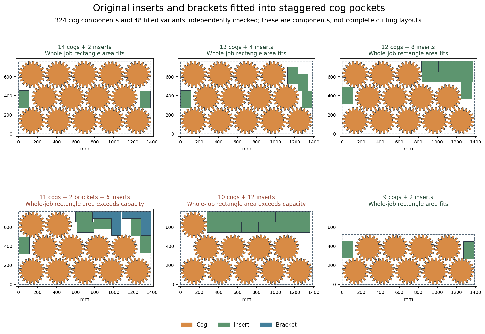

# H5: staggered cog pockets and exact rectangle-domain reductions — 2026-10-18

**The new components validate, but no complete target layout is found.** Three
bounded rectangle searches end UNKNOWN; none proves infeasibility. The earlier
63/66 partial remains better than these component-only results. H5 is open and
completion remains **60%**. This is offline development diagnosis, not a quality
run, production change or new release qualification.

The [previous checkerboard study](h5-cog-lattices-20261018.md) led to ragged rows
whose short middle row avoids the extra half-pitch overhang of uniform grids.
This uses the same saved large-plates job at 0.2 mm kerf, all original quantities,
allowed rotations and filled outer geometry. The material target stays
**4,988,890.353495 mm²**, and the last-sheet used-height limit stays
**325.92690233 mm**. Frames' holes remain reserved.

## Ragged rows and real gap filling

The predeclared construction uses three base angles, six row-phase differences
and three offsets from half the horizontal pitch: **54 variants**. Each has row
counts 5/4/5, 5/4/4, 5/4/3, 5/4/2, 5/4/1 or 5/4. Horizontal pitch comes from both
actual same-orientation Minkowski obstacles. Vertical pitch checks every relevant
cross-row displacement and the two-row separation. Construction has positive
0.22 mm clearance; the original acceptance remains 0.2 mm.

All **324 components** pass **20,034** independently reconstructed original-vertex
pair checks, with minimum distance **0.220178532 mm**.
Generation finishes in **9.616890 seconds**, below its 120-second
ceiling. The selected 14-cog group measures **1,388.465439 × 765.549235 mm**.
The best finite phase is 4.5° with identical row orientations; no cog symmetry or
circular surrogate is assumed.

Instead of reserving every group's empty rectangular pockets, a separate finite
construction inserts original rectangles and brackets into actual inter-part
gaps. It keeps every cog pose and enclosing rectangle unchanged. Two family
orders and four corner priorities produce **48 filled components** in
**3.814874 seconds**, without its 120-second ceiling firing. Each
uses allowed rotations/reflections, three distinct contact candidates per
orientation and a declared twelve-addition cap. Holes inside parts remain closed.

The independent audit checks **1,197** proposed additions against their accepted
prefixes, **6,301** final component pairs and all **237** accepted additions across
the 48 variants. Minimum final distance is **0.220100000 mm**.
Every full-job recipe independently totals the original 66 parts. Examples are
fourteen cogs plus two inserts, thirteen cogs plus four inserts, and twelve cogs
plus eight inserts within unchanged component bounds. The twelve-insert variant
reaches its declared addition cap; it is not asserted to be maximally filled.

The least padded-area recipe for each row family is retained. Two exceed the
available rectangle area and are excluded from this restricted model only.
Four survive: the 14-, 13-, 12- and 9-cog components, their pocket fillers, and
all remaining original cogs, frames, brackets and inserts. Their padded area
test is necessary, not sufficient, for those rectangular recipes; it is not a
global lower bound for arbitrary original outlines.

## Three controlled rectangle models

The first model freely places every rectangle group on the original two target
sheets, including all frame positions. Shared quantities are factored across
the four alternatives; exactly one complete recipe is selected. Padded sizes
round outward and sheet capacities inward on a **0.001 mm** grid. Independent
protobuf parsing verifies all **634 variables**, **707 constraints**, **190
optional rectangles**, exact inventories, all original target bounds and the
two area exclusions. No partial objective or hidden constraints are present.

A second model adds **eight** independently verified symmetry constraints. Each
horizontal ragged group's width plus every coexisting rectangle's smallest
allowed width exceeds stock width. Thus every other rectangle lies entirely
above or below it. Moving the below rectangles upward by the group's padded
height, retaining the above rectangles, and putting the group at (0,0) preserves
nonoverlap and stock bounds. Quarter-turned groups are unchanged. Removing only
these constraints and remapping interval references reproduces the first model
exactly. This is a feasibility-preserving reduction for these rectangle groups.

A third model keeps only normal coordinates: subset sums of allowed rectangle
widths and heights. A feasible arrangement can first compact left at fixed y,
then down at fixed x. Each resulting coordinate follows a positive-size contact
chain to a stock boundary. Such a chain uses coexisting items at most once; all
its sums are included. Identical copies can be relabelled to restore their order,
and the horizontal group already at the origin cannot move farther left/down.
This preserves existence of a feasible rectangle arrangement on the same grid.

Producer integer bitsets and an independent Boolean-array enumeration agree on
**1,277 / 34,911** x/y values for the first sheet and **307 / 7** for the last.
The actual per-variable domains contain **2,706,544** values across **380**
coordinate variables. Restoring only the original interval domains reproduces
the second serialized model exactly. No geometry, inventory, budget or acceptance
threshold changes in either reduction.

Each search uses the verified isolated standard-CPython OR-Tools 9.15.6755 runtime,
seed 0, eight offline CCD1 workers and a 120-second limit. The attempts are serial,
and all logs and unsuccessful results are preserved.

| Mechanism | Actual seconds | Status | Complete selection |
| --- | ---: | --- | --- |
| Original rectangle coordinates | 120.105524 | UNKNOWN | none |
| Width-proven separator origin | 120.154421 | UNKNOWN | none |
| Normal subset-sum coordinates | 120.179651 | UNKNOWN | none |

The normalized-domain run records 1,442,434 branches, 187,289 conflicts and no
feasible selection. These observations do not establish runtime superiority or
unrestricted geometric impossibility. No original CLI validation is invoked for
an absent full layout. Reused bracket/insert patterns retain their prior roughly
0.2011 mm distance; native-margin compatibility remains unqualified.

[Checks](h5-ragged-pockets-20261018/checks.json),
[all source geometry, attempts, models, parameters, logs and audits](h5-ragged-pockets-20261018/raw.zip),
[manifest](h5-ragged-pockets-20261018/raw-manifest.json),
[next investigation](h5-ragged-pockets-20261018/source-review.json).
All **314** archived members, CRCs and byte hashes verify. The figure
has been visually inspected. No source designs or runtime binaries are uploaded
to external testing services.

The ragged components and their fillers are physically valid, and the rectangle models preserve the original inventory and target, but all three bounded searches returned UNKNOWN. No full target witness or improvement over the earlier 63/66 partial is established. Do not repeat unchanged models, seeds or longer limits. Installed OR-Tools 9.15.6755 declares use_timetabling_in_no_overlap_2d, use_energetic_reasoning_in_no_overlap_2d and use_area_energetic_reasoning_in_no_overlap_2d false by default. Their installed documentation describes additional cumulative and area reasoning. Next prepare one controlled propagation mechanism experiment on the exact saved normal-coordinate model, enabling those three flags while preserving model bytes, grid, inventories, original material target, seed 0, eight offline CCD1 workers and 120 seconds. Record parameter differences and preserve all prior UNKNOWN results; do not treat finite rectangle-model infeasibility as unrestricted outline infeasibility. If this still supplies no witness, examine the conservative enclosing rectangles and whether smaller coordinated outline groups can free their unused boundary space, rather than continuing parameter sweeps. Only a complete 66-copy layout passing the frozen original CLI and independent filled-outer target checks is a witness. Native margins, production-budget checks, the four-step repair cap and full H5 matrix remain required before integration or gate credit.

[All six hosted checks on main 67e77b1 pass](h5-ragged-pockets-20261018/main-ci-67e77b1.json),
including Windows, Linux and the browser. The earlier in-progress snapshot is
preserved. Production source, gate limits, release assets and all three accurate
READMEs are unchanged. H2 and H5 remain open at **60%**.
