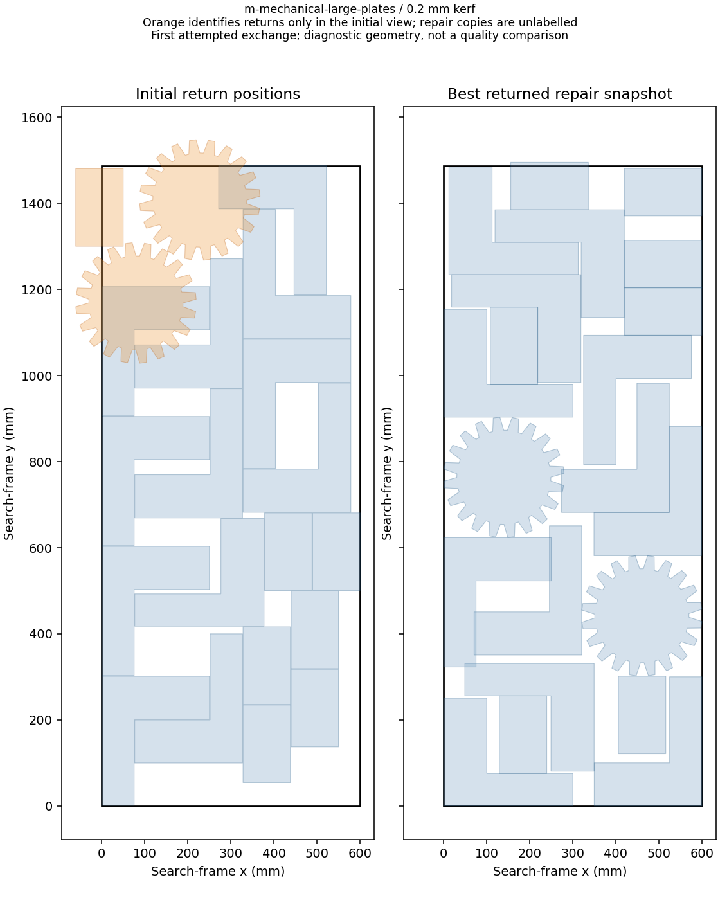
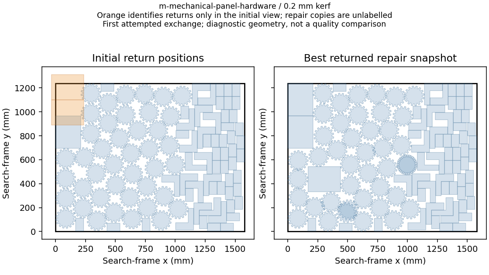

# Return-sheet capacity and repair diagnosis — 2026-10-18

**All four diagnostic layouts validate.** These observations locate filters
and repair stages; they do not measure improvement or replace the failed pilot.

The [committed plan](h5-return-capacity-diagnosis-20261017/plan.json) fixes
both mechanical jobs, both kerfs, seed zero, 60 seconds and serial CCD0 CPU 8.
Production and the original rejected candidate remain unchanged. Aggregate
tracing preserves decisions but may perturb wall-clock behavior.

| Job | Kerf mm | Attempted exchanges | Complete-set outcomes | Partial-set outcomes | Eligible full-set samples: smaller / equal-or-larger area |
| --- | ---: | ---: | --- | --- | ---: |
| m-mechanical-large-plates | 0.2 | 7 | source_repair_failed: 7 | none | 0 / 197 |
| m-mechanical-large-plates | 1.5 | 8 | source_repair_failed: 8 | none | 0 / 196 |
| m-mechanical-panel-hardware | 0.2 | 4 | source_repair_failed: 4 | none | 0 / 17 |
| m-mechanical-panel-hardware | 1.5 | 6 | source_repair_failed: 6 | none | 0 / 17 |

The complete session takes 4.558 minutes. All four
original-job validations, quantities, metrics, zero reported hole riders
and public exports pass. Every immutable attempt archive passes CRC and
all member hashes; trace attempt/acceptance counts match saved solver counters.
[Full observations](h5-return-capacity-diagnosis-20261017/observed-stages.json)
retain sample eligibility, returned-area ratios and both repair losses.
[Frame observations](h5-return-capacity-diagnosis-20261017/observed-frames.json)
retain orientation modes, per-mode outcomes and validated material changes.
[Verification](h5-return-capacity-diagnosis-20261017/verification.json) binds
source/binaries/inputs to the precommitted plan.

An eligible sample is not proof of a feasible exchange, and a failed repair
is not proof of impossibility. Any new heuristic needs separate authored
correctness checks and a committed comparison. Original H5 conditions,
failed measurements and the reserved split remain unchanged. **60% complete; H2/H5 open.**

## Independent capacity and geometry review

All 25 complete-set attempts use allowed reciprocal frames and fail at
return-sheet repair. The saved geometry independently confirms zero overlap
and zero outside area on every repaired receiver. Every repaired return sheet
still has substantial pairwise intersection area (1,239.713–75,490.467 mm²).

Summed collision-polygon area is **75.281–85.554%** of the actual shortened
container area. Original filled outer-ring area is **15.962–47.573%** of full
usable physical stock. **Neither area bound establishes infeasibility.**
These bounds also do not establish that the shapes can be packed. All initial
source assignments have both overlap and outside area; the final snapshots
retain overlap even when outside area reaches zero.

| Job | Kerf mm | Attempts | Shortened-area occupancy | Repaired source pairwise overlap sum (mm²) |
| --- | ---: | ---: | ---: | ---: |
| m-mechanical-large-plates | 0.2 | 7 | 79.715–84.212% | 1,239.713–71,111.229 |
| m-mechanical-large-plates | 1.5 | 8 | 80.991–85.554% | 7,525.227–75,490.467 |
| m-mechanical-panel-hardware | 0.2 | 4 | 75.281–75.281% | 6,069.092–43,823.599 |
| m-mechanical-panel-hardware | 1.5 | 6 | 77.357–77.357% | 24,413.363–55,780.984 |

The [independent audit](h5-return-capacity-diagnosis-20261017/independent-capacity-audit.json)
uses Shapely 2.1.2 on saved polygons and original filled outer rings, including
public transforms. Exact analytic checks cover mirrored rotation, outside
area, ignored area hints and an overfull overlap example. Raw positive
intersections and outside areas remain available; these diagnostic magnitudes
do not change the public validator or any acceptance tolerance.

The next step is a separately planned complete repack of fixed saved source
assignments, keeping their boundary, parts and allowed orientations. A valid
packing would supply an actual feasibility witness before modifying repair.
A failed bounded search would still not prove impossibility. The balanced
two-to-three authored witness remains useful but proves no mechanical gain.

Complete expanded records total 328 MB and are retained byte-for-byte in
[original-records.zip](h5-return-capacity-diagnosis-20261017/original-records.zip),
with [member hashes and CRC verification](h5-return-capacity-diagnosis-20261017/records-integrity.json).
The [compact index](h5-return-capacity-diagnosis-20261017/summary.json) points
to each immutable original attempt archive and full stderr trace. Extract
`records.json` and `results.json` here before using the retained reproduction
helpers; the exact expanded files remain locally and are ignored by Git.

The first attempted exchange in each of the four cases is plotted with equal
axes. Orange marks returned parts only in the initial view; repaired copies
are unlabelled because snapshot keys are not stable copy identities. An
initial coloring mistake is preserved in `figure-key-review/` with its
correction; it never affected geometry or numeric conclusions. All corrected
figures have been inspected.

No production change, repeated quality pilot, relaxed threshold or H5 credit.
**60% complete; H2 and H5 remain open.**
