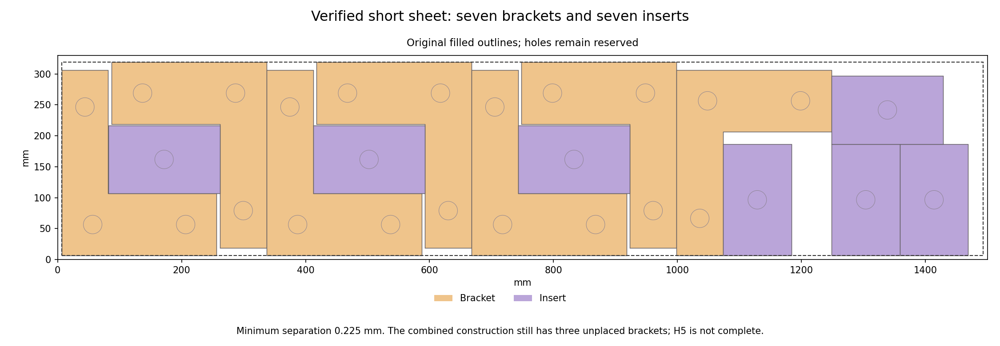

# Seven-bracket width bounds and a source-valid short sheet — 2026-10-28

The new deterministic source construction fits **seven brackets and seven
inserts** on the unchanged short sheet, with at least **0.225 mm** between
original filled outlines. A separate exact width argument excludes seven
brackets with eight or nine inserts. The complete frontier now has **444
necessary candidates**; no complete 66-part layout or H5 pass is claimed.

## Exact width extension

The previous [source stem-gap proof](h5-short-stem-gap-exclusion-20261028.md)
is unchanged. Its 42 gap bounds for 0–6 inserts are reused byte-for-byte.
Only the predeclared 7–9-insert cases are enumerated: **162 new wing/orientation
cases and 194,944 distinct task orders**. Every order and schedule is retained.
Derivation takes 26.377307 s, with no solver call.

The independent reader checks complete multiset-order coverage using a separate
factorial rank calculation, then recomputes **2,033,536 earliest-start steps**
and every makespan. It verifies all 60 gap bounds, 241 chain states and 4,660
transitions. An independent backward recurrence agrees on all 90 terminal
count cases. The old 169 states and 63 terminal bounds remain identical.
The independent audit takes 39.778210 s.

Seven brackets/eight inserts require at least **1,489.948 mm**, exceeding the
relaxed sheet width of 1,487.040 mm by **2.908 mm**. Seven brackets/nine inserts
require **1,559.948 mm**, a deficit of **72.908 mm**. These are the only two
newly excluded vectors. All 4,576 original rows and previous exclusions remain
recorded. The proof retains every allowed source mode and does not rely on
any unknown solver response or fixed source placement.

## Direct original-shape construction

The seven-bracket/seven-insert case remains allowed. Its source construction
keeps six existing brackets and three horizontal inserts exactly. A new end
group contains one bracket, one vertical insert in its notch, two vertical
inserts beside it and one horizontal insert above those two. This is a direct
geometric construction, without an optimizer or random choice.

Independent original-ring readback checks all 14 originals, **91 pairs, 56 stock
edges, 28 holes and 3,416 hole vertices**. Minimum pair clearance is 0.225 mm;
minimum extra stock clearance is 0.025 mm. Holes remain reserved and all legal
mode, source-identity and unchanged-target checks pass.

Moving inserts16/17 off the first sheet leaves 49 first-sheet originals in
their exact previous poses. Combined with the new short14, these are **63
source-valid originals**, with brackets7/10/11 explicitly unplaced. The full
partial readback checks 1,267 pairs, 252 stock edges and 81 holes containing
8,928 vertices; minimum pair gap is 0.214826983 mm, above the unchanged guarded
requirement. The previous source-valid64 remains unchanged. The new allocation
is an alternative construction, not a better total part-count result.

The rendered original-shape figure was visually checked. Two preliminary
versions with a clipped title or overlapping legend are retained in the raw
archive; the final figure fixes those layout issues without changing geometry.

## Closed fixed-neighbour probe and next work

One predeclared greedy probe computes all eight legal bracket-mode regions
against the 49 fixed first-sheet originals. Every conservative region is empty,
so it stops before inserting any bracket, in **7.484384 shared seconds**. The
independent reader verifies the modes, empty results and unchanged valid63.
This is neither actual fixed49 nor global infeasibility; no placement search
is restarted and no native call is made.

Completion needs a different first-sheet arrangement. The new allocation leaves
a 29-original frame/side-insert core and 23 upper originals: 15 cogs, five
brackets and three inserts. Inspect actual contact geometry and allow changed
cog phases or row structure before declaring a bounded new construction.
The failed fixed-phase local calls remain closed. All66 original source and
native checks are still required before integration or an H5 matrix rerun.

At publication review, main `db26d120` has five passing jobs and its Windows
check is running in
[CI 40711177461](https://github.com/skulitom/Nestbolt/actions/runs/40711177461).
A normal main push waits for all six to pass and fresh remote checks. Production,
READMEs and upstream heads/releases are unchanged. H2/H5 remain open at **60%
completed milestone weight**, all 22 reserved H2 vectors remain unopened, and
no new release qualifies.

[Width audit](h5-seven-bracket-source-and-bound-20261028/gap-audit-checks.json),
[source readback](h5-seven-bracket-source-and-bound-20261028/source-checks.json),
[closed insertion probe](h5-seven-bracket-source-and-bound-20261028/fixed49-probe-checks.json),
[complete allocation list](h5-seven-bracket-source-and-bound-20261028/updated-allocations.json),
[next step](h5-seven-bracket-source-and-bound-20261028/next-step.json),
[byte-verified archive](h5-seven-bracket-source-and-bound-20261028/raw-manifest.json).
The archive preserves 429 canonical files and
56 identical-byte aliases in 2,568,627
compressed bytes, including every new task order, reused proof evidence,
original source ring inputs, candidate, audit and preceding main-push receipt.
