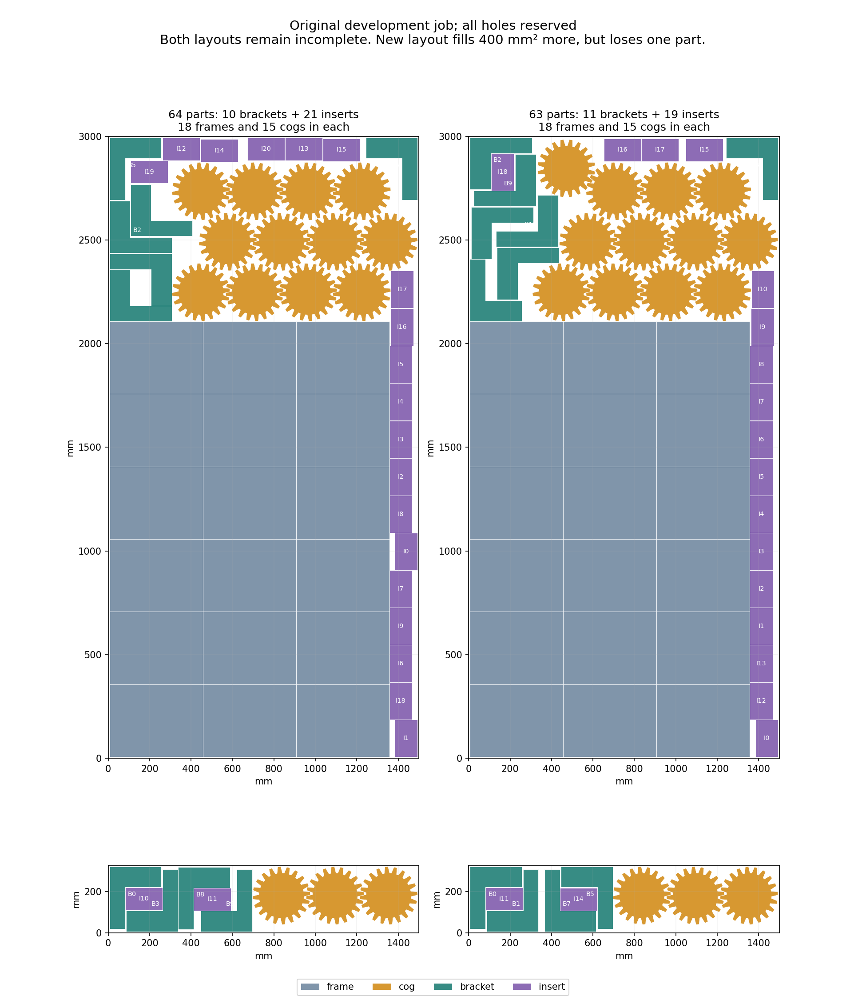

# H5: small-part contacts around changed cog arrangements — 2026-10-23

**The new highest-area layout has 63/66 parts: one bracket and two inserts
remain missing.** It places 11 brackets and 19 inserts, with all 18 frames and
15 cogs, and fills **400 mm² more** than the preserved 64-part layouts.
Those layouts still contain 10 brackets and all 21 inserts, missing two brackets.
The extra area is a different partial arrangement, not an inventory or H5 pass.
H2/H5 remain open at **60%** completed milestone weight.

## Fresh contacts and independent geometry

Two original baseline cores and five previously checked changed-cog cores give
seven distinct fixed 33-part arrangements, each with 18 frames and 15 cogs.
Every one of the 39,488 source pool records is preserved. Fourteen reused input
members match their committed manifests, including the compound catalogues,
core choices and verified explicit 128-sided clearance construction.

The generator processes 268 specifications: ten individual orientations,
36 small-part compounds at four quarter turns, and 114 already transformed
reflected compounds. Each specification visits every core and both sheets
before the next. All **3,752 queries** complete in **42.013214
seconds** within the 120-second limit; 1,773 regions are empty. All 92 cached
obstacle first uses independently agree with direct global constructions.
The compound bounding box restricts only stock translations; exclusions use
each original member outline, and members remain independently selectable.

A separate 90-second proposal phase ends after **2.972284
seconds** at the declared caps of 2,000 new brackets and 2,000 new inserts.
There are 16,408 recorded events: 4,000 additions and 12,408 exact duplicates.
All **1,950 deferred member lists** and their exact cursors are preserved;
none is resumed. Original generation checks cover 320,709 fixed-part pairs.
The 0.0126 mm construction padding applies to new contacts with fixed parts
and stock. It does not change internal compound gaps or existing core gaps
and does not establish native-margin qualification.

Independent verification takes **28.473354 seconds**. It checks
all 268 specifications, 456 independent whole-shape affine comparisons,
990 internal compound pairs, every saved region and proposal list, and the
entire event/deferred-list sequence. It reconstructs 1,074,147 distinct
fixed-part distances and all **211,995** old/new-to-core memberships using
both individual part distances and complete filled core unions. All 3,066
core pairs and both original 64-part baselines pass. Minimum new construction
padding is 0.012600000000 mm.

## Complete graph, certified reduction and one search

All **14,046** eligible choices enter a new complete geometric graph:
6,197 brackets and 7,849 inserts, including 10,046 old and 4,000 new poses.
The graph has **19,719,151** original-geometry conflicts;
there are no count-derived cog edges. Construction and serialization take
87.411031 seconds. A separate sequential bounds scan considers
53,051,995 same-sheet pairs and checks
22,641,849 exact distances in 43.432543
seconds. Every row agrees, and both 64-part baselines remain valid.

Fresh same-family substitutions require an adjacent retained replacement,
inclusion of all conflict neighbors and a superset of compatible cores.
They complete in **6.373183 seconds** and 10,884,376
comparisons, within 30 seconds and 50 million comparisons. Independent
certificates enumerate 21,031,751
neighbor relationships and 53,432
core memberships. The result retains **4,739** choices.
The exact induced 3,792,788-edge graph compresses to
9,077 cliques in 3.994958 seconds,
within 20 seconds. No residual edges remain; all edges reconstruct independently.
Both baseline mappings retain counts and area. There is no extra greedy search.

Retained choices include **1,246 new poses** (555 brackets and 691 inserts)
and 3,493 old poses. Of the 2,754 removed new choices, 2,054 have certified old
replacements and 700 have certified new replacements. Another 422 old choices
have certified new replacements. Every one of the seven cores still has
compatible retained new geometry; per-core counts are saved.

Every binary model and parameter field independently reconstructs. The model
contains **4,746 variables** (4,739 pose choices
plus seven cores) and **13,785 constraints**, with exactly one
core and unchanged 12-bracket/21-insert caps. Its original variable-area floor
is 815,800,000 and full-inventory score 895,800,000. One eight-worker, seed-zero,
presolve-disabled call has a 60-second allowance. Actual wall time is
**61.793372 seconds**; the soft overrun is preserved.

The baseline arrives at 0.120241 seconds and search starts at 0.16 seconds.
At 51.928128 seconds a second callback finds the new 63-part layout in core 3.
The distinct final layout has the same score **816,200,000**. Status is
`FEASIBLE` and the full 895,800,000 bound remains unresolved. Worker logs
show active search, including 2,465,405 branches for the core worker.
The completed solve is neither repeated nor extended.

## Original layouts and fixed-layout gap diagnosis

All **4** layouts—hint, both callbacks and
distinct final—pass original transforms, stock, material and every same-sheet
geometry pair. The 64-part layouts each check 1,521 pairs; the 63-part layouts
each check 1,467. Three fresh frozen-CLI calls and one exact-layout reuse report
only the original missing quantities. Every failed quantity result is retained.

New filled area is **4402140.784069743 mm²**, versus
4401740.784069743 mm² for the preserved baseline. Material is
4988890.203494999 mm² in both. The new core's minimum separation is
0.200122540483 mm, so native-margin qualification remains
absent. The second callback uses five new small poses; the final uses seven.

A fresh diagnosis fixes every placement in each distinct 63-part layout and
checks all ten permitted small-part orientations on both sheets. All **40
continuous insertion queries** complete in **4.294158 seconds**
within 90 seconds. Every padded region is empty. All 150 cached obstacles agree
with independent direct calculations; there are no proposed additions,
pending queries or extra solver calls. These conservative empty regions do
not prove unrestricted impossibility. Further progress needs coordinated
movement rather than a simple padded insertion into these fixed arrangements.

Investigate a fresh bounded neighborhood of coordinated small-part moves in the two new 63-part layouts. First measure which adjacent bracket/insert pairs, when temporarily released together, expose continuous original-outline placements for the missing inventory; choose release pairs from recorded geometry rather than resuming capped proposal lists. Preserve all fixed-part, stock and mutual conflicts and every pending query. Any later selection must retain the two original 64-part baseline mappings and both new 63-part mappings, use the original area floor 815800000, and keep the full 12-bracket/21-insert inventory with all 18 frames and 15 cogs. Declare genuinely new generation and selection bounds before execution; do not retry or extend this completed 60-second solve, resume 1950 deferred member lists, or infer impossibility from the unresolved full bound or conservative empty regions. All 66 parts, the original material target, native guard, original production budget and full 13-job/two-kerf matrix remain required.

No native packing, original-budget qualification, full H5 quality matrix or
held-out evaluation occurs. All original gate requirements remain intact.
Product source and all three accurate READMEs are unchanged. Preview
v0.2.0-alpha.1 and stable Latest v0.1.0 remain current; this diagnostic result
does not qualify another release. Main facf0f38 completed all six checks.
Checkpoints 5e88ac91 and 0526421e were pushed normally to main; the new main run
39991641757 is saved as `in_progress` / `pending`.

Evidence: [generation](h5-shifted-core-small-joint-20261023/generation.json), [geometry audit](h5-shifted-core-small-joint-20261023/geometry.json),
[graph](h5-shifted-core-small-joint-20261023/graph.json), [independent graph audit](h5-shifted-core-small-joint-20261023/audit.json),
[source provenance](h5-shifted-core-small-joint-20261023/provenance.json), [reduction](h5-shifted-core-small-joint-20261023/reduction.json),
[model](h5-shifted-core-small-joint-20261023/model.json), [solver](h5-shifted-core-small-joint-20261023/solver.json),
[original layouts](h5-shifted-core-small-joint-20261023/layouts.json), [new layout](h5-shifted-core-small-joint-20261023/new-layout.json),
[preserved baseline](h5-shifted-core-small-joint-20261023/baseline-layout.json), [retained geometry](h5-shifted-core-small-joint-20261023/retention.json),
[gap diagnosis](h5-shifted-core-small-joint-20261023/gaps.json), [source review](h5-shifted-core-small-joint-20261023/source-review.json),
raw evidence [part 1](h5-shifted-core-small-joint-20261023/raw-001.zip), and [manifest](h5-shifted-core-small-joint-20261023/raw-manifest.json).
All 4145 canonical members and 58
aliases are byte-verified, with archive CRCs and SHA-256 checked. Each ZIP part
is independently readable and below 50 MiB.
