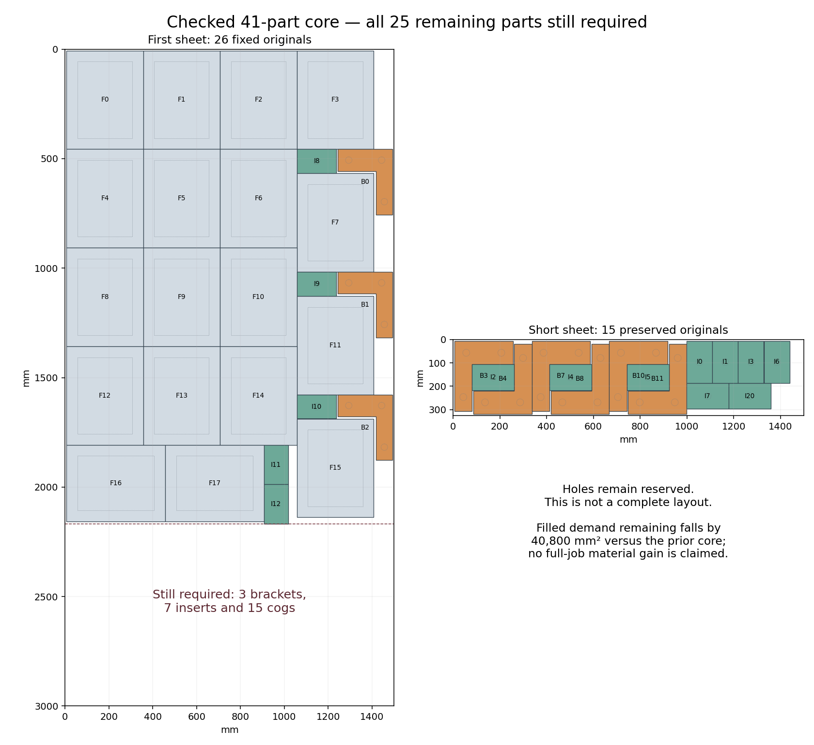

# H5: staggered frame strip and joint original contact search — 2026-10-26

**A changed frame arrangement fits three original brackets into the narrow side
strip and five inserts into adjacent gaps.** Its checked 41-original core reduces
remaining first-sheet filled demand by **40,800 mm²**, while one insert extends
10.45 mm beyond the prior core. The following joint search requires every remaining
part, but closes INFEASIBLE within its finite 2,000-pose pool. This is not a full
layout, a material-gate pass or an unrestricted exclusion. H2/H5 remain open at 60%.

## Source construction

Preserve the fifteen original short-sheet placements. Keep the first three
columns of four turned frames, then stagger the fourth column at 560.45 mm row
spacing. Each new gap holds a bracket foot and a 180 × 110 mm insert; the bracket's
75 mm stem occupies the unused side strip. Put the two unturned frames adjacent
at the upper left and two vertical inserts beside them. The first sheet fixes
eighteen frames, three brackets and five inserts.

Independent direct-vertex readback reconstructs all 26 first-sheet anchors from
rationals and verifies **430 filled-outer pairs, 164 stock edges, 59 cutouts and
5,074 cutout vertices** across both sheets. Minimum pair clearance is 0.225 mm
against 0.211708673 mm required; extra stock margin is 0.025 mm. All original
orientations and quantities are checked, holes remain reserved, and the short
sheet is unchanged. The earlier 64-original partial is preserved; this 41-original
core is a different starting arrangement, not a higher partial count.

## Complete finite joint search

All remaining **three brackets, seven inserts and fifteen cogs** are mandatory.
Four actual cog phases, eight bracket modes and two insert modes seed fresh
translation regions against the changed 26 owners. Cog centers then move
independently through 384 original pair-contact offsets; they are not forced into
a repeated lattice. A finite spatial quota limits near-duplicates. The pool has
1,400 cog poses, 300 bracket poses and 300 insert poses, with unfinished queues
and every generation event retained. Cog depths 0–3 contain 117, 651, 446 and 186
poses respectively.

The non-cog proposal helper supplies both obstacle-boundary points and interior
representatives. Of 410 accepted obstacle-derived non-cog proposals, **277 are
interior representatives**. They are valid alternatives against the fixed core,
but conflict with their generating cog pose. Every such conflict is independently
checked and retained. They must not be described as boundary contacts.

The independent source audit checks **52,000 fixed pairs, 8,000 stock edges and
all 1,999,000 unordered candidate pairs**. It reconstructs all **573,329** conflicts
and verifies their complete coverage by **2,855** original-graph cliques. No
candidate or required quantity is removed. The 2,000-variable, 2,858-constraint
model is independently reconstructed from the saved inventory and graph.

The sole call returns **INFEASIBLE** in **0.960597 returned-call seconds**, within
**2.098136 shared-process seconds**, against declared 60/90-second limits. There
is no overrun and no retry. Search proceeds beyond presolve: `default_lp` logs
6,127 branches and `no_lp` 11,174, while `max_lp` completes the finite exclusion
with 1,086 LP iterations. The returned worker's zero branch count does not mean
the entire search stopped during presolve. No separate formal unsat certificate
is claimed.

## Preserved failures and next action

Four failed attempts remain intact: the first core checker omitted mirrored
short-sheet transforms; the first graph audit assumed every obstacle-derived
proposal was a boundary contact; the first response audit mistook zero returned
branches for presolve termination; and its first repair read beyond the Search
stats table. Corrected audits retain the same source poses, conflict graph,
single solver call and response. No failed solver run was repeated.

The finite pool is closed. The next construction must change coordinates or the
frame-side-strip composition, keep all 25 remaining originals mandatory, and
rebuild current-owner geometry. Future contact generation must distinguish
interior representatives before consuming boundary-contact quotas. Full 66-part
source/native/material validation, production integration within 60 seconds and
the full H5 matrix remain required.

At 2026-10-26T15:30:44.752059+00:00, all six jobs in
[main CI 40343656177](https://github.com/skulitom/Nestbolt/actions/runs/40343656177)
pass on 6c5bf878. This permits a normal two-commit checkpoint push after staging
and ancestry verification. Production and READMEs are unchanged; no new release
is qualified. H2 retains its original gate and all 22 reserved vectors remain
untouched.

All five audits pass. [Checks](h5-staggered-frame-core-and-joint-contacts-20261026/checks.json),
[core](h5-staggered-frame-core-and-joint-contacts-20261026/core-independent-checks.json),
[source graph](h5-staggered-frame-core-and-joint-contacts-20261026/graph-independent-checks.json),
[model](h5-staggered-frame-core-and-joint-contacts-20261026/model-independent-checks.json),
[response](h5-staggered-frame-core-and-joint-contacts-20261026/response-checks.json), [scope](h5-staggered-frame-core-and-joint-contacts-20261026/scope.json),
[next inventory](h5-staggered-frame-core-and-joint-contacts-20261026/next-fixed26-neighborhood.json),
[next step](h5-staggered-frame-core-and-joint-contacts-20261026/next-step.json), and [raw manifest](h5-staggered-frame-core-and-joint-contacts-20261026/raw-manifest.json).
The archive verifies 131 canonical files and
26 aliases by bytes, SHA-256 and CRC.
