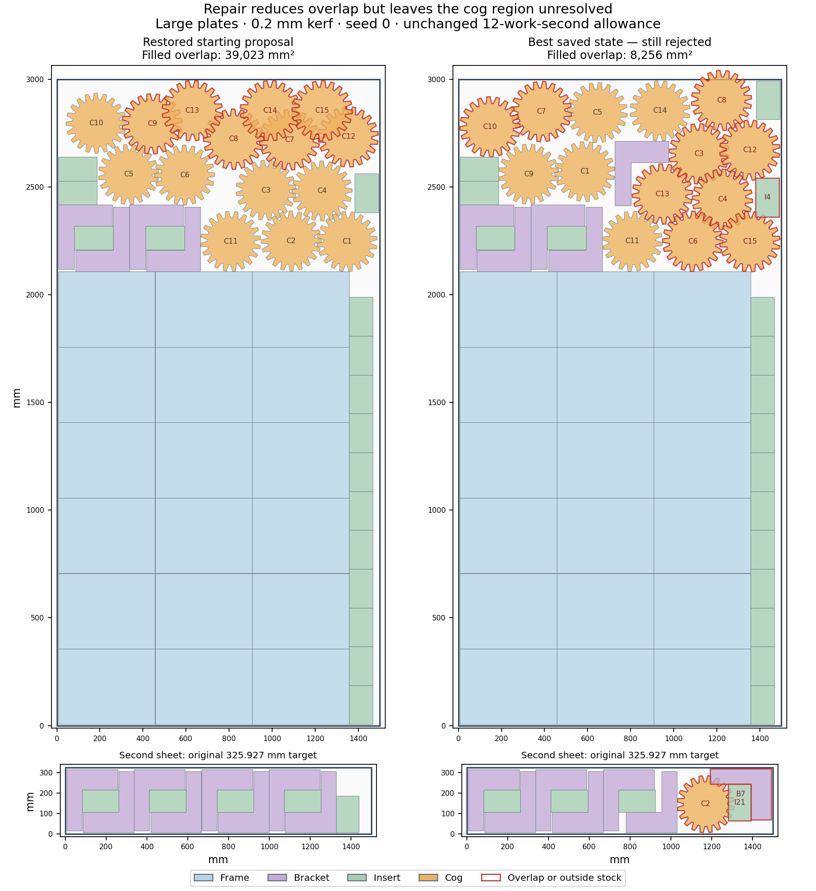

# H5: retained repair state and residual cog conflicts — 2026-10-18

The observed repair reduces physical overlap by **78.8441%**, but still fails.
Its retained best state has **ten pair overlaps and one cog extending 47.7152 mm
beyond the original stock edge**. All remaining overlaps involve cogs. No expired
state or geometry follow-up becomes an accepted layout; H5 remains open.

The [native-margin investigation](h5-native-collision-diagnosis-20261018.md) produced
four partial layouts with exactly zero native loss, yet restoring their missing
parts still expired the unchanged repair. This checkpoint instruments one fixed
replay of the closest case, large plates / 0.2 mm, to retain both its initial
proposal and its best state immediately before the original expiry return.

The test-only observer runs in a fresh source copy and build target on logical
CPU 8. Seed 0, the 12-work-second allowance, hard limit, runtime decisions and
charged work remain unchanged. It reproduces the previous failure's **exact work
counts, statistics, initial losses and expiry**, finishing at 12.03904728 charged
seconds (14.8567 real seconds). No quality run is repeated and the expired result
is still rejected. All 173 prior test bodies and all runtime source remain exact
after removing the observer; this does not claim a fresh full regression run.

Stable tracker identity is matched uniquely to all **66 original copies**, then
carried through the retained best state. Independent original-vertex transforms
and filled-outer checks examine **2,953 physical pairs** across the two states.
Both original public CLI checks reject their layouts. Original quantities and
copy identities are preserved; holes stay reserved.

| Retained state | Native loss score | Filled overlap (mm²) | Parts on first / second sheet | Accepted |
| --- | ---: | ---: | ---: | :---: |
| Initial proposal | 175,938.3125 | 39,022.751975 | 53 / 13 | no |
| Best before expiry | 83,827.648438 | 8,255.630840 | 54 / 12 | no |

Native loss scores are not overlap areas. The best state has eleven native pair
collisions and one wall collision: the additional pair contact crosses the joined
virtual sheet boundary because the out-of-stock cog straddles it. Its second-sheet
height is 325.788154 mm, below the original 325.926902 mm target, but the other
violations still invalidate the layout. All 15 cogs, three brackets and three
inserts move; three copies change sheets. **No frame moves.**

A separate fixed-neighbour free-space construction removes one conflicting cog
at a time. It tests its retained angle plus integer angles 0–17°, on both original
target sheets: **380 queries over ten cogs**. Exact covering convex pieces build
Minkowski obstacles with a conservative mitred clearance envelope and a positive
0.0001 mm construction margin. Every saved free region is empty; no move is
accepted. It finishes in 34.114 seconds under its declared 120-second geometry
ceiling. This finite-angle, conservative query is not a proof that no single-cog
move exists under arbitrary rotation, and says nothing about global feasibility.

One bounded offline collective experiment then lets every non-frame part
translate together, including currently noncolliding neighbours. Rotations,
reflections, sheet assignments and the frame block stay fixed. Closest obstacle
boundaries define a local linear problem with nonnegative separation slacks,
original stock bounds and 60 mm coordinate trust steps. Every constraint and the
objective recheck: its predicted slack sum is **120.539379 mm**. However, the actual
conservative penetration measure rises from **249.971424 mm** to **468.483502 mm**
at the full step. Fractions 1/2, 1/4, 1/8 and 1/16 also worsen that measure.
The method stops at its first local stall after 8.591 seconds; it accepts no move.

Independent original-shape checks replay all five collective proposals, covering
another **7,485 physical pairs**. They contain 22–23 pair conflicts, compared with
ten initially. The full step brings the protruding cog inside stock but has
34,468.544080 mm² overlap and fails the original public CLI check. The smallest
step slightly lowers overlap area to 8,193.476867 mm² while increasing the conflict
count to 22 and retaining the stock violation; it is still rejected. No linear
prediction is substituted for geometric acceptance. Both follow-ups retain the
original rejected terminal layout unchanged as their final output.

[Checks](h5-terminal-repair-diagnosis-20261018/checks.json),
[all raw source, states, regions, proposals, logs and audits](h5-terminal-repair-diagnosis-20261018/raw.zip),
[manifest](h5-terminal-repair-diagnosis-20261018/raw-manifest.json),
[next investigation](h5-terminal-repair-diagnosis-20261018/source-review.json).
All 1008 archive members, CRCs and byte hashes verify. The saved failed
proposals, original work limit, conversion guard and material target are unchanged.

The fixed-seed repair and every terminal state are now observed. Do not repeat the same repair, spacing adjustment or one-cog relocation grid. The local collective LP also fails actual geometry and must not be treated as a feasible rearrangement. The native separator moves all cogs but leaves the noncolliding frame block fixed; the closest beam construction likewise commits to that block early. Next investigate a discrete placement-selection construction that chooses several compatible part placements together from actual-outline contact candidates, with exact inventory constraints, rather than committing each part greedily. Include alternative frame allocations already present in the retained catalog, retain candidate/coverage failures and declare a finite offline limit before running. Do not alter the original stock, filled holes, quantities, rotations or material target. An independently validated whole-job target witness is still required before proposing bounded runtime changes or another matched quality pilot. These restricted failures are not global infeasibility evidence. Normal-mode hole riders cannot be reused under the common-line reserved-hole requirement.

All six hosted checks on main commit `cb5e23c` pass, including both native
platforms and the Chromium/Firefox web job ([record](h5-terminal-repair-diagnosis-20261018/main-ci-cb5e23c.json)).
That is the previous pushed revision, not a claim about this evidence commit.
Production source, preview assets and all three accurate README descriptions
remain unchanged. H2/H5 are still open at **60%**; this diagnostic work does not
create a newly qualified release.
