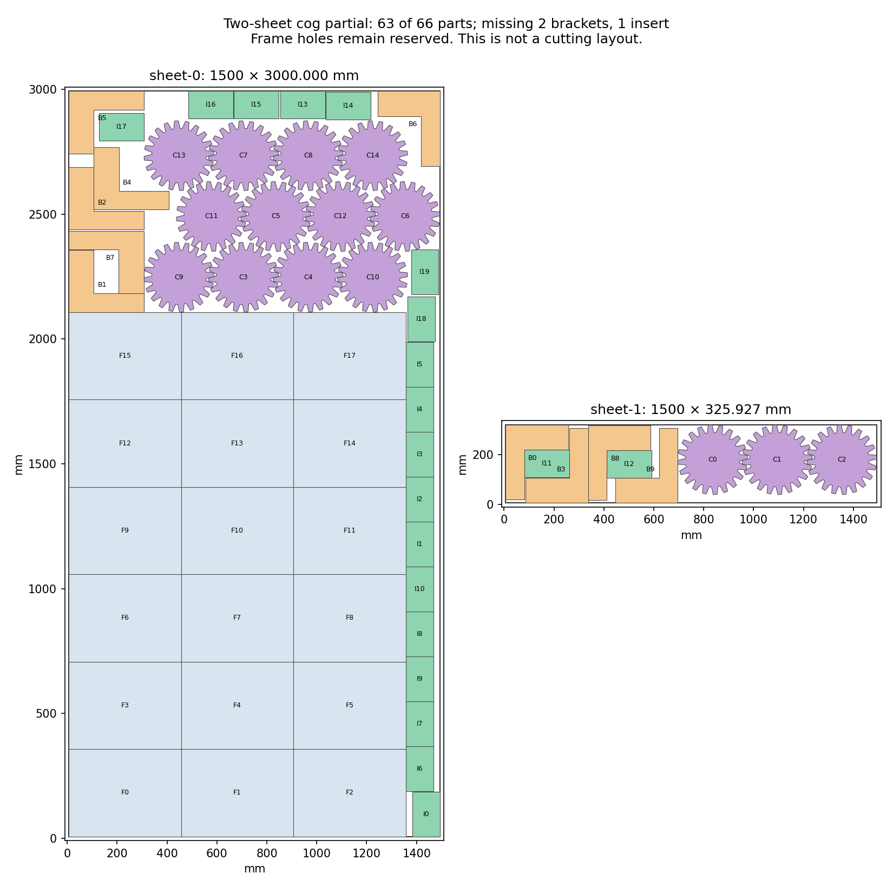

# H5: two-sheet cog progress and changed frame construction — 2026-10-23

**The new 63-part partial improves filled area by 325.437876 mm².** It contains
all 18 frames and 15 cogs, ten brackets and 20 inserts, missing two brackets and
one insert. The earlier 64-part partial, missing two cogs, remains preserved as
the highest-count result. Neither completes the original 66-copy job. H2/H5
remain open at **60%**.

## Changed complete-group model

This construction combines the previous 165 complete-cog cases with the 200
newly audited sheet distributions. Only new neighborhoods absent from the prior
query set are queried. All 500 queries finish; the 980 previously capped lists
are not resumed. The full source pool is retained before fresh filtering.

Generation takes 4.790236600 seconds, adding 1,600 bracket and 1,200 insert poses
under fresh family caps. All 7,326 events are retained, including 4,526 duplicates
and no geometric rejection. All queries finish; 322 new capped lists remain
pending. Forty Minkowski caches pass absolute-coordinate comparisons with maximum
error 4.687×10⁻¹³ mm, and every query region reconstructs with zero area difference.

Independent checks reconstruct all 365 complete groups, including their 200
new source combinations, and cover 168,910 within-group geometry pairs,
219,150 old/frame pairs and 158,477 proposal/neighbor pairs. All original stock
bounds, allowed transforms and every compatibility list pass. Of 3,481,472
cog/small-part possibilities, 599,372 exact distances establish 502,701 conflicts.

The 12,960 retained choices have 54,714,544 same-sheet pair possibilities.
Independent checks of 7,753,291 exact distances establish 6,603,323 conflicts.
The bounded compression produces 3,711 cliques and retains all 541,132 residual
edges when its allowance expires. Full coverage is checked; no edge is dropped.

## Safe reduction and bounded selection

Fresh substitution certificates require the same family, adjacency, a subset of
other original neighbors, and a superset of compatible complete groups. This
preserves original counts, filled area and group choice. The 10-million-comparison
cap is reached in 2.562611700 seconds; all unprocessed candidates remain. The
3,938 certificates receive 2,908,867 independent neighbor checks and 505,345
group-membership checks. The 9,022 retained choices and 306,217 projected
constraints exactly preserve the induced graph. The previous 63-part seed is
mapped only through these new certificates and checked.

All 7,300 declared starting-layout cases finish in 21.380736700 seconds. The
200 new groups are visited first, followed by the earlier 165. Every selected
set passes graph, group, count and score checks. The best hint has ten brackets
and 19 inserts with all frames/cogs, using group 258.

All fields of the 9,387-variable, 315,243-constraint model are independently
reconstructed. One eight-worker, seed-zero solve with a 60-second allowance takes
62.378406200 seconds; this soft overrun is preserved. It returns `FEASIBLE` with
score 796,000,000 and full-inventory upper bound 895,800,000. The gap remains
unresolved; no optimum or infeasibility is claimed. No call is repeated or extended.

The hint, two callbacks and a different final layout receive four fresh frozen
CLI checks. Every original filled-outer geometry check passes; only the recorded
missing quantities fail. The better layouts use group 259, splitting cogs 12+3
across sheets, and fill 4,381,940.784070 mm². The previous highest filled area was
4,381,615.346194 mm². Charged material is 4,988,890.203495 mm², within the unchanged
target. Minimum clearance is about 0.2001 mm; native margins are unqualified.

## Fixed-layout gaps and the next geometry

A separately declared insertion check keeps all 63 final placements exactly
fixed. All 20 bracket/insert orientation queries finish in 8.896743200 seconds;
every conservative padded region is empty. There are no new proposals, capped
lists or pending queries. No solver is called. The unchanged prefix and all
1,467 same-sheet original pairs pass; the recorded fresh CLI check still reports
two missing brackets and one missing insert. Empty conservative regions do not
prove unrestricted impossibility.

A different checked subassembly prepares a new construction: all 18 frames are
quarter-turned in four columns of 4/4/5/5. The two shorter columns leave room
for eight aligned cogs; the two taller columns leave room for four; a saved
three-cog row occupies the last sheet. The eight- and four-cog components are
specified subsets of the previously audited aligned lattice, preserving their
original members before translation normalization.

All 438 original same-sheet pairs and all stock/transform checks pass, with
minimum distance about 0.225 mm. The frozen CLI reports only the twelve missing
brackets and 21 missing inserts. This 33-part subassembly is not a partial
improvement, complete job, or native qualification. Historical four-tall-column
patterns already exist at source indices 22–24, including balanced 5/5/4/4;
the new evidence concerns these exact coordinates and the 8+4+3 cog construction,
not a claim that this frame orientation was never tried.

Do not repeat the 365-group solve, extend its limit, resume its 322 capped lists, or rerun the unchanged empty-gap queries. Preserve both useful partials: the new 63-part layout has higher filled area, while output/h5-dense-insert-gap-20261023/layout.json retains the highest part count of 64. The concrete next construction is output/h5-tall-frame-cog-subassembly-20261023/layout.json: all 18 quarter-turned frames in columns 4/4/5/5, eight dense cogs above the shorter pair of columns, four above the taller pair, and three on the last sheet. All 33 original pieces pass geometry and the frozen CLI reports only the 12 missing brackets and 21 missing inserts. This is not itself a partial improvement. Declare a fresh bounded completion against those exact 33 poses. Preserve the full current source pool before any old frame/cog filtering, append absent fixed poses by exact identity, and generate all bracket orientation/reflection and insert-class contacts. Inspect the already saved bracket/insert compound components and include compatible actual-outline compound contacts under explicit new caps when useful; do not repeat the earlier whole-bounding-rectangle searches. Audit original member geometry, stock, all conflicts and model fields before at most one newly declared selection call. The historical four-tall-column frame pattern already exists; the exact coordinates and 8+4+3 cog subassembly are the changed construction. Native margins, original production repair limits/budget, the complete 66-part target and all H5 jobs/kerfs remain required. H2 retains Artem's unchanged gate decision.

## Repository and scope

Main remains at pushed `37b671d3`; the prior `356c8523` checkpoint is local and
queued behind its live checks. The saved run `39955078136` is `in_progress`
with conclusion `pending`. No unobserved pass is inferred.
Frozen original job, library, request and target bytes match the preceding raw
manifest. Core source and all three README hashes remain unchanged. The published
preview is accurate, and no new application release qualifies. No production
packing, full quality matrix or reserved-input evaluation occurs.

Evidence: [plan](h5-two-sheet-cog-progress-20261023/plan.json), [generation](h5-two-sheet-cog-progress-20261023/generation.json),
[graph audit](h5-two-sheet-cog-progress-20261023/graph-audit.json), [reduction](h5-two-sheet-cog-progress-20261023/reduction-audit.json),
[starting layouts](h5-two-sheet-cog-progress-20261023/hint-audit.json), [model](h5-two-sheet-cog-progress-20261023/model-audit.json),
[solve](h5-two-sheet-cog-progress-20261023/solver-result.json), [original layouts](h5-two-sheet-cog-progress-20261023/layout-audit.json),
[gap checks](h5-two-sheet-cog-progress-20261023/gap-audit.json), [new subassembly plan](h5-two-sheet-cog-progress-20261023/tall-plan.json),
[subassembly audit](h5-two-sheet-cog-progress-20261023/tall-audit.json), [subassembly](h5-two-sheet-cog-progress-20261023/tall-subassembly.json),
[source review](h5-two-sheet-cog-progress-20261023/source-review.json), [raw evidence](h5-two-sheet-cog-progress-20261023/raw.zip), and
[manifest](h5-two-sheet-cog-progress-20261023/raw-manifest.json). All 691 archive members, CRCs and
byte hashes verify.
