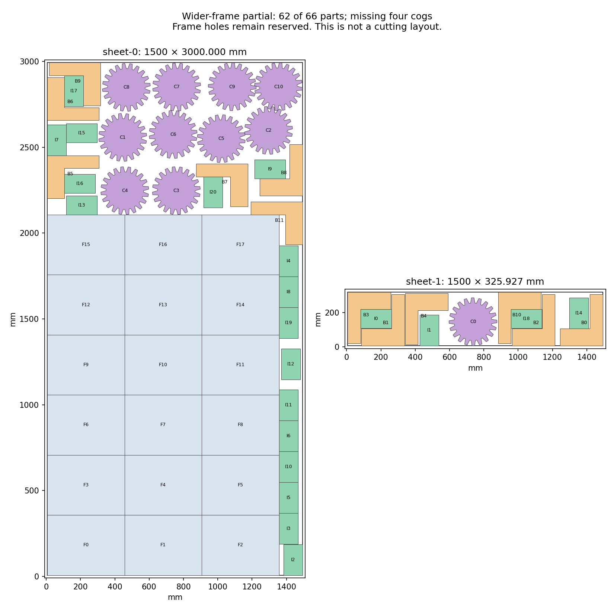

# H5: small-part selection around wider frames — 2026-10-23

**The new arrangement places 62 of 66 parts and still misses four cogs.**
Its filled area is 4,281,489.908318 mm², below the prior best
4,342,015.346194 mm². The bounded search is not an optimum or an impossibility
proof. H2/H5 remain open at **60%**, with the original quantities and target.

## Geometry and candidate coverage

The [checked wider frame group](h5-cog-insert-regions-20261023.md) keeps 18 original
450 × 350 mm frames in three columns and six rows. Eleven side-strip insert
poses are optional. This orientation/count pattern appeared in the October 18
rectangle study; the present coordinates and individual-outline conflict model
are different. No claim of a first-ever orientation pattern is made.

An independently recomputed necessary area check leaves 2,071,991.303765 mm²
outside the frames, against 1,646,740.784070 mm² required for all small parts.
It is inconclusive: sufficient area alone does not establish a packing.

The pool retains 4,057 compatible old small-part poses. Twenty-eight free-region
queries and 2,851 translations/quarter turns of 108 saved compound patterns add
1,767 bracket, 2,242 cog and 2,000 insert positions. The total is 10,066 choices.
Generation takes 4.519206900 seconds. The insert cap leaves 834 recorded proposal
lists pending; a list stops when its next member reaches its family cap, including
any later members of other families. No suffix is resumed. All queries complete.

The independent audit verifies 135,198 old/fixed pairs, 119,808 proposal/fixed
pairs, every query and compound placement, 1,158 compound pairs and all pending
lists. Among 32,508,456 small-pair possibilities, 6,289,379 exact distances establish
5,286,767 conflicts. The 20-second compression limit leaves 523,186 edges explicit,
alongside 4,538 cliques. Every conflict remains covered; no edge is dropped.

## Safe reduction and bounded selection

Same-family substitutions remove a pose only for an adjacent retained alternative
whose other original conflicts are a subset. Independent enumeration checks
1,691,182 replacement-neighbor relations. The ten-million-comparison cap is reached
after 3.357768200 seconds; unprocessed poses remain. All 2,290 removals preserve
family counts and area, leaving 7,776 variables and 352,739 projected clique/edge
constraints with complete conflict coverage.

Exactly 40 declared greedy starting layouts are checked. The best has 18 frames,
12 brackets, 11 cogs and 17 inserts. Every protobuf model field is independently
reconstructed before one eight-worker, seed-zero, 60-second call. It returns
`FEASIBLE` after 60.278050300 seconds, with seven callbacks and a different final
layout. The upper bound still permits full inventory; optimality is not proved.

The best result has all 18 frames, 12 brackets and 21 inserts, but only 11 of 15
cogs. It improves this experiment's starting hint, not the previous best result.
The hint, seven callbacks and distinct final layout all pass independent original
stock, rotation, mirror, pair-distance and material checks. Nine fresh frozen-CLI
calls fail only for their recorded missing quantities. Final material is
4,988,890.203495 mm², within the unchanged 4,988,890.353495 mm² allowance. Minimum
final clearance is 0.2011 mm; native construction margins are not qualified.
No native packing, quality matrix or reserved-input evaluation occurs.

## Changed geometry available for the next investigation

The earlier [aligned and staggered cog study](h5-aligned-pockets-and-rows-20261018.md)
contains denser components than the sampled-phase groups used in this pool.
A finite coverage audit takes its 15 nondominated groups and six selected ragged
groups, both whole-group quarter turns, and the corners/center of the three
saved free rectangles. It verifies 1,128 component pairs, 135 placed groups,
4,925 placed-member pairs and 18,090 fixed-frame pairs. Of 489 distinct cog poses,
488 are absent from the completed pool; ten placed groups contain all 15 cogs.
Minimum checked clearance is 0.2126 mm. These are valid subassemblies only:
coexistence with every bracket and insert remains unproved. Earlier rectangle
studies of these components remain preserved and are not rerun.

Do not retry the expired wider-frame model or resume its capped proposal lists. The catalogue coverage audit supplies 488 exact cog positions absent from that pool, from previously checked aligned/staggered and ragged groups. Build a changed individual-pose model using those positions and new bracket/insert contacts around the denser original cog outlines, keeping the full small-family counts free. Retain prior feasible hints after exact mapping; recompute and independently audit every changed conflict, and declare fresh finite generation/search bounds before work. The old fixed-component rectangle studies and this finite-pool timeout do not settle unrestricted feasibility. Only all 66 original parts within the original material target, passing frozen CLI and independent filled-outer checks, can advance to native-margin and production-budget qualification. Full original H5 requirements remain required; H2 stays open under the retained-denominator decision.

## Repository and release status

All six checks on main `44ff9cc4` now pass. The two prior evidence commits are
pushed normally to main as `37edb1d2`. The saved snapshot of main `37edb1d2` has 4 passing checks; the remaining jobs are still running. A complete pass is not inferred.
Core source and all three READMEs remain byte-identical to the preceding checkpoint.
The README accurately describes v0.2.0-alpha.1, the hosted preview from main, and
the two open gates. No new application build is qualified for release. The existing
release authorization remains; stable v0.1.0 and registry versions are unchanged.

Evidence: [generation](h5-wide-small-selection-20261023/generation.json), [graph audit](h5-wide-small-selection-20261023/graph-audit.json),
[reduction audit](h5-wide-small-selection-20261023/reduction-audit.json), [model audit](h5-wide-small-selection-20261023/model-audit.json),
[solver result](h5-wide-small-selection-20261023/solver-result.json), [all layout checks](h5-wide-small-selection-20261023/layout-audit.json),
[catalogue coverage](h5-wide-small-selection-20261023/catalogue-audit.json), [source review](h5-wide-small-selection-20261023/source-review.json),
[raw inputs and outcomes](h5-wide-small-selection-20261023/raw.zip), and [manifest](h5-wide-small-selection-20261023/raw-manifest.json).
All 162 archive members, CRCs and byte hashes verify.
