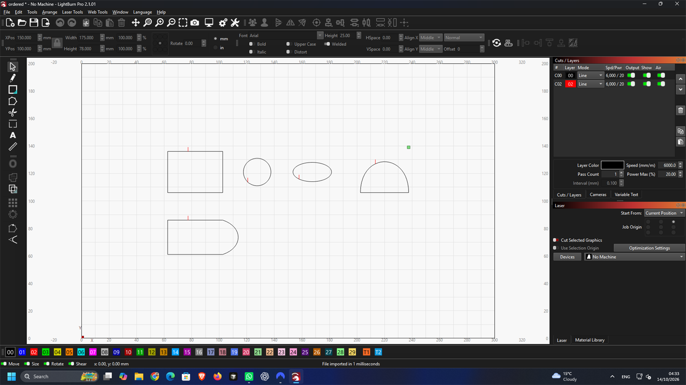

# N5 contour starts — 2026-10-14 UTC

This is a foundation checkpoint, **not H6 completion**. Exact segment splitting,
derivatives and cyclic contour starts are implemented in the core. The optional
review exporter can apply a start to each outer contour and hole. Public lead
controls, collision footprints, shortening, common-line exclusions, material-cost
measurement and the three searched native lead checks are still pending.
Completed milestone weight remains **15%**. No held-out geometry was read.

## Implementation

`Segment::split_at` uses de Casteljau for Béziers and exact angular subdivision for
arcs. `Contour::restarted` retains curve types, geometry and winding, rotating the
segment list and splitting only the selected segment. Invalid parameters, indices
and open contours fail explicitly. SVG uses those exact contours.

DXF start overrides use closed LWPOLYLINEs for lines/circular arcs and clamped
cubic SPLINEs for other contours. Elliptical arcs in these ordered splines use
curved cubic spans with an analytic geometric bound of **0.000001 mm before
six-decimal serialization**. They are not polygonized. Exact rational splines
were rejected after native testing; the original exports and failures remain.
Existing exports without start overrides keep their previous representation.

A mixed contour starting along a straight edge needs a special encoding: the
remaining open spline followed by the leading LINE. LightBurn joins them with the
selected start preserved, but **reverses winding** in the tested case. Future lead
footprints must account for native direction; this checkpoint makes no claim that
the marker lines reserve safe space. Closed contours must also keep “Choose best
starting point” off when native leads are eventually enabled.

## Native evidence and rejected attempts

All probes are original MIT geometry, run in LightBurn Pro 2.1.01 on Anode's hidden
desktop with No Machine. No settings, device, trial or installation were changed.
The temporary 1920 × 1080 display was restored and every owned app was closed.
Preparation ran on CPU 0, independent audits on CPU 8, and builds/tests on CCD1.

| Probe | Result |
| --- | --- |
| [02:56:35](h6-starts-20261014T025635Z/) | Exact rational DXF passes independent file geometry; LightBurn moves the rectangle start by 14.8 mm and distorts the ellipse by 0.012190 mm. SVG passes all four native starts; largest native geometry error 0.001264 mm |
| [03:01:30](h6-starts-20261014T030130Z/) | Closed LWPOLYLINE fixes the rectangle and circle. Rational ellipse still fails |
| [03:09:48](h6-starts-20261014T030948Z/) | Smaller rational spans do not fix native ellipse conversion: 0.012810 mm error |
| [03:17:23](h6-starts-20261014T031723Z/) | Bounded polynomial cubics fix the ellipse; all four DXF starts/contours pass. This SVG is byte-identical to the first probe's native-tested SVG |
| [03:22:45](h6-starts-20261014T032245Z/) | Fifth mixed contour reveals another 14.8 mm native start displacement on a straight-edge interior; retained as a failure |
| [Encoding diagnostic](h6-starts-seam-20261014T032721Z/native-audit.json) | Open spline alone and LINE-before-spline lose the selected start. Spline-before-LINE keeps it, with winding reversed |
| [03:31:54 final](h6-starts-20261014T033154Z/format-audit-20261014T033416771772Z.json) | All five DXF native starts/contours pass; largest start error 0.000011 mm and geometry error 0.000449 mm. Mixed contour winding reversal remains explicit |

The final direct SVG/DXF comparisons use independent svgpathtools, ezdxf and
Shapely readers. Original analytic/de Casteljau evaluations determine the target
starts. DXF entities are closed or independently verified to form the documented
directed spline/line cycle. Native files use unmodified MIT lbrn2-to-svg 0.5.3,
with the established H3 transform normalization. One global import translation
is removed; individual contours are not fitted independently. Every preparation
and audit records hashes. Reference sampling is 0.000001 mm for SVG/native curves
and 1,024 intervals per DXF spline knot span; these are finite-sampling checks.
The final DXF sample error is below 0.000011 mm. The 0.01 mm native threshold is
unchanged. Native directions are measured separately from geometric distance.

Red paths in the screenshots are **start markers, not validated lead-ins**.
These layouts are authored, not search results; they do not satisfy H6's three
nested exports with LightBurn's own leads.

## Validation and reproducibility

- Full workspace: 222 passed, one existing ignored test. This preceded the final
  mixed-contour encoding; all seven export tests pass again after that change,
  including the additional 64-case ellipse property test. Split/restart properties
  cover transformed and mirrored lines, quadratics, cubics and ellipses. Circular
  polyline properties cover another 64 cases, preserving arcs on re-import.
- Chromium and Firefox: 50 passed, four opt-in tests skipped. Public surfaces
  still have no lead option. The final native seam change also builds for WASM.
- Final strict workspace Clippy, formatting and WASM build pass. Schemas match;
  all 1,181 frozen inventory hashes and the original manifest hash still match.
- [Check logs and provenance](h6-start-checks-20261014/checks.json) retain the
  successful checks, native failures, compiler/lint mistakes and harness failures.
  An initial zero-area property fixture was corrected and its regression seed
  retained. A circular re-import test now allows only a sub-0.000002 mm rounding
  join, with every nontrivial span still an arc. The broader mixed SVG test uses
  the unchanged 0.01 mm gate: its initial, stricter 0.00021 mm assertion failed at
  0.001017 mm on an endpoint-rounded ellipse. Native and direct probes retain their
  separate tighter thresholds; no failed result was overwritten.

Rebuild the `contour_starts` release example on CCD1; run
`scripts/h6_start_prepare.py` on its guarded CPU 0 helper. Import the new DXF in
LightBurn, Save As `dxf-native.lbrn2` beside `preparation.json`, and retain native
UI/screenshot evidence. Run `scripts/h6_start_audit.py <folder>` in the shop Python
environment on a permitted CCD0 core. It writes a fresh report, including failed
geometry scores. The seam diagnostic has a separate generator/auditor in
`scripts/h6_dxf_seam_probe.py`. Historical generated exports are immutable inputs
and need no historical product binary to repeat their independent audits.

No v1 number or public quality claim changes. The previous `f2118dd` checkpoint's
[GitHub checks](https://github.com/skulitom/Nestbolt/actions/runs/38502624603) all
passed before this checkpoint was prepared for the next ordinary push to main.
