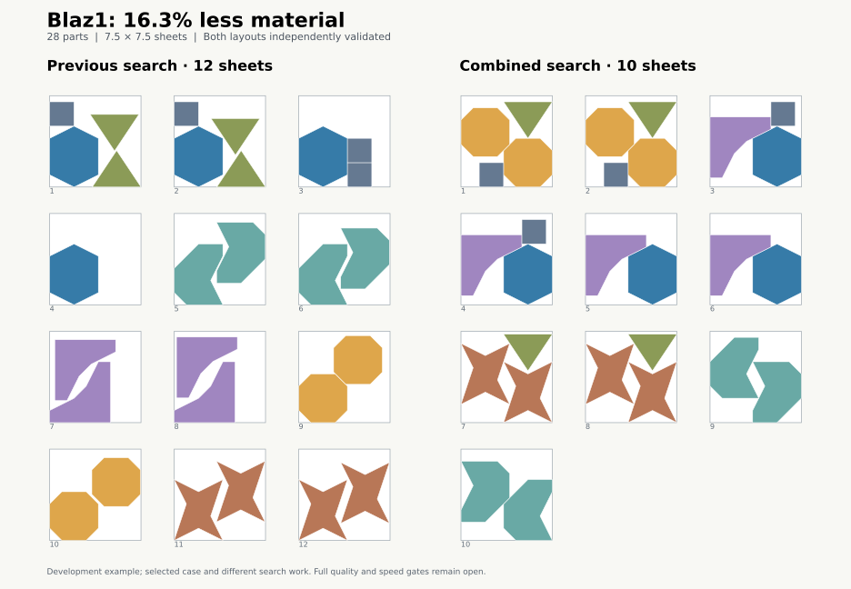

# Placement diversity development pilot

Four previously selected weak development cases, seed0. Final mixed portfolio requests1024 passes,80M queries,60s cooperative deadline,90s process kill cap,one explicit CPU each. Baseline requests512 passes with the same safety controls. Selected cases and different work; no G2/G4 or population claim. Ten held-out maker jobs unused.

| Job | Previous material | Final material | Reduction | Sheets | CPU seconds | Completed passes | Stop |
| --- | ---: | ---: | ---: | ---: | ---: | ---: | --- |
| b-blaz1-nest-mb-given | 11.666674267 | 9.766804667 | 16.2846% | 10 | 16.938 | 391 | work_limit |
| b-jakobs1-strip-sheet | 0.780403775 | 0.780403775 | 0.0000% | 1 | 16.438 | 1024 | requested work complete |
| b-marques-strip-sheet | 1.096161490 | 1.096161490 | 0.0000% | 2 | 23.250 | 1024 | requested work complete |
| m-garment-bruce-1 | 0.216391561 | 0.209922946 | 2.9893% | 1 | 56.578 | 1024 | requested work complete |

All four complete layouts pass a separate native validation call. The first 64 search histories and their finishing trials match the previous search exactly. Final Blaz1, Jakobs1 and Marques reports replay exactly. Bruce retains the identical layout; its first combined run stopped at the 60-second deadline after 1,015 passes, while the final replay completed 1,024.

The first experiment replaced every later construction with shuffled orientations and alternating left/right placement. It improved Blaz1 and Bruce but regressed Jakobs1 by 2.5175% and Marques by 1.7554% against the preceding 512-pass results. All five attempts (including the exact Blaz1 replay) are retained in the JSON evidence.

The retained implementation preserves the original first 64 passes, then pairs the original strategy with a diversified strategy for successive seeds. On an empty region the latter uses the first feasible shuffled allowed orientation; placement and translation refinement prefer either the left or right edge. Later parts still compare all allowed orientations. Source geometry, clearance guards and independent acceptance are unchanged. Defaults remain four passes.

Blaz1 now needs 10 sheets instead of 12. Its material score 9.766804667 is 0.001413% above the retained Deepnest median 9.766666667. This is a one-seed development comparison, not a win/tie or equal-budget acceptance result. The original fixed 1e-6 relative tie tolerance remains unchanged.

Full scripts/check.py exit0:93 workspace Rust tests,4 stock-helper tests,91 Python tests,bothWASM,source/schema/notices/freeze checks. Added mid-diversified-pass rollback assertion also passes in focused longer-search test.

[Full evidence, layouts, histories, profiles and rejected experiment](placement-diversity-20261012T045248Z.json)

